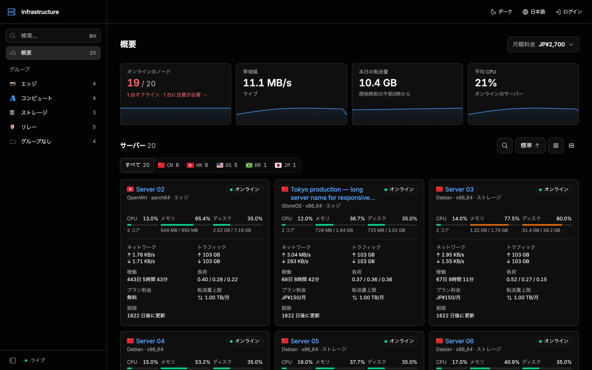
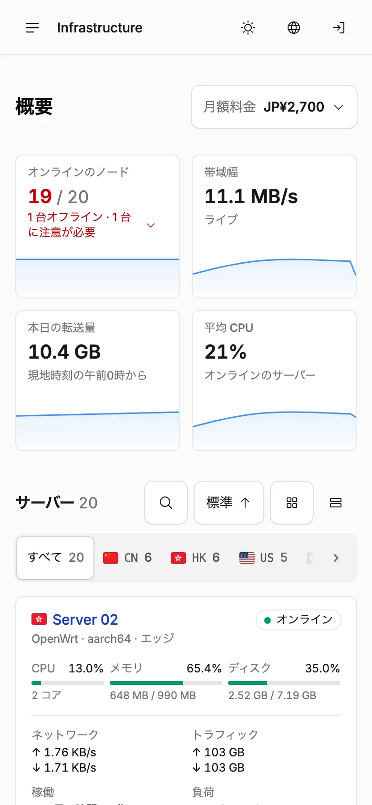

# Nezha Kumo Theme

[English](README.md) | [简体中文](README.zh-CN.md) | [繁體中文·台灣](README.zh-TW.md) | [繁體中文·香港](README.zh-HK.md) | 日本語

Cloudflare の [Kumo](https://github.com/cloudflare/kumo) デザインシステムで構築した、[Nezha Monitoring](https://github.com/nezhahq/nezha) 向けのレスポンシブな公開ステータス画面および管理画面テーマです。

English、簡体字中国語、繁体字中国語（台湾・香港）、日本語に対応し、「**ライト**」「**ダーク**」「**システム**」の外観モードを切り替えられます。公開ステータス画面ではリアルタイムの稼働状態、転送量の課金方式アイコン、「**本日の転送量**」の合計を表示し、同梱の Web App manifest によりホーム画面へ追加するとサイト名のスタンドアロンアプリとしてホーム画面を開けます。サイドバーのグループアイコンには絵文字または 1 文字、同梱の `vps:<slug>` アイコン、または `https://` 画像 URL を指定できます。

## スクリーンショット

| デスクトップ（ライト）                                             | デスクトップ（ダーク）                                            |
| ------------------------------------------------------------------ | ----------------------------------------------------------------- |
|  |  |

| モバイル（ライト）                                                                                | モバイル（ダーク）                                                                               |
| ------------------------------------------------------------------------------------------------- | ------------------------------------------------------------------------------------------------ |
|  |  |

| ノード詳細                                          | 管理画面のサーバー一覧                                            |
| --------------------------------------------------- | ----------------------------------------------------------------- |
|  |  |

| 構造化された公開メモエディター                                              |
| --------------------------------------------------------------------------- |
|  |

## 対応バージョン

- **対応範囲**：[Nezha Monitoring](https://github.com/nezhahq/nezha) **v2.6.0 以降**（組み込みのフロントエンド管理機能は `v2.6.0` で導入されました）。
- **検証済み**：**Nezha v2.6.1** で動作確認済みです。

## インストール（推奨 — Nezha v2.6.0+）

> [!IMPORTANT]
>
> 1. **管理画面フロントエンド**を置き換える前に、まず**ユーザー向けフロントエンド**をインストールして動作を確認してください。
> 2. サードパーティ製の**管理画面フロントエンド**を有効化する前に、[ロールバック](#ロールバック)の手順および Personal Access Token（PAT）またはサーバーシェルへのアクセス手段を控えておいてください。カスタム管理画面の読み込みに失敗した場合でも、組み込みの管理画面へ戻せます。

Nezha ダッシュボードを開き、「**設定 → フロントエンド**」（Kumo 管理画面ではサイドバーの「**システム → フロントエンド**」）へ移動します。

| フロントエンド種別             | GitHub リポジトリ URL                       | ベースパス    | リリースアセット |
| ------------------------------ | ------------------------------------------- | ------------- | ---------------- |
| **ユーザー向けフロントエンド** | `https://github.com/zhdsmy/nezha-kumo-theme` | `/`           | `dist.zip`       |
| **管理画面フロントエンド**     | `https://github.com/zhdsmy/nezha-kumo-admin` | `/dashboard/` | `dist.zip`       |

1. 「**フロントエンド種別**」で「**ユーザー向けフロントエンド**」を選択し、`https://github.com/zhdsmy/nezha-kumo-theme` を入力して「**リリースを読み込む**」をクリックします。目的のタグ（例：`v1.0.0`）を「**インストール**」し、「**有効化**」をクリックします。
2. 公開ステータス画面（`/`）を開き、正常に表示されることを確認します。
3. 「**フロントエンド種別**」を「**管理画面フロントエンド**」に切り替え、`https://github.com/zhdsmy/nezha-kumo-admin`（本リポジトリの同一タグから公開されるビルド成果物ミラー）を入力して「**リリースを読み込む**」をクリックし、同じバージョンのタグをインストールして「**有効化**」をクリックします。

各リリースの `dist.zip` は `dist/` 配下に空でない `dist/index.html` を含み、Nezha のアーカイブ制限（`dist.zip` ≤ 64 MiB、展開後 ≤ 256 MiB、エントリ数 ≤ 10,000、シンボリックリンクおよび重複パスなし）に準拠しています。

## 手動インストール

フロントエンド管理機能がないパネルや、コンテナ／ホストで独自にディレクトリをマウントする環境では、以下の手順で導入します。

1. ユーザー向けフロントエンドは [GitHub Releases](https://github.com/zhdsmy/nezha-kumo-theme/releases) から、管理画面は [`zhdsmy/nezha-kumo-admin` Releases](https://github.com/zhdsmy/nezha-kumo-admin/releases) から `dist.zip` と `dist.zip.sha256` をダウンロードし、SHA-256 チェックサムを検証します。
2. Nezha Dashboard のプロセスまたはコンテナから読み取れるディレクトリ（例：`data/kumo-user`、`data/kumo-admin`）に `dist/` を展開します。
3. _（任意・ユーザー向けフロントエンドのみ）_ [`apps/frontend/public/config.js`](apps/frontend/public/config.js) を展開先の `index.html` と同じディレクトリにコピーし、`window.NezhaKumoConfig` を編集します。`dist.zip` にはコメントアウトされた `config.js` が含まれるため、手動アップグレード時は展開前にバックアップし、展開後に戻してください。
4. Nezha の `data/config.yaml` にある `user_template`（および／または `admin_template`）を展開先ディレクトリに変更し、Nezha Dashboard サービスを再起動します。

## ロールバック

### 管理画面をロールバックする

- **方法 A — Personal Access Token（PAT）で API を呼び出す**：

  ```bash
  curl -X POST "https://your-panel.example.com/api/v1/frontend/activate" \
    -H "Authorization: Bearer <YOUR_PAT>" \
    -H "Content-Type: application/json" \
    -d '{"path":"admin-dist","is_admin":true}'
  ```

- **方法 B — サーバー上の `config.yaml` を編集する**：
  Nezha Dashboard のサービスまたはコンテナを停止し、`data/config.yaml` で `admin_template: admin-dist` を設定してから再起動します。

### ユーザー向けフロントエンドをロールバックする

- **方法 A — PAT で API を呼び出す**：

  ```bash
  curl -X POST "https://your-panel.example.com/api/v1/frontend/activate" \
    -H "Authorization: Bearer <YOUR_PAT>" \
    -H "Content-Type: application/json" \
    -d '{"path":"user-dist","is_admin":false}'
  ```

- **方法 B — サーバー上の `config.yaml` を編集する**：
  Nezha Dashboard のサービスまたはコンテナを停止し、`data/config.yaml` で `user_template: user-dist` を設定してから再起動します（管理画面の「**フロントエンド**」ページから組み込み版へ戻すこともできます）。

## アップグレードと古いバージョンの削除

1. 「**システム → フロントエンド**」（または標準管理画面の「**設定 → フロントエンド**」）を開き、`https://github.com/zhdsmy/nezha-kumo-theme`（および `https://github.com/zhdsmy/nezha-kumo-admin`）のリリース一覧を再読み込みして、新しいタグを「**インストール**」し「**有効化**」します。
2. Nezha は即時ロールバックできるよう、過去にインストールしたフロントエンドをディスク上に保持します。新バージョンの動作を確認したら、「**フロントエンド**」ページで未使用の古いバージョンを「**削除**」してディスク容量を回収できます。
3. 手動デプロイ環境では、新しい `dist.zip` をテンプレートディレクトリへ展開し（`index.html` と同じ階層の `config.js` は保持）、不要になった旧バージョンのディレクトリを削除します。

## 設定

### 設定方法

次の 2 つの設定方法をサポートしており、併用もできます。

1. **パネルのカスタムコード（フロントエンド管理での導入時に推奨）**
   管理画面の「**システム → 設定**」（標準管理画面では「**設定**」）にある「**カスタムコード（スタイル・スクリプト）**」（ユーザー向けフロントエンドの `custom_code`）に、`id="nezha-kumo-config"` の JSON `<script>` ブロックを追加します。

   ```html
   <script type="application/json" id="nezha-kumo-config">
     {
       "siteTitle": "Infrastructure",
       "defaultAppearance": "system",
       "defaultLanguage": "auto",
       "showCost": true
     }
   </script>
   ```

   このブロックは `type="application/json"` を指定しているため、JSON データとしてのみ解析され、JavaScript として実行されることはありません。

2. **`config.js`（`window.NezhaKumoConfig`、手動デプロイ向け）**
   展開した `index.html` と同じディレクトリに `config.js` を配置します。

   ```js
   window.NezhaKumoConfig = {
     siteTitle: "Infrastructure",
     showCost: true,
   };
   ```

   - `<script id="nezha-kumo-config">` と `config.js` の両方がある場合、キー単位でマージされ、**`config.js` の値が優先**されます。
   - `config.js` がない場合でも、パネル側の JSON 設定またはデフォルト値で動作します。`dist.zip` にはコメントのみの `config.js` が同梱されているため、そのファイルを削除しない限りブラウザに 404 は記録されません。

### テーマ設定一覧

すべてのキーは任意で、定義は [`apps/frontend/src/core/settings.ts`](apps/frontend/src/core/settings.ts) にあります。

| キー                | 型                                                         | デフォルト | 説明                                                                                                               |
| ------------------- | ---------------------------------------------------------- | ---------- | ------------------------------------------------------------------------------------------------------------------ |
| `defaultAppearance` | `"system" \| "light" \| "dark"`                            | `"system"` | 訪問者が切り替える前の初期外観モード（保存キー：`nkt:appearance`）。                                               |
| `defaultLanguage`   | `"auto" \| "en" \| "zh-CN" \| "zh-HK" \| "zh-TW" \| "ja"` | `"auto"`   | 訪問者が選択する前の初期表示言語（`nkt:language`）。`"auto"` はパネルの言語を優先し、未設定時はブラウザの言語に従います。 |
| `siteTitle`         | `string`                                                   | `""`       | サイドバーと `<title>` に表示するサイト名。空の場合はパネルの `site_name`（または `"Nezha"`）を使用します。        |
| `showOverview`      | `boolean`                                                  | `true`     | ホーム画面上部に概要メトリクスタイルを表示します。                                                                 |
| `showCost`          | `boolean`                                                  | `true`     | ホーム画面に定期料金メニュー（「**月額料金**」／「**年額料金**」）を表示し、為替換算を有効にします。               |
| `showRegions`       | `boolean`                                                  | `true`     | サーバー一覧の上部に地域フラグのフィルターバーを表示します。                                                       |
| `showGroups`        | `boolean`                                                  | `true`     | サイドバーに「**グループ**」ナビゲーションを表示し、グループによる絞り込みを有効にします。                         |
| `showBilling`       | `boolean`                                                  | `true`     | `public_note` から解析したプラン料金、請求サイクル、有効期限、転送量上限を表示します。                             |
| `showOffline`       | `boolean`                                                  | `true`     | 公開サーバー一覧にオフラインのサーバーを含めます（`false` で非表示）。                                             |
| `hiddenNodes`       | `string[]`                                                 | `[]`       | 公開画面で非表示にするサーバー ID または完全一致のサーバー名（カンマまたは改行区切りの `string` も指定可）。       |
| `hideAdminEntry`    | `boolean`                                                  | `false`    | 上部バーの「**ログイン**」／「**管理画面**」ボタンを非表示にします。                                               |
| `footerNote`        | `string`                                                   | `""`       | フッターのクレジット表記の下に別行で表示するプレーンテキストの注記です。                                           |

### サーバーグループアイコン（`nezha-kumo-group-icons`）

サイドバーのサーバーグループ用カスタムアイコンは、ユーザー向けフロントエンドの「**カスタムコード（スタイル・スクリプト）**」（`custom_code`）内に `id="nezha-kumo-group-icons"` の JSON `<script>` ブロックとして保存されます（[`packages/shared/group-icons.ts`](packages/shared/group-icons.ts) を参照）。

```html
<script type="application/json" id="nezha-kumo-group-icons">
  { "1": "vps:aws", "2": "vps:azure", "3": "🗄️", "4": "https://cdn.example.com/icons/storage.svg" }
</script>
```

- **キー**：Nezha のサーバーグループ ID の文字列（例：`"1"`、`"2"`）。
- **値**：同梱の **vps-icons v1.4.0**（ライト／ダーク対応の 263 プロバイダーアイコン）の `vps:<slug>`、サイドバーの `16px` 枠に収まる絵文字または 1 文字、または `https://` 画像 URL。VPS の `slug` は同梱カタログに存在する必要があります。
- **ビジュアルエディター**：Kumo 管理画面（`zhdsmy/nezha-kumo-admin`）の「**サーバーグループ**」ページで「**サーバーグループを作成**」／「**サーバーグループを編集**」ダイアログを開き、「**VPS アイコンを選択**」からプロバイダー名、中国語名、slug、別名、通称で検索して設定・解除できます。保存時は `custom_code` 内の該当 `<script>` ブロックのみを更新します。

## 公開メモと請求・プラン項目

サーバーの請求情報とプラン情報は Nezha の `public_note` JSON フィールドに格納します。**[nezhainfojson](https://plane.2233444.xyz/)** ジェネレーター（および `nezha-dash`、`Nazhua` 形式）と互換性があり、Kumo 管理画面には未知の JSON キーを保持したまま保存できる構造化「**公開メモ**」エディターを備えています。

```json
{
  "billingDataMod": {
    "startDate": "2026-05-01T00:00:00+08:00",
    "endDate": "2027-05-01T00:00:00+08:00",
    "autoRenewal": "1",
    "cycle": "Year",
    "amount": "USD 48.00"
  },
  "planDataMod": {
    "bandwidth": "1Gbps",
    "trafficVol": "2TB/Month",
    "trafficType": "2",
    "IPv4": "1",
    "IPv6": "1",
    "networkRoute": "IIJ,BBTEC",
    "extra": "NVMe,Anycast"
  }
}
```

### `billingDataMod` の項目

| 項目          | 例                            | 説明                                                                                                                                             |
| ------------- | ----------------------------- | ------------------------------------------------------------------------------------------------------------------------------------------------ |
| `startDate`   | `"2026-05-01T00:00:00+08:00"` | 請求開始日時（ISO 8601）。                                                                                                                       |
| `endDate`     | `"2027-05-01T00:00:00+08:00"` | 有効期限。無期限のサーバーには `"0000-00-00T23:59:59+08:00"` を指定します。                                                                      |
| `autoRenewal` | `"1"` / `"0"`                 | `"1"` で自動更新を有効、`"0"` で無効にします。                                                                                                   |
| `cycle`       | `"Year"`                      | 請求サイクル（`Day`、`Week`、`Month`、`Quarter`、`Half`、`Year`、`2Year` などのほか、中国語・日本語の別名に対応）。                              |
| `amount`      | `"USD 48.00"`                 | ISO 通貨コードまたは通貨記号付きの金額（`"USD 48.00"`、`"CNY 300.00"`、`"€9.50"`、無料は `"0"` / `"Free"`、従量課金は `"-1"`）。`/Cycle` も付与可。 |

### `planDataMod` の項目

| 項目           | 例                      | 説明                                                               |
| -------------- | ----------------------- | ------------------------------------------------------------------ |
| `bandwidth`    | `"1Gbps"`               | ポート帯域幅（`Mbps`、`Gbps`、または `"Unlimited"`）。             |
| `trafficVol`   | `"2TB/Month"`           | 転送量上限と任意のリセット周期（`GB`、`TB`、または `"Unlimited"`）。 |
| `trafficType`  | `"1"` \| `"2"` \| `"3"` | 転送量の課金方式（下記参照）。                                     |
| `IPv4`         | `"1"` / `"0"`           | `"1"` は IPv4 あり、`"0"` はなし。                                 |
| `IPv6`         | `"1"` / `"0"`           | `"1"` は IPv6 あり、`"0"` はなし。                                 |
| `networkRoute` | `"IIJ,BBTEC"`           | カンマ区切りのネットワーク経路タグ。                               |
| `extra`        | `"NVMe,Anycast"`        | カンマ区切りのハードウェアまたはプラン補足タグ。                   |

#### `trafficType` の値

- `"1"` — **送信のみ**（`out`）：アップロード（`net_out_transfer`）のみを `trafficVol` に計上します。
- `"2"` — **送受信合計**（`sum`）：アップロードとダウンロードの合計（`net_out_transfer + net_in_transfer`）を `trafficVol` に計上します。
- `"3"` — **大きい方**（`max`、省略時のデフォルト）：アップロードとダウンロードのうち大きい方（`max(net_out_transfer, net_in_transfer)`）を `trafficVol` に計上します。

### 非公開メモの実際の更新費用（`note`）

管理者は Nezha の非公開 **`note`** フィールド（または Kumo 管理画面の「**非公開メモ**」エディター）に実際の更新費用を記録できます。未ログインの訪問者には公開価格（または非表示）のみが見え、ログイン中はホーム画面の料金集計とノード詳細の「**実際のコスト**」に実際の費用が反映されます。

```json
{
  "billingDataMod": {
    "actualAmount": "CNY 300.00/Year"
  }
}
```

`billingDataMod.actualAmount` には通貨コードまたは記号が必要で、任意の `/Cycle` 接尾辞（例：`"CNY 300.00/Year"`、`"USD 25.00/Quarter"`）を付けられます。周期を省略した場合は `public_note` の `billingDataMod.cycle` を引き継ぎます。

## プライバシーと外部通信

- **為替レートの取得**：`showCost` が `true`（デフォルト）の場合、訪問者のブラウザは多通貨換算のため認証情報なしの `GET` リクエストを `https://api.frankfurter.dev/v2/rates?base=USD` に送信し、レスポンスを `localStorage`（`nkt:exchange-rates`）に **24 時間**キャッシュします。
- **外部通信の無効化**：`nezha-kumo-config` または `config.js` で `"showCost": false` を設定すると料金集計が無効になり、`api.frankfurter.dev` への通信は一切発生しません。
- **ローカル同梱アセット**：フォント（`@fontsource-variable/inter`）、SVG 国旗（`flag-icons`）、VPS プロバイダーアイコンはすべてリリースアーカイブ内に同梱されており、外部のフォント／アイコン CDN を使用しません。

## 開発

**Node.js 22+** と **pnpm**（`corepack enable`）が必要です。

```bash
pnpm install          # ワークスペースの依存関係をインストール
pnpm check            # 全パッケージの型チェック、テスト、本番ビルド
pnpm typecheck        # ワークスペースの型チェック
pnpm test             # ユニットテストと Playwright E2E
pnpm build            # フロントエンドと管理画面のビルド
```

### Mock E2E と開発ワークフロー

- **公開フロントエンド**（[`apps/frontend`](apps/frontend/README.md)）：`pnpm --filter frontend test:e2e` は決定論的な HTTP／WebSocket モック（`apps/frontend/tests/mock.ts`）に対して Playwright を実行するため、稼働中の Nezha パネルは不要です。
- **管理画面**（[`apps/admin`](apps/admin/README.md)）：`pnpm --filter nezha-kumo-admin test` で Vitest のコンポーネント／ユニットテストを実行できます。`apps/admin/tests/e2e/` 配下の Playwright E2E テストはモック化された `/api/v1/*` ルートまたはローカルテストバックエンドを使用します。
- **README スクリーンショット**：`NKT_DOCS_LANG=en node docs/capture-screenshots.mjs` で英語版を生成できます。`zh-CN`、`zh-TW`、`zh-HK`、`ja` を指定すると各言語版を生成でき、生成後は `node docs/check-links.mjs` でリンクを検証します。

### リポジトリ構成

```text
.
├── apps/
│   ├── frontend/      # 公開ステータスフロントエンド（ベース: /）
│   └── admin/         # Nezha 管理画面の再デザイン（ベース: /dashboard/）
├── packages/
│   ├── ui/            # 共通 AppShell、Page、ブレークポイント、シェル CSS 契約
│   └── shared/        # 公開ノートの解析/書き込みとグループアイコンの共通ヘルパー
└── docs/
    ├── screenshots/   # Mock WebP スクリーンショット
    ├── capture-screenshots.mjs
    └── check-links.mjs
```

コミット規約や共通シェルレイアウトの規則については [CONTRIBUTING.md](CONTRIBUTING.md) を、脆弱性の報告手順については [SECURITY.md](SECURITY.md) を参照してください。

## 謝辞とライセンス

- UI コンポーネントとデザイントークンには [`@cloudflare/kumo`](https://github.com/cloudflare/kumo)（MIT）を使用しています。本プロジェクトは独立したコミュニティテーマであり、Cloudflare, Inc. と**提携・承認関係にはありません**。
- [Nezha Monitoring](https://github.com/nezhahq/nezha) 向けに開発され、[`nezhahq/admin-frontend`](https://github.com/nezhahq/admin-frontend)、[`foru17/zool-theme`](https://github.com/foru17/zool-theme)、[`lipis/flag-icons`](https://github.com/lipis/flag-icons)、[Inter](https://github.com/rsms/inter) の実装およびアセットを基にしています。vps-icons v1.4.0 を含む完全な権利表記は [NOTICE.md](NOTICE.md) に記載しています。
- [MIT License](LICENSE) のもとで公開されています。
