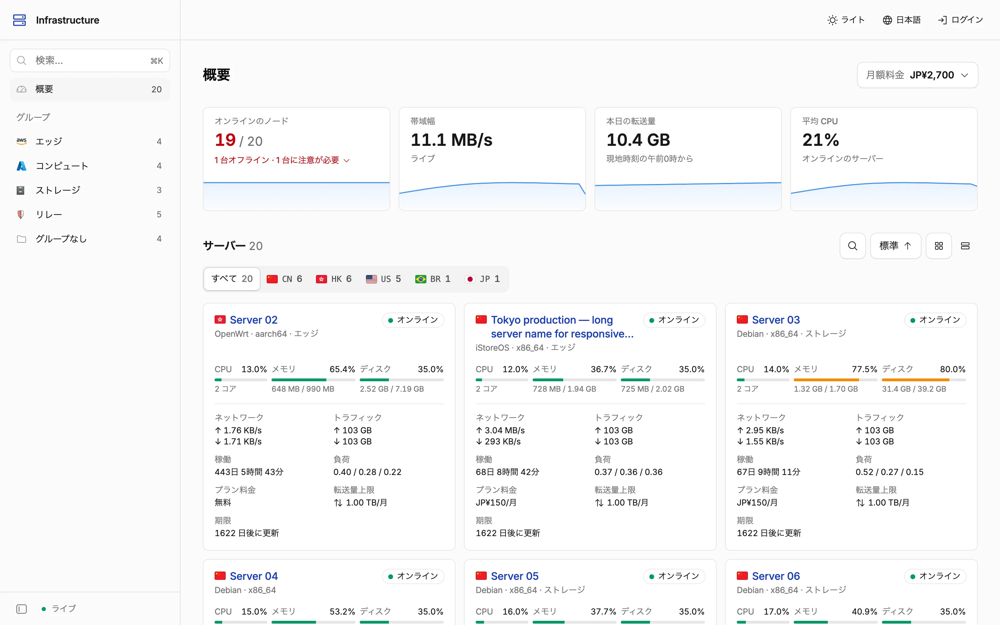
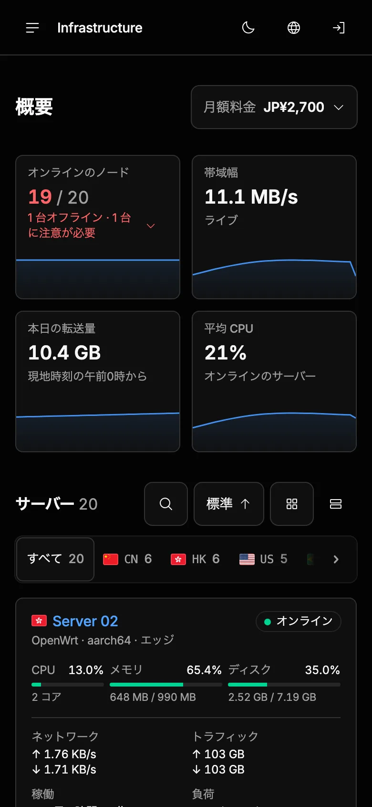
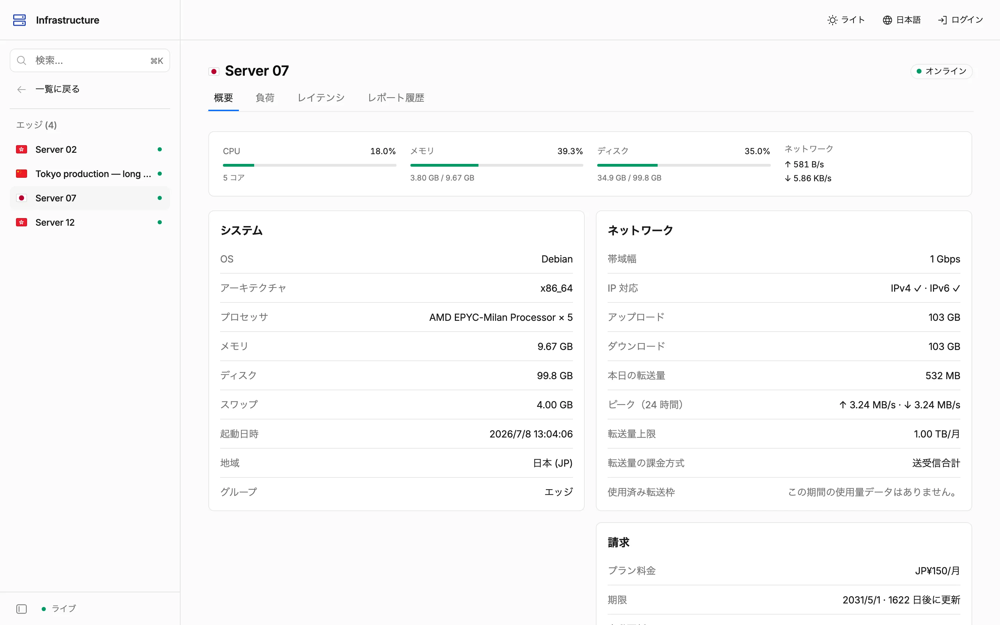
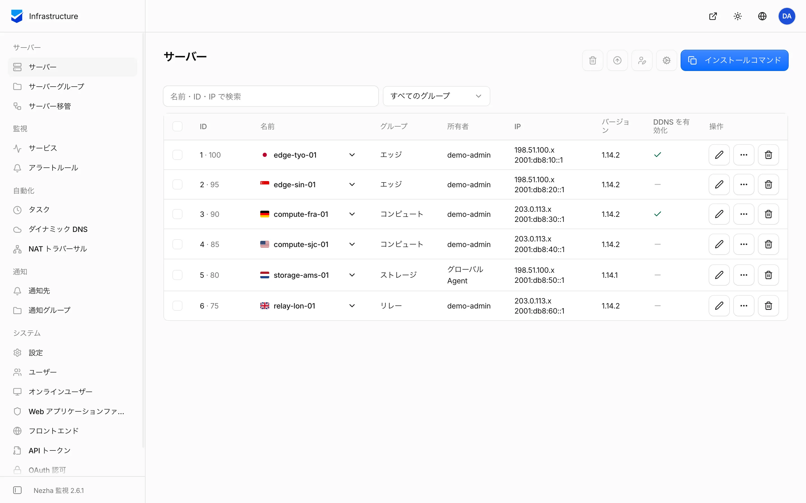
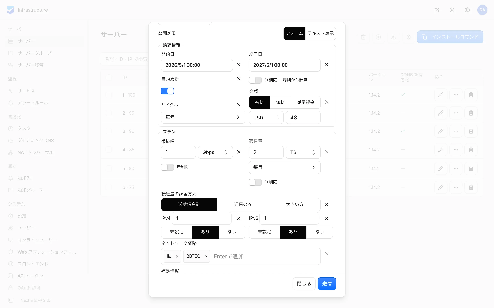

# Nezha Kumo Theme

[English](README.md) | [简体中文](README.zh-CN.md) | [繁體中文·台灣](README.zh-TW.md) | [繁體中文·香港](README.zh-HK.md) | 日本語

Cloudflare の [Kumo](https://github.com/cloudflare/kumo) デザインシステムのビジュアル言語で構築した、レスポンシブな Nezha 監視ダッシュボードテーマ（公開ステータス画面と管理画面）です。

English、簡体字中国語、台湾・香港向け繁体字中国語、日本語に対応しています。ライト、ダーク、システム設定から表示を選べます。グループアイコンには 1 つの絵文字または文字、同梱された `vps:<slug>` アイコン、HTTPS 画像 URL を使用できます。公開画面にはライブ状態、トラフィック課金表示、本日のトラフィック合計を表示します。同梱の Web App manifest により、サイトをホーム画面に追加でき、サイト名のスタンドアロンアプリとしてホームを開けます。

## Screenshots

| デスクトップ（ライト）                                             | デスクトップ（ダーク）                                            |
| ------------------------------------------------------------------ | ----------------------------------------------------------------- |
|  |  |

| モバイル（ライト）                                                                            | モバイル（ダーク）                                                                           |
| ----------------------------------------------------------------------------------------- | ----------------------------------------------------------------------------------------- |
|  |  |

| ノード詳細                                        | 管理画面のサーバー一覧                                  |
| ------------------------------------------------- | ------------------------------------------------------ |
|  |  |

| 構造化された公開ノートエディター                              |
| --------------------------------------------------------- |
|  |

## Compatibility

- **対応**：[Nezha Monitoring](https://github.com/nezhahq/nezha) **v2.6.0 以降**（組み込みフロントエンド管理は `v2.6.0` で導入されました）。
- **検証済み**：**Nezha v2.6.1** でテストと検証を行っています。

## Installation（推奨 — Nezha v2.6.0+）

> [!IMPORTANT]
>
> 1. **管理画面**を置き換える前に、まず **ユーザーフロントエンド**をインストールして確認してください。
> 2. 第三者製の **管理画面**を有効にする前に、[ロールバック](#rollback) のコマンドと、Personal Access Token またはサーバーシェルへのアクセスを保存してください。カスタム管理画面が読み込めない場合でも、組み込み管理画面を復元できます。

Nezha ダッシュボードを開き、**Settings → Frontends**（`设置 → 前端管理`）へ移動します。

| 対象                 | GitHub リポジトリ                                                         | アセットのベースパス | リリースアセット |
| -------------------- | ------------------------------------------------------------------------ | ------------------- | --------------- |
| **ユーザーフロントエンド** | `zhdsmy/nezha-kumo-theme`（`https://github.com/zhdsmy/nezha-kumo-theme`） | `/`                 | `dist.zip`      |
| **管理画面**           | `zhdsmy/nezha-kumo-admin`（`https://github.com/zhdsmy/nezha-kumo-admin`）  | `/dashboard/`       | `dist.zip`      |

1. **User Frontend** に `zhdsmy/nezha-kumo-theme` を入力し、リリースを読み込み、目的のタグ（例 `v1.0.0`）をインストールして **Activate** をクリックします。
2. 公開ステータス画面（`/`）を開き、フロントエンドが表示されることを確認します。
3. **Admin Panel** に `zhdsmy/nezha-kumo-admin`（このリポジトリの対応タグから公開されるリリース専用ミラー）を入力し、対応するタグをインストールして **Activate** をクリックします。

各リリースには `dist/` 以下の空でない `dist/index.html` を含む `dist.zip` が入り、Nezha のアーカイブ制限（`dist.zip` ≤ 64 MiB、展開後 ≤ 256 MiB、≤ 10,000 エントリ、シンボリックリンクや重複パスなし）に従います。

## Manual Installation

フロントエンド管理がないパネル、またはカスタムコンテナー/ホストマウントを使う場合は、次の手順を実行します。

1. ユーザーフロントエンドは [GitHub Releases](https://github.com/zhdsmy/nezha-kumo-theme/releases) から `dist.zip`（および `dist.zip.sha256`）を、管理画面は [`zhdsmy/nezha-kumo-admin` Releases](https://github.com/zhdsmy/nezha-kumo-admin/releases) からダウンロードし、SHA-256 を確認します。
2. `dist/` を Nezha Dashboard のプロセスまたはコンテナーが読み取れるディレクトリ（例 `data/kumo-user` または `data/kumo-admin`）へ展開します。
3. _（任意、ユーザーフロントエンド）_ [`apps/frontend/public/config.js`](apps/frontend/public/config.js) を展開した `index.html` と同じ場所へコピーし、`window.NezhaKumoConfig` を設定します。`dist.zip` にはコメントだけの `config.js` が入るため、アップグレード前に自分のファイルをバックアップし、展開後に戻してください。
4. Nezha の `data/config.yaml` にある `user_template`（および/または `admin_template`）を展開先へ変更し、Nezha Dashboard サービスを再起動します。

## Rollback

### 管理画面をロールバックする

- **方法 A — Personal Access Token（PAT）を使う API**：

  ```bash
  curl -X POST "https://your-panel.example.com/api/v1/frontend/activate" \
    -H "Authorization: Bearer <YOUR_PAT>" \
    -H "Content-Type: application/json" \
    -d '{"path":"admin-dist","is_admin":true}'
  ```

- **方法 B — サーバーの `config.yaml`**：
  Nezha Dashboard のサービスまたはコンテナーを停止し、`data/config.yaml` の `admin_template: admin-dist` を設定してから、パネルを起動します。

### ユーザーフロントエンドをロールバックする

- **方法 A — PAT を使う API**：

  ```bash
  curl -X POST "https://your-panel.example.com/api/v1/frontend/activate" \
    -H "Authorization: Bearer <YOUR_PAT>" \
    -H "Content-Type: application/json" \
    -d '{"path":"user-dist","is_admin":false}'
  ```

- **方法 B — サーバーの `config.yaml`**：
  Nezha Dashboard のサービスまたはコンテナーを停止し、`data/config.yaml` の `user_template: user-dist` を設定してから、パネルを起動します（管理画面の **Settings → Frontends** から戻すこともできます）。

## Upgrading & Removing Old Versions

1. **Settings → Frontends** で `zhdsmy/nezha-kumo-theme`（および `zhdsmy/nezha-kumo-admin`）のリリース一覧を更新し、新しいタグをインストールして有効化します。
2. Nezha は即時ロールバック用に、以前インストールしたフロントエンドをディスクに保持します。新しいリリースを確認したら、**Frontends** ページから無効な古いバージョンを削除してディスクを空けます。
3. 手動デプロイでは、新しい `dist.zip` をテンプレートディレクトリへ展開します（`index.html` と同じ場所の `config.js` は保持）。不要なバージョンディレクトリは削除します。

## Configuration

### Configuration Entrypoints

次の 2 つの設定方法を同時に使用できます。

1. **パネルのカスタムコード（フロントエンド管理のインストールに推奨）**
   **Settings → System settings → Custom code**（`设置 → 自定义代码`、ユーザーフロントエンドのカスタムコード）に、`id="nezha-kumo-config"` の JSON `<script>` ブロックを追加します。

   ```html
   <script type="application/json" id="nezha-kumo-config">
     {
       "siteTitle": "Infrastructure",
       "defaultAppearance": "system",
       "defaultLanguage": "auto",
       "showCost": true
     }
   </script>
   ```

   このブロックは `type="application/json"` を使用し、データとして解析されるだけで JavaScript は実行されません。

2. **`config.js`（`window.NezhaKumoConfig`、手動デプロイ用）**
   展開した `index.html` と同じ場所に `config.js` を置きます。

   ```js
   window.NezhaKumoConfig = {
     siteTitle: "Infrastructure",
     showCost: true,
   };
   ```

   - `<script id="nezha-kumo-config">` と `config.js` の両方がある場合、設定をキー単位でマージし、**`config.js` を優先**します。
   - `config.js` がない場合、パネル JSON またはデフォルト値で通常どおり動作します。ブラウザーはファイルの 404 を記録します。`dist.zip` にはコメント付きの `config.js` があるため、削除した場合だけ発生します。

### Theme Settings Reference

すべてのキーは任意で、定義は [`apps/frontend/src/core/settings.ts`](apps/frontend/src/core/settings.ts) にあります。

| キー                | 型                                             | デフォルト | 説明                                                                                              |
| ------------------- | ---------------------------------------------- | --------- | ------------------------------------------------------------------------------------------------- |
| `defaultAppearance` | `"system" \| "light" \| "dark"`                | `"system"` | 訪問者が選択する前の初期カラースキーム（`nkt:appearance`）。                                         |
| `defaultLanguage`   | `"auto" \| "en" \| "zh-CN" \| "zh-HK" \| "zh-TW" \| "ja"` | `"auto"`   | 初期 UI 言語（`"auto"` はブラウザーまたはパネルの言語に従います）。                                    |
| `siteTitle`         | `string`                                       | `""`      | サイドバーと `<title>` のブランドタイトル。空の場合はパネルの `site_name`（または `"Nezha"`）を使います。 |
| `showOverview`      | `boolean`                                      | `true`     | ホーム上部の概要メトリクスタイルを表示します。                                                        |
| `showCost`          | `boolean`                                      | `true`     | ホームの定期料金集計を表示し、通貨換算を有効にします。                                                  |
| `showRegions`       | `boolean`                                      | `true`     | サーバー一覧の上に地域フラグフィルターを表示します。                                                  |
| `showGroups`        | `boolean`                                      | `true`     | サイドバーにサーバーグループを表示し、ホームをグループ別に分けます。                                    |
| `showBilling`       | `boolean`                                      | `true`     | `public_note` から解析した料金、請求周期、期限、容量情報を表示します。                                  |
| `showOffline`       | `boolean`                                      | `true`     | 公開サーバー一覧にオフラインサーバーを含めます（`false` で非表示）。                                   |
| `hiddenNodes`       | `string[]`                                     | `[]`      | 公開画面で隠すサーバー ID または完全一致するサーバー名（カンマまたは改行区切りの `string` も可）。       |
| `hideAdminEntry`    | `boolean`                                      | `false`   | 上部バーのサインイン / 管理画面ボタンを隠します。                                                      |
| `footerNote`        | `string`                                       | `""`      | フッターのクレジットの下に別行で表示するプレーンテキストです。                                           |

### Server Group Icons (`nezha-kumo-group-icons`)

サイドバーのサーバーグループ用カスタムアイコンは、`id="nezha-kumo-group-icons"` の JSON ブロックとしてユーザーフロントエンドの **Custom code**（`custom_code`）に保存します（[`packages/shared/group-icons.ts`](packages/shared/group-icons.ts) を参照）。

```html
<script type="application/json" id="nezha-kumo-group-icons">
  { "1": "vps:aws", "2": "vps:azure", "3": "🗄️", "4": "https://cdn.example.com/icons/storage.svg" }
</script>
```

- **キー**：Nezha のサーバーグループ ID の文字列（例 `"1"`、`"2"`）。
- **値**：同梱の **vps-icons v1.4.0** にある `vps:<slug>`（ライト/ダーク 263 プロバイダーアセット）、`16px` のサイドバー枠に収まる 1 つの絵文字または文字、または `https://` 画像 URL。VPS の slug は同梱カタログに一致する必要があります。
- **ビジュアルエディター**：Kumo 管理画面（`zhdsmy/nezha-kumo-admin`）の **Server Group** 作成/編集ダイアログでアイコンを選択または削除できます。ピッカーはプロバイダー名、中国語名、別名、ニックネームを検索し、`custom_code` 内のこの `<script>` ブロックだけを更新します。

## Public Note & Billing / Plan Fields

サーバーの請求・プラン情報は Nezha の `public_note` JSON フィールドに保存されます。このテーマは **[nezhainfojson](https://plane.2233444.xyz/)** ジェネレーター（`nezha-dash` と `Nazhua` の方言も含む）に対応し、Kumo 管理画面には未知の JSON キーを保存時に保持する構造化 **Public Note** エディターがあります。

```json
{
  "billingDataMod": {
    "startDate": "2026-05-01T00:00:00+08:00",
    "endDate": "2027-05-01T00:00:00+08:00",
    "autoRenewal": "1",
    "cycle": "Year",
    "amount": "USD 48.00"
  },
  "planDataMod": {
    "bandwidth": "1Gbps",
    "trafficVol": "2TB/Month",
    "trafficType": "2",
    "IPv4": "1",
    "IPv6": "1",
    "networkRoute": "IIJ,BBTEC",
    "extra": "NVMe,Anycast"
  }
}
```

### `billingDataMod` Fields

| フィールド     | 例                            | 説明                                                                                              |
| -------------- | ----------------------------- | ------------------------------------------------------------------------------------------------- |
| `startDate`    | `"2026-05-01T00:00:00+08:00"` | 請求開始時刻（ISO 8601）。                                                                         |
| `endDate`      | `"2027-05-01T00:00:00+08:00"` | 期限。無期限のサーバーには `"0000-00-00T23:59:59+08:00"` を使います。                               |
| `autoRenewal`  | `"1"` / `"0"`                 | `"1"` は自動更新、`"0"` は自動更新なしです。                                                       |
| `cycle`        | `"Year"`                      | 請求周期（`Day`、`Week`、`Month`、`Quarter`、`Half`、`Year`、`2Year` など、中国語/日本語の別名も可）。 |
| `amount`       | `"USD 48.00"`                 | ISO 通貨コードまたは記号の価格（`"USD 48.00"`、`"CNY 300.00"`、`"€9.50"`、無料の `"0"` / `"Free"`、従量課金の `"-1"`）。`/Cycle` を付けられます。 |

### `planDataMod` Fields

| フィールド      | 例                      | 説明                                                        |
| --------------- | ----------------------- | ----------------------------------------------------------- |
| `bandwidth`     | `"1Gbps"`               | ポート帯域幅（`Mbps`、`Gbps`、または `"Unlimited"`）。       |
| `trafficVol`    | `"2TB/Month"`           | 任意のリセット周期付きトラフィック容量（`GB`、`TB`、`"Unlimited"`）。 |
| `trafficType`   | `"1"` \| `"2"` \| `"3"` | トラフィックの課金方式（下記参照）。                         |
| `IPv4`          | `"1"` / `"0"`           | `"1"` は IPv4 あり、`"0"` はなし。                          |
| `IPv6`          | `"1"` / `"0"`           | `"1"` は IPv6 あり、`"0"` はなし。                          |
| `networkRoute`  | `"IIJ,BBTEC"`           | カンマ区切りのネットワーク経路タグ。                          |
| `extra`         | `"NVMe,Anycast"`        | カンマ区切りのハードウェアまたはプランタグ。                  |

#### `trafficType` Values

- `"1"` — **出方向のみ**（`out`）：アップロード（`net_out_transfer`）だけを `trafficVol` に加えます。
- `"2"` — **双方向の合計**（`sum`）：アップロードとダウンロード（`net_out_transfer + net_in_transfer`）を合計します。
- `"3"` — **大きい方向**（`max`、省略時のデフォルト）：アップロードとダウンロードの大きい方（`max(net_out_transfer, net_in_transfer)`）を加えます。

### Private Actual Renewal Amount (`note`)

サインインした管理者は Nezha の非公開 **`note`** フィールドに更新費用を記録できます。公開訪問者には公開価格（または何も表示しない）が見え、サインイン後は料金集計に実際の費用が使われます。

```json
{
  "billingDataMod": {
    "actualAmount": "CNY 300.00/Year"
  }
}
```

`billingDataMod.actualAmount` には任意の `/Cycle` 接尾辞（例 `"CNY 300.00/Year"`、`"USD 25.00/Quarter"`）を付けられます。周期を省略すると、`public_note` の `billingDataMod.cycle` を使います。

## Privacy & Third-Party Requests

- **為替レート取得**：`showCost` が `true`（デフォルト）の場合、訪問者のブラウザーは認証情報なしの `GET` で `https://api.frankfurter.dev/v2/rates?base=USD` にアクセスして通貨を換算し、`localStorage`（`nkt:exchange-rates`）に **24 時間**キャッシュします。
- **外部リクエストを無効化**：`nezha-kumo-config` または `config.js` で `"showCost": false` を設定すると料金集計が無効になり、`api.frankfurter.dev` へのリクエストは **0 回**になります。
- **ローカルアセット**：フォント（`@fontsource-variable/inter`）、SVG フラグ（`flag-icons`）、VPS プロバイダーアイコンはリリースアーカイブに同梱され、第三者のフォントまたはアイコン CDN を使いません。

## Development

**Node.js 22+** と **pnpm**（`corepack enable`）が必要です。

```bash
pnpm install          # ワークスペースの依存関係をインストール
pnpm check            # 全パッケージの型チェック、テスト、本番ビルド
pnpm typecheck        # ワークスペースの型チェック
pnpm test             # ユニットテストと Playwright E2E
pnpm build            # フロントエンドと管理画面のビルド
```

### Mock E2E & App Workflows

- **公開フロントエンド**（[`apps/frontend`](apps/frontend/README.md)）：`pnpm --filter frontend test:e2e` は決定的な HTTP/WebSocket Mock（`apps/frontend/tests/mock.ts`）で Playwright を実行し、実際の Nezha パネルは不要です。
- **管理画面**（[`apps/admin`](apps/admin/README.md)）：`pnpm --filter nezha-kumo-admin test` は Vitest のコンポーネント/ユニットテストを実行します。`apps/admin/tests/e2e/` の Playwright E2E は Mock の `/api/v1/*` ルートまたはローカルテストバックエンドを使います。
- **README スクリーンショット**：`NKT_DOCS_LANG=en node docs/capture-screenshots.mjs` で英語版を生成します。`zh-CN`、`zh-TW`、`zh-HK`、`ja` を指定して各言語版を生成し、その後 `node docs/check-links.mjs` を実行します。

### Repository Layout

```text
.
├── apps/
│   ├── frontend/      # 公開ステータスフロントエンド（ベース: /）
│   └── admin/         # Nezha 管理画面の再デザイン（ベース: /dashboard/）
├── packages/
│   ├── ui/            # 共通 AppShell、Page、ブレークポイント、シェル CSS 契約
│   └── shared/        # 公開ノートの解析/書き込みとグループアイコンの共通ヘルパー
└── docs/
    ├── screenshots/   # Mock WebP スクリーンショット
    ├── capture-screenshots.mjs
    └── check-links.mjs
```

コミット規約と共通シェルレイアウトは [CONTRIBUTING.md](CONTRIBUTING.md) を、脆弱性の報告は [SECURITY.md](SECURITY.md) を参照してください。

## Acknowledgments & License

- UI コンポーネントとデザイントークンは [`@cloudflare/kumo`](https://github.com/cloudflare/kumo)（MIT）を使用しています。本プロジェクトは独立したコミュニティテーマであり、Cloudflare, Inc. と**提携または承認関係にありません**。
- [Nezha Monitoring](https://github.com/nezhahq/nezha) 向けに構築し、[`nezhahq/admin-frontend`](https://github.com/nezhahq/admin-frontend)、[`foru17/zool-theme`](https://github.com/foru17/zool-theme)、[`lipis/flag-icons`](https://github.com/lipis/flag-icons)、[Inter](https://github.com/rsms/inter) の実装またはリソースを利用しています。vps-icons v1.4.0 を含む完全な帰属表示は [NOTICE.md](NOTICE.md) にあります。
- [MIT License](LICENSE) で公開しています。
