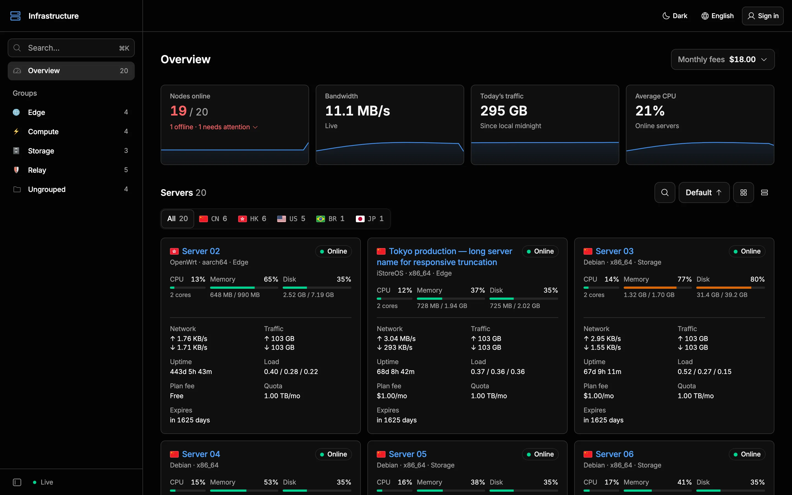
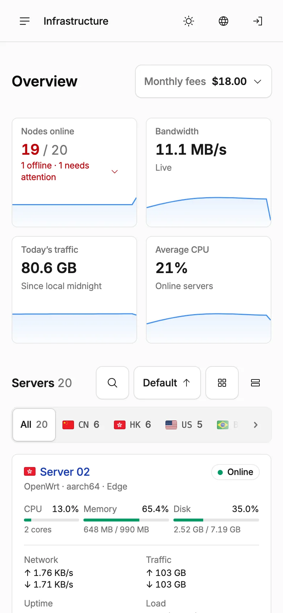
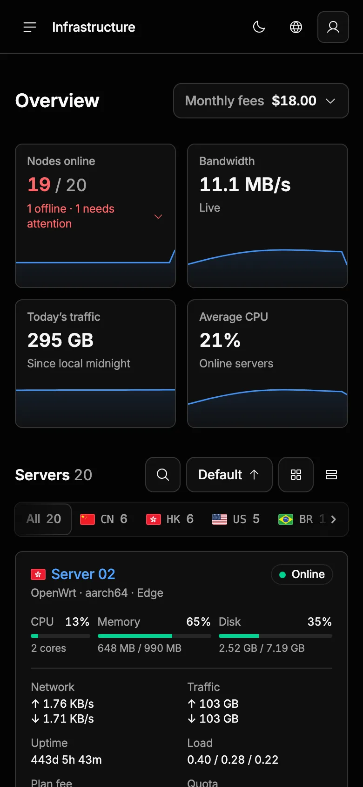
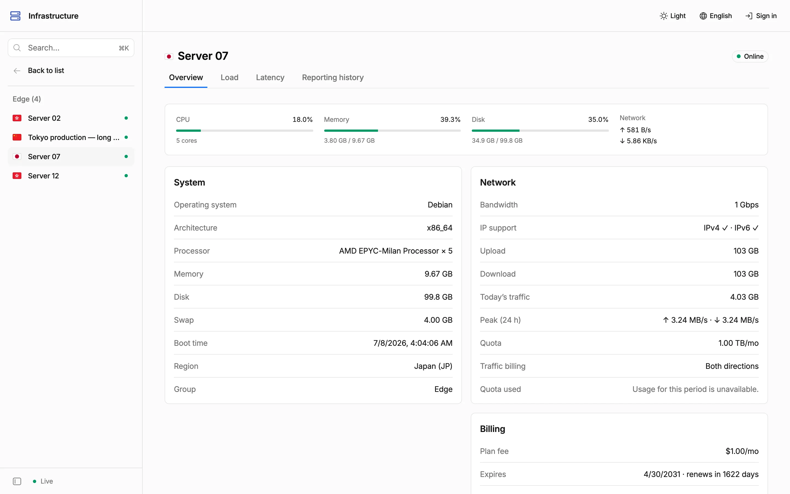
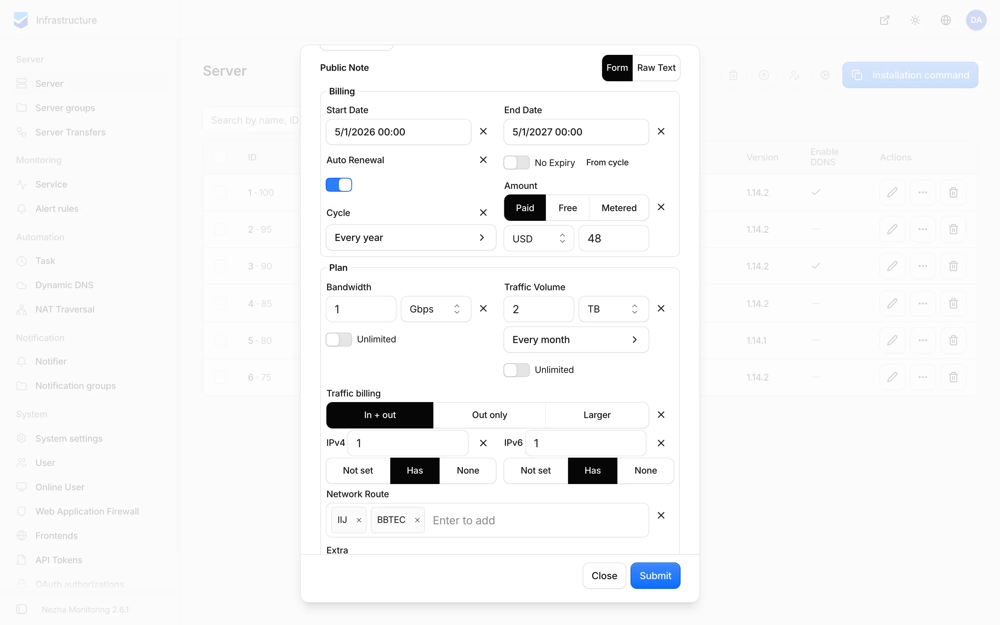

# Nezha Kumo Theme

English | [简体中文](README.zh-CN.md)

A responsive Nezha monitoring dashboard theme (public status frontend and admin panel) built in the visual language of Cloudflare's [Kumo](https://github.com/cloudflare/kumo) design system.

## Screenshots

| Desktop (Light)                                                 | Desktop (Dark)                                                |
| --------------------------------------------------------------- | ------------------------------------------------------------- |
|  |  |

| Mobile (Light)                                                                            | Mobile (Dark)                                                                           |
| ----------------------------------------------------------------------------------------- | --------------------------------------------------------------------------------------- |
|  |  |

| Node Detail                                       | Admin Server List                                         |
| ------------------------------------------------- | --------------------------------------------------------- |
|  |  |

| Structured Public Note Editor                                        |
| -------------------------------------------------------------------- |
|  |

## Compatibility

- **Supported**: [Nezha Monitoring](https://github.com/nezhahq/nezha) **v2.6.0 and above** (built-in Frontend Management was introduced in `v2.6.0`).
- **Verified**: Tested and verified against **Nezha v2.6.1**.

## Installation (Recommended — Nezha v2.6.0+)

> [!IMPORTANT]
>
> 1. Install and verify the **User Frontend** first before replacing the **Admin Panel**.
> 2. Before activating a third-party **Admin Panel**, copy and save the [Rollback](#rollback) commands (plus a Personal Access Token or server shell access) so you can restore the built-in admin UI even if a custom admin build fails to load.

Open your Nezha dashboard and navigate to **Settings → Frontends** (`设置 → 前端管理`):

| Target            | GitHub Repository                                                        | Asset Base Path | Release Asset |
| ----------------- | ------------------------------------------------------------------------ | --------------- | ------------- |
| **User Frontend** | `zhdsmy/nezha-kumo-theme` (`https://github.com/zhdsmy/nezha-kumo-theme`) | `/`             | `dist.zip`    |
| **Admin Panel**   | `zhdsmy/nezha-kumo-admin` (`https://github.com/zhdsmy/nezha-kumo-admin`) | `/dashboard/`   | `dist.zip`    |

1. Under **User Frontend**, enter `zhdsmy/nezha-kumo-theme`, load releases, install the desired tag (e.g. `v0.1.0`), and click **Activate**.
2. Open your public status page (`/`) to confirm the frontend renders as expected.
3. Under **Admin Panel**, enter `zhdsmy/nezha-kumo-admin` (a release-only mirror published from matching tags of this repository), load releases, install the matching version tag, and click **Activate**.

Each release ships a `dist.zip` whose contents live under `dist/` with a non-empty `dist/index.html`, adhering to Nezha's archive limits (`dist.zip` ≤ 64 MiB, extracted ≤ 256 MiB, ≤ 10,000 entries, no symlinks or duplicate paths).

## Manual Installation

For panels without Frontend Management or custom container/host mounts:

1. Download `dist.zip` (and `dist.zip.sha256`) from [GitHub Releases](https://github.com/zhdsmy/nezha-kumo-theme/releases) for the user frontend, or from [`zhdsmy/nezha-kumo-admin` Releases](https://github.com/zhdsmy/nezha-kumo-admin/releases) for the admin panel, and verify the SHA-256 checksum.
2. Extract `dist/` to a directory readable by the Nezha Dashboard process/container (for example `data/kumo-user` or `data/kumo-admin`).
3. _(Optional, user frontend)_ Copy [`apps/frontend/public/config.js`](apps/frontend/public/config.js) next to the extracted `index.html` and customize `window.NezhaKumoConfig`. `dist.zip` ships an all-commented `config.js`, so back up your own copy before extracting an upgrade and restore it afterwards.
4. Update `user_template` (and/or `admin_template`) in Nezha's `data/config.yaml` to point to the extracted directory, then restart the Nezha Dashboard service.

## Rollback

### Roll back the Admin Panel

- **Option A — API with a Personal Access Token (PAT)**:

  ```bash
  curl -X POST "https://your-panel.example.com/api/v1/frontend/activate" \
    -H "Authorization: Bearer <YOUR_PAT>" \
    -H "Content-Type: application/json" \
    -d '{"path":"admin-dist","is_admin":true}'
  ```

- **Option B — `config.yaml` on the server**:
  Stop the Nezha Dashboard service/container, set `admin_template: admin-dist` in `data/config.yaml`, and start the panel again.

### Roll back the User Frontend

- **Option A — API with a PAT**:

  ```bash
  curl -X POST "https://your-panel.example.com/api/v1/frontend/activate" \
    -H "Authorization: Bearer <YOUR_PAT>" \
    -H "Content-Type: application/json" \
    -d '{"path":"user-dist","is_admin":false}'
  ```

- **Option B — `config.yaml` on the server**:
  Stop the Nezha Dashboard service/container, set `user_template: user-dist` in `data/config.yaml`, and start the panel again (or switch back from **Settings → Frontends** in the admin UI).

## Upgrading & Removing Old Versions

1. In **Settings → Frontends**, refresh the release list for `zhdsmy/nezha-kumo-theme` (and `zhdsmy/nezha-kumo-admin`), install the new tag, and activate it.
2. Nezha retains previously installed frontend versions on disk for instant rollback. After confirming the new release works, delete inactive older versions from the **Frontends** page to reclaim disk space.
3. For manual deployments, extract the new `dist.zip` over the template directory (preserving your `config.js` next to `index.html`) and remove unused version directories.

## Configuration

### Configuration Entrypoints

Two configuration methods are supported and can be used together:

1. **Panel Custom Code (Recommended for Frontend Management installs)**
   In **Settings → System settings → Custom code** (`设置 → 自定义代码`, user frontend custom code), add a JSON `<script>` block with `id="nezha-kumo-config"`:

   ```html
   <script type="application/json" id="nezha-kumo-config">
     {
       "siteTitle": "Infrastructure",
       "defaultAppearance": "system",
       "defaultLanguage": "auto",
       "showCost": true
     }
   </script>
   ```

   This block uses `type="application/json"` — it is parsed as data only and never executed as JavaScript.

2. **`config.js` (`window.NezhaKumoConfig`, for manual deployments)**
   Place a `config.js` file next to the extracted `index.html`:

   ```js
   window.NezhaKumoConfig = {
     siteTitle: "Infrastructure",
     showCost: true,
   };
   ```

   - When both `<script id="nezha-kumo-config">` and `config.js` exist, settings are merged key-by-key and **`config.js` takes precedence**.
   - When `config.js` is absent, the page works normally on the panel JSON or defaults. The browser logs a 404 for the missing file; `dist.zip` ships a commented `config.js`, so this only happens if you delete it.

### Theme Settings Reference

All keys are optional and defined in [`apps/frontend/src/core/settings.ts`](apps/frontend/src/core/settings.ts):

| Key                 | Type                                           | Default    | Description                                                                                                            |
| ------------------- | ---------------------------------------------- | ---------- | ---------------------------------------------------------------------------------------------------------------------- |
| `defaultAppearance` | `"system" \| "light" \| "dark"`                | `"system"` | Initial color scheme before a visitor chooses one (`nkt:appearance`).                                                  |
| `defaultLanguage`   | `"auto" \| "en" \| "zh-CN" \| "zh-TW" \| "ja"` | `"auto"`   | Initial UI language (`"auto"` follows browser / panel language).                                                       |
| `siteTitle`         | `string`                                       | `""`       | Custom brand title in the sidebar and `<title>`. Falls back to the panel's `site_name` (or `"Nezha"`) when empty.      |
| `showOverview`      | `boolean`                                      | `true`     | Show the summary metric tiles at the top of the home page.                                                             |
| `showCost`          | `boolean`                                      | `true`     | Show the aggregated recurring fee menu on the home page and enable currency conversion.                                |
| `showRegions`       | `boolean`                                      | `true`     | Show the region flag filter bar above the server list.                                                                 |
| `showGroups`        | `boolean`                                      | `true`     | Show server-group navigation in the sidebar and group sections on the home page.                                       |
| `showBilling`       | `boolean`                                      | `true`     | Show plan fee, billing cycle, expiration, and quota metadata parsed from `public_note`.                                |
| `showOffline`       | `boolean`                                      | `true`     | Include offline servers in the public server list (`false` hides offline servers).                                     |
| `hiddenNodes`       | `string[]`                                     | `[]`       | Server IDs or exact server names to hide on the public frontend (also accepts a comma- or newline-separated `string`). |
| `hideAdminEntry`    | `boolean`                                      | `false`    | Hide the sign-in / admin dashboard button in the top bar.                                                              |
| `footerNote`        | `string`                                       | `""`       | Optional plain-text note rendered in the footer.                                                                       |

### Server Group Icons (`nezha-kumo-group-icons`)

Custom icons for sidebar server groups are stored in user-frontend **Custom code** (`custom_code`) as a JSON block with `id="nezha-kumo-group-icons"` (see [`packages/shared/group-icons.ts`](packages/shared/group-icons.ts)):

```html
<script type="application/json" id="nezha-kumo-group-icons">
  { "1": "🌐", "2": "⚡", "3": "https://cdn.example.com/icons/storage.svg" }
</script>
```

- **Keys**: Nezha server-group IDs as strings (e.g. `"1"`, `"2"`).
- **Values**: Either **a single grapheme** (one emoji or character to fit the `16px` sidebar icon slot) or an **`https://` image URL** (whitespace and non-HTTPS schemes are rejected).
- **Visual editor**: In the Kumo Admin Panel (`zhdsmy/nezha-kumo-admin`), you can set or clear icons directly in the **Server Group** create/edit dialog, which updates only this `<script>` block inside `custom_code`.

## Public Note & Billing / Plan Fields

Server billing and plan metadata live in Nezha's `public_note` JSON field. This theme is compatible with **[nezhainfojson](https://plane.2233444.xyz/)** generators (as well as `nezha-dash` and `Nazhua` dialects) and includes a structured **Public Note** editor in the Kumo Admin Panel (which preserves unknown JSON keys when saving).

```json
{
  "billingDataMod": {
    "startDate": "2026-05-01T00:00:00+08:00",
    "endDate": "2027-05-01T00:00:00+08:00",
    "autoRenewal": "1",
    "cycle": "Year",
    "amount": "USD 48.00"
  },
  "planDataMod": {
    "bandwidth": "1Gbps",
    "trafficVol": "2TB/Month",
    "trafficType": "2",
    "IPv4": "1",
    "IPv6": "1",
    "networkRoute": "IIJ,BBTEC",
    "extra": "NVMe,Anycast"
  }
}
```

### `billingDataMod` Fields

| Field         | Example                       | Description                                                                                                                                                                |
| ------------- | ----------------------------- | -------------------------------------------------------------------------------------------------------------------------------------------------------------------------- |
| `startDate`   | `"2026-05-01T00:00:00+08:00"` | Billing start timestamp (ISO 8601).                                                                                                                                        |
| `endDate`     | `"2027-05-01T00:00:00+08:00"` | Expiration timestamp, or `"0000-00-00T23:59:59+08:00"` for non-expiring servers.                                                                                           |
| `autoRenewal` | `"1"` / `"0"`                 | `"1"` enables auto-renewal; `"0"` disables it.                                                                                                                             |
| `cycle`       | `"Year"`                      | Billing cycle (`Day`, `Week`, `Month`, `Quarter`, `Half`, `Year`, multi-unit forms like `2Year`, or Chinese/Japanese aliases).                                             |
| `amount`      | `"USD 48.00"`                 | Price with ISO currency code or symbol (`"USD 48.00"`, `"CNY 300.00"`, `"€9.50"`, `"0"` / `"Free"` for free, `"-1"` for pay-as-you-go), optionally suffixed with `/Cycle`. |

### `planDataMod` Fields

| Field          | Example                 | Description                                                              |
| -------------- | ----------------------- | ------------------------------------------------------------------------ |
| `bandwidth`    | `"1Gbps"`               | Port bandwidth (`Mbps`, `Gbps`, or `"Unlimited"`).                       |
| `trafficVol`   | `"2TB/Month"`           | Traffic quota with optional reset period (`GB`, `TB`, or `"Unlimited"`). |
| `trafficType`  | `"1"` \| `"2"` \| `"3"` | Traffic accounting mode (see below).                                     |
| `IPv4`         | `"1"` / `"0"`           | `"1"` = has IPv4, `"0"` = none.                                          |
| `IPv6`         | `"1"` / `"0"`           | `"1"` = has IPv6, `"0"` = none.                                          |
| `networkRoute` | `"IIJ,BBTEC"`           | Comma-separated network route tags.                                      |
| `extra`        | `"NVMe,Anycast"`        | Comma-separated hardware or plan tags.                                   |

#### `trafficType` Values

- `"1"` — **Outbound only** (`out`): only upload (`net_out_transfer`) counts toward `trafficVol`.
- `"2"` — **Both directions** (`sum`): upload + download (`net_out_transfer + net_in_transfer`) count toward `trafficVol`.
- `"3"` — **Larger direction** (`max`, default when omitted): `max(net_out_transfer, net_in_transfer)` counts toward `trafficVol`.

### Private Actual Renewal Amount (`note`)

Signed-in administrators can record a private renewal cost inside Nezha's private **`note`** field so public visitors still see the list price (or nothing) while signed-in sessions see the actual cost in fee totals:

```json
{
  "billingDataMod": {
    "actualAmount": "CNY 300.00/Year"
  }
}
```

`billingDataMod.actualAmount` accepts an optional `/Cycle` suffix (for example `"CNY 300.00/Year"` or `"USD 25.00/Quarter"`). When the cycle suffix is omitted, it falls back to `billingDataMod.cycle` from `public_note`.

## Privacy & Third-Party Requests

- **Exchange-rate lookup**: When `showCost` is `true` (default), visitor browsers send a credential-less `GET` request to `https://api.frankfurter.dev/v2/rates?base=USD` to convert multi-currency fees, caching responses in `localStorage` (`nkt:exchange-rates`) for **24 hours**.
- **Disabling external requests**: Set `"showCost": false` in `nezha-kumo-config` or `config.js` to disable fee aggregation and make **zero** requests to `api.frankfurter.dev`.
- **Self-hosted assets**: Fonts (`@fontsource-variable/inter`) and SVG flags (`flag-icons`) are bundled locally in the release archive with no third-party font or icon CDNs.

## Development

Requires **Node.js 22+** and **pnpm** (`corepack enable`).

```bash
pnpm install          # Install workspace dependencies
pnpm check            # Run typecheck, tests, and production builds across all packages
pnpm typecheck        # Typecheck workspace packages
pnpm test             # Run unit and Playwright E2E suites
pnpm build            # Build frontend and admin bundles
```

### Mock E2E & App Workflows

- **Public frontend** ([`apps/frontend`](apps/frontend/README.md)): `pnpm --filter frontend test:e2e` runs Playwright against deterministic HTTP and WebSocket mocks (`apps/frontend/tests/mock.ts`) with no live Nezha panel required.
- **Admin panel** ([`apps/admin`](apps/admin/README.md)): `pnpm --filter nezha-kumo-admin test` runs Vitest component/unit tests; Playwright E2E specs under `apps/admin/tests/e2e/` run against mocked `/api/v1/*` routes or a local test backend.

### Repository Layout

```text
.
├── apps/
│   ├── frontend/      # Public status frontend (base: /)
│   └── admin/         # Reskinned Nezha admin panel (base: /dashboard/)
├── packages/
│   ├── ui/            # Shared AppShell, Page, breakpoints, and shell CSS contract
│   └── shared/        # Shared public_note parser/writer and group-icon helpers
└── docs/
    ├── screenshots/   # Mocked WebP screenshots
    ├── capture-screenshots.mjs
    └── check-links.mjs
```

See [CONTRIBUTING.md](CONTRIBUTING.md) for commit conventions and shared shell layout rules, and [SECURITY.md](SECURITY.md) for vulnerability reporting.

## Acknowledgments & License

- Visual components and tokens powered by [`@cloudflare/kumo`](https://github.com/cloudflare/kumo) (MIT). This project is an independent community theme and is **not** affiliated with or endorsed by Cloudflare, Inc.
- Built for [Nezha Monitoring](https://github.com/nezhahq/nezha), building upon [`nezhahq/admin-frontend`](https://github.com/nezhahq/admin-frontend), Nezha data-layer adaptations from [`foru17/zool-theme`](https://github.com/foru17/zool-theme), [`lipis/flag-icons`](https://github.com/lipis/flag-icons), and [Inter](https://github.com/rsms/inter). Full attributions are listed in [NOTICE.md](NOTICE.md).
- Released under the [MIT License](LICENSE).
