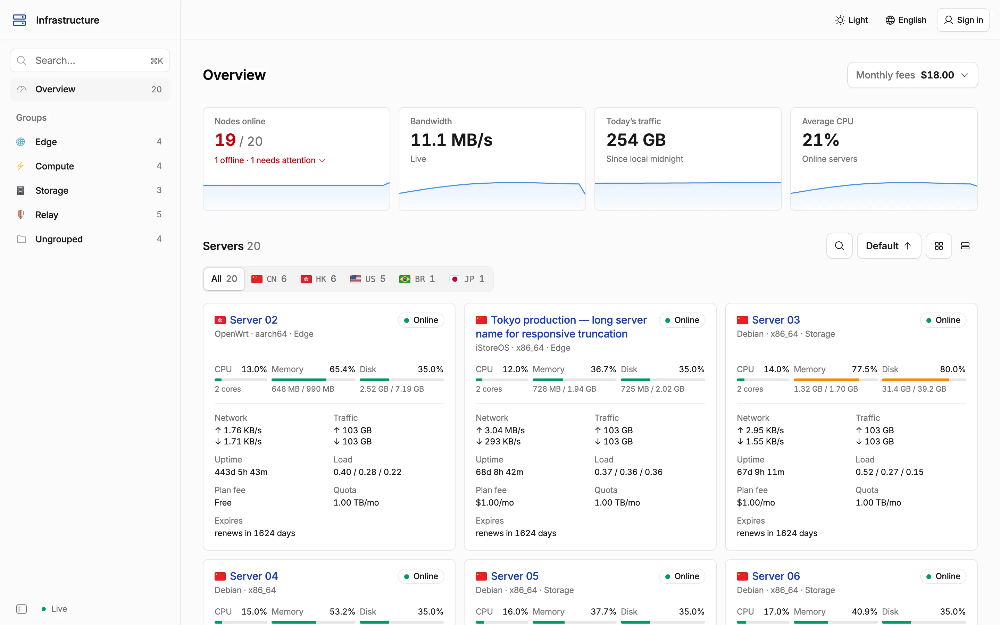
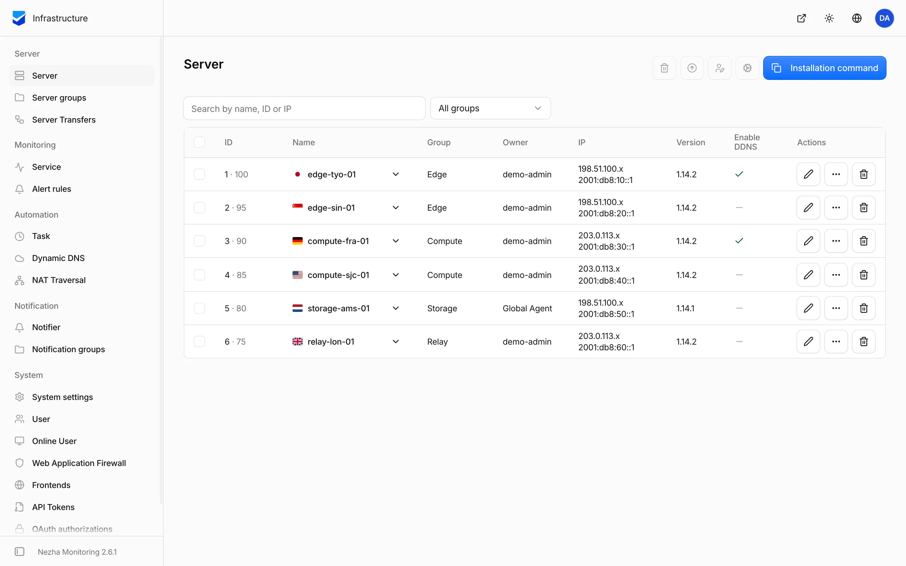

# Nezha Kumo Theme

English | [简体中文](README.zh-CN.md) | [繁體中文·台灣](README.zh-TW.md) | [繁體中文·香港](README.zh-HK.md) | [日本語](README.ja.md)

Responsive public status frontend and admin panel for [Nezha Monitoring](https://github.com/nezhahq/nezha), built with Cloudflare's [Kumo](https://github.com/cloudflare/kumo) design system.

Supports English, Simplified Chinese, Traditional Chinese (Taiwan and Hong Kong), and Japanese, with **Light**, **Dark**, and **System** appearance modes. The public page shows live server status, traffic billing indicators, and **Today’s traffic** totals, and ships a Web App manifest so adding the site to a Home Screen opens the home page as a standalone app named after the site. Sidebar group icons accept an emoji or single character, a bundled `vps:<slug>` provider icon, or an `https://` image URL.

## Screenshots

| Desktop (Light)                                                 | Desktop (Dark)                                                |
| --------------------------------------------------------------- | ------------------------------------------------------------- |
|  |  |

| Mobile (Light)                                                                            | Mobile (Dark)                                                                           |
| ----------------------------------------------------------------------------------------- | --------------------------------------------------------------------------------------- |
|  |  |

| Node Detail                                       | Admin Server List                                         |
| ------------------------------------------------- | --------------------------------------------------------- |
|  |  |

| Structured Public Note Editor                                        |
| -------------------------------------------------------------------- |
|  |

## Compatibility

- **Supported**: [Nezha Monitoring](https://github.com/nezhahq/nezha) **v2.6.0 and later** (built-in Frontend Management was introduced in `v2.6.0`).
- **Verified**: Tested against **Nezha v2.6.1**.

## Installation (Recommended — Nezha v2.6.0+)

> [!IMPORTANT]
>
> 1. Install and verify the **User frontend** before replacing the **Admin frontend**.
> 2. Before activating a third-party **Admin frontend**, save the [Rollback](#rollback) commands along with a Personal Access Token (PAT) or server shell access so you can restore the built-in admin UI if a custom build fails to load.

Open your Nezha dashboard and go to **Settings → Frontends** (or **System → Frontends** in Kumo Admin):

| Frontend Type      | Repository URL                                  | Asset Base Path | Release Asset |
| ------------------ | ----------------------------------------------- | --------------- | ------------- |
| **User frontend**  | `https://github.com/zhdsmy/nezha-kumo-theme`    | `/`             | `dist.zip`    |
| **Admin frontend** | `https://github.com/zhdsmy/nezha-kumo-admin`    | `/dashboard/`   | `dist.zip`    |

1. Set **Frontend type** to **User frontend**, enter `https://github.com/zhdsmy/nezha-kumo-theme`, click **Read releases**, click **Install** next to the target tag (for example `v1.0.0`), and click **Activate**.
2. Open your public status page (`/`) and confirm the frontend renders properly.
3. Set **Frontend type** to **Admin frontend**, enter `https://github.com/zhdsmy/nezha-kumo-admin` (a release-only mirror published from matching tags of this repository), click **Read releases**, install the matching tag, and click **Activate**.

Each release ships a `dist.zip` whose contents live under `dist/` with a non-empty `dist/index.html`, within Nezha's archive limits (`dist.zip` ≤ 64 MiB, extracted ≤ 256 MiB, ≤ 10,000 entries, no symlinks or duplicate paths).

## Manual Installation

For panels without Frontend Management or deployments using custom host/container mounts:

1. Download `dist.zip` and `dist.zip.sha256` from [GitHub Releases](https://github.com/zhdsmy/nezha-kumo-theme/releases) (user frontend) or [`zhdsmy/nezha-kumo-admin` Releases](https://github.com/zhdsmy/nezha-kumo-admin/releases) (admin panel), then verify the SHA-256 checksum.
2. Extract `dist/` to a directory readable by the Nezha Dashboard process or container (for example `data/kumo-user` or `data/kumo-admin`).
3. _(Optional, user frontend)_ Copy [`apps/frontend/public/config.js`](apps/frontend/public/config.js) next to the extracted `index.html` and customize `window.NezhaKumoConfig`. Because `dist.zip` includes an all-commented `config.js`, back up your file before extracting an upgrade and restore it afterward.
4. Set `user_template` (and/or `admin_template`) in `data/config.yaml` to the extracted directory, then restart Nezha Dashboard.

## Rollback

### Roll back the Admin Panel

- **Option A — API with a Personal Access Token (PAT)**:

  ```bash
  curl -X POST "https://your-panel.example.com/api/v1/frontend/activate" \
    -H "Authorization: Bearer <YOUR_PAT>" \
    -H "Content-Type: application/json" \
    -d '{"path":"admin-dist","is_admin":true}'
  ```

- **Option B — `config.yaml` on the server**:
  Stop the Nezha Dashboard service or container, set `admin_template: admin-dist` in `data/config.yaml`, and start the panel again.

### Roll back the User Frontend

- **Option A — API with a PAT**:

  ```bash
  curl -X POST "https://your-panel.example.com/api/v1/frontend/activate" \
    -H "Authorization: Bearer <YOUR_PAT>" \
    -H "Content-Type: application/json" \
    -d '{"path":"user-dist","is_admin":false}'
  ```

- **Option B — `config.yaml` on the server**:
  Stop the Nezha Dashboard service or container, set `user_template: user-dist` in `data/config.yaml`, and start the panel again (or switch back on the **Frontends** page in the admin UI).

## Upgrading & Removing Old Versions

1. Open **System → Frontends** (or **Settings → Frontends**), load releases for `https://github.com/zhdsmy/nezha-kumo-theme` (and `https://github.com/zhdsmy/nezha-kumo-admin`), click **Install** on the new tag, and click **Activate**.
2. Nezha keeps previously installed frontend versions on disk for instant rollback. Once the new release is verified, click **Delete** on inactive older versions on the **Frontends** page to reclaim disk space.
3. For manual deployments, extract the new `dist.zip` over the template directory (preserving your `config.js` next to `index.html`) and delete unused version directories.

## Configuration

### Configuration Entrypoints

Two configuration methods are supported and can be used together:

1. **Panel Custom Code (Recommended for Frontend Management installs)**
   In **System → System settings** → **Custom Codes (Style and Script)** (or **Settings → System settings** in the built-in admin; user-frontend `custom_code`), add a JSON `<script>` block with `id="nezha-kumo-config"`:

   ```html
   <script type="application/json" id="nezha-kumo-config">
     {
       "siteTitle": "Infrastructure",
       "defaultAppearance": "system",
       "defaultLanguage": "auto",
       "showCost": true
     }
   </script>
   ```

   This `<script>` uses `type="application/json"` — it is parsed strictly as JSON data and never executed as JavaScript.

2. **`config.js` (`window.NezhaKumoConfig`, for manual deployments)**
   Place `config.js` next to the extracted `index.html`:

   ```js
   window.NezhaKumoConfig = {
     siteTitle: "Infrastructure",
     showCost: true,
   };
   ```

   - When both `<script id="nezha-kumo-config">` and `config.js` are present, settings merge key by key and **`config.js` takes precedence**.
   - Without `config.js`, the frontend uses the panel JSON or built-in defaults. `dist.zip` includes a commented `config.js`, so the browser only logs a 404 if that file is deleted.

### Theme Settings Reference

All keys are optional and defined in [`apps/frontend/src/core/settings.ts`](apps/frontend/src/core/settings.ts):

| Key                 | Type                                                       | Default    | Description                                                                                                              |
| ------------------- | ---------------------------------------------------------- | ---------- | ------------------------------------------------------------------------------------------------------------------------ |
| `defaultAppearance` | `"system" \| "light" \| "dark"`                            | `"system"` | Initial color scheme before a visitor chooses one (`nkt:appearance`).                                                    |
| `defaultLanguage`   | `"auto" \| "en" \| "zh-CN" \| "zh-HK" \| "zh-TW" \| "ja"` | `"auto"`   | Initial UI language before a visitor chooses one (`nkt:language`); `"auto"` uses the panel language, then browser language. |
| `siteTitle`         | `string`                                                   | `""`       | Custom brand title in the sidebar and `<title>`. Falls back to the panel's `site_name` (or `"Nezha"`) when empty.        |
| `showOverview`      | `boolean`                                                  | `true`     | Show the summary metric tiles at the top of the home page.                                                               |
| `showCost`          | `boolean`                                                  | `true`     | Show the recurring fee menu (**Monthly fees** / **Yearly fees**) on the home page and enable currency conversion.        |
| `showRegions`       | `boolean`                                                  | `true`     | Show the region flag filter bar above the server list.                                                                   |
| `showGroups`        | `boolean`                                                  | `true`     | Show **Groups** navigation in the sidebar and enable filtering by group.                                                 |
| `showBilling`       | `boolean`                                                  | `true`     | Show plan fee, billing cycle, expiration, and quota metadata parsed from `public_note`.                                  |
| `showOffline`       | `boolean`                                                  | `true`     | Include offline servers in the public server list (`false` hides offline servers).                                       |
| `hiddenNodes`       | `string[]`                                                 | `[]`       | Server IDs or exact server names to hide on the public frontend (also accepts a comma- or newline-separated `string`).   |
| `hideAdminEntry`    | `boolean`                                                  | `false`    | Hide the **Sign in** / **Dashboard** button in the top bar.                                                              |
| `footerNote`        | `string`                                                   | `""`       | Optional plain-text note shown on its own line below the footer credits.                                                 |

### Server Group Icons (`nezha-kumo-group-icons`)

Custom icons for sidebar server groups are stored in user-frontend **Custom Codes (Style and Script)** (`custom_code`) as a JSON `<script>` block with `id="nezha-kumo-group-icons"` (see [`packages/shared/group-icons.ts`](packages/shared/group-icons.ts)):

```html
<script type="application/json" id="nezha-kumo-group-icons">
  { "1": "vps:aws", "2": "vps:azure", "3": "🗄️", "4": "https://cdn.example.com/icons/storage.svg" }
</script>
```

- **Keys**: Nezha server-group IDs as strings (for example `"1"`, `"2"`).
- **Values**: A `vps:<slug>` entry from bundled **vps-icons v1.4.0** (263 light/dark provider icons), a single grapheme (one emoji or character for the `16px` sidebar slot), or an `https://` image URL. VPS slugs must exist in the bundled catalog.
- **Visual editor**: In Kumo Admin (`zhdsmy/nezha-kumo-admin`), open **Server groups** and use **Create Server Group** / **Edit Server Group** → **Choose a VPS icon** (or enter an icon directly) to set or clear an icon. The picker searches slugs, provider names, Chinese names, aliases, and nicknames, updating only this `<script>` block in `custom_code`.

## Public Note & Billing / Plan Fields

Server billing and plan metadata are stored in Nezha's `public_note` JSON field. The theme is compatible with **[nezhainfojson](https://plane.2233444.xyz/)** generators (as well as `nezha-dash` and `Nazhua` dialects) and includes a structured **Public Note** editor in Kumo Admin that preserves unknown JSON keys on save.

```json
{
  "billingDataMod": {
    "startDate": "2026-05-01T00:00:00+08:00",
    "endDate": "2027-05-01T00:00:00+08:00",
    "autoRenewal": "1",
    "cycle": "Year",
    "amount": "USD 48.00"
  },
  "planDataMod": {
    "bandwidth": "1Gbps",
    "trafficVol": "2TB/Month",
    "trafficType": "2",
    "IPv4": "1",
    "IPv6": "1",
    "networkRoute": "IIJ,BBTEC",
    "extra": "NVMe,Anycast"
  }
}
```

### `billingDataMod` Fields

| Field         | Example                       | Description                                                                                                                                                                |
| ------------- | ----------------------------- | -------------------------------------------------------------------------------------------------------------------------------------------------------------------------- |
| `startDate`   | `"2026-05-01T00:00:00+08:00"` | Billing start timestamp (ISO 8601).                                                                                                                                        |
| `endDate`     | `"2027-05-01T00:00:00+08:00"` | Expiration timestamp, or `"0000-00-00T23:59:59+08:00"` for non-expiring servers.                                                                                           |
| `autoRenewal` | `"1"` / `"0"`                 | `"1"` enables auto-renewal; `"0"` disables it.                                                                                                                             |
| `cycle`       | `"Year"`                      | Billing cycle (`Day`, `Week`, `Month`, `Quarter`, `Half`, `Year`, multi-unit forms like `2Year`, or Chinese/Japanese aliases).                                             |
| `amount`      | `"USD 48.00"`                 | Price with ISO currency code or symbol (`"USD 48.00"`, `"CNY 300.00"`, `"€9.50"`, `"0"` / `"Free"` for free, `"-1"` for pay-as-you-go), optionally suffixed with `/Cycle`. |

### `planDataMod` Fields

| Field          | Example                 | Description                                                              |
| -------------- | ----------------------- | ------------------------------------------------------------------------ |
| `bandwidth`    | `"1Gbps"`               | Port bandwidth (`Mbps`, `Gbps`, or `"Unlimited"`).                       |
| `trafficVol`   | `"2TB/Month"`           | Traffic quota with optional reset period (`GB`, `TB`, or `"Unlimited"`). |
| `trafficType`  | `"1"` \| `"2"` \| `"3"` | Traffic accounting mode (see below).                                     |
| `IPv4`         | `"1"` / `"0"`           | `"1"` = has IPv4, `"0"` = none.                                          |
| `IPv6`         | `"1"` / `"0"`           | `"1"` = has IPv6, `"0"` = none.                                          |
| `networkRoute` | `"IIJ,BBTEC"`           | Comma-separated network route tags.                                      |
| `extra`        | `"NVMe,Anycast"`        | Comma-separated hardware or plan tags.                                   |

#### `trafficType` Values

- `"1"` — **Outbound only** (`out`): only upload (`net_out_transfer`) counts toward `trafficVol`.
- `"2"` — **Both directions** (`sum`): upload + download (`net_out_transfer + net_in_transfer`) count toward `trafficVol`.
- `"3"` — **Larger direction** (`max`, default when omitted): `max(net_out_transfer, net_in_transfer)` counts toward `trafficVol`.

### Private Actual Renewal Amount (`note`)

Administrators can record an actual renewal cost in Nezha's private **`note`** field (or via the **Private note** editor in Kumo Admin). Public visitors still see only the public price (or none), while signed-in users see the actual cost in fee totals and node **Actual cost** details:

```json
{
  "billingDataMod": {
    "actualAmount": "CNY 300.00/Year"
  }
}
```

`billingDataMod.actualAmount` requires a currency code or symbol and accepts an optional `/Cycle` suffix (for example `"CNY 300.00/Year"` or `"USD 25.00/Quarter"`). When `/Cycle` is omitted, it inherits `billingDataMod.cycle` from `public_note`.

## Privacy & Third-Party Requests

- **Exchange-rate lookup**: When `showCost` is `true` (default), visitor browsers send a credential-less `GET` request to `https://api.frankfurter.dev/v2/rates?base=USD` for multi-currency conversion and cache the response in `localStorage` (`nkt:exchange-rates`) for **24 hours**.
- **Disabling external requests**: Set `"showCost": false` in `nezha-kumo-config` or `config.js` to hide fee totals and make **zero** requests to `api.frankfurter.dev`.
- **Self-hosted assets**: Fonts (`@fontsource-variable/inter`), SVG flags (`flag-icons`), and VPS provider icons are bundled in the release archive with no third-party font or icon CDNs.

## Development

Requires **Node.js 22+** and **pnpm** (`corepack enable`).

```bash
pnpm install          # Install workspace dependencies
pnpm check            # Run typecheck, tests, and production builds across all packages
pnpm typecheck        # Typecheck workspace packages
pnpm test             # Run unit and Playwright E2E suites
pnpm build            # Build frontend and admin bundles
```

### Mock E2E & App Workflows

- **Public frontend** ([`apps/frontend`](apps/frontend/README.md)): `pnpm --filter frontend test:e2e` runs Playwright against deterministic HTTP and WebSocket mocks (`apps/frontend/tests/mock.ts`) without a live Nezha panel.
- **Admin panel** ([`apps/admin`](apps/admin/README.md)): `pnpm --filter nezha-kumo-admin test` runs Vitest component and unit tests; Playwright E2E specs under `apps/admin/tests/e2e/` run against mocked `/api/v1/*` routes or a local test backend.
- **README screenshots**: `NKT_DOCS_LANG=en node docs/capture-screenshots.mjs` generates the English set. Pass `zh-CN`, `zh-TW`, `zh-HK`, or `ja` for localized sets, then verify with `node docs/check-links.mjs`.

### Repository Layout

```text
.
├── apps/
│   ├── frontend/      # Public status frontend (base: /)
│   └── admin/         # Reskinned Nezha admin panel (base: /dashboard/)
├── packages/
│   ├── ui/            # Shared AppShell, Page, breakpoints, and shell CSS contract
│   └── shared/        # Shared public_note parser/writer and group-icon helpers
└── docs/
    ├── screenshots/   # Mocked WebP screenshots
    ├── capture-screenshots.mjs
    └── check-links.mjs
```

See [CONTRIBUTING.md](CONTRIBUTING.md) for commit conventions and shared shell layout rules, and [SECURITY.md](SECURITY.md) for vulnerability reporting.

## Acknowledgments & License

- UI components and design tokens powered by [`@cloudflare/kumo`](https://github.com/cloudflare/kumo) (MIT). This project is an independent community theme and is **not** affiliated with or endorsed by Cloudflare, Inc.
- Built for [Nezha Monitoring](https://github.com/nezhahq/nezha), building upon [`nezhahq/admin-frontend`](https://github.com/nezhahq/admin-frontend), Nezha data-layer adaptations from [`foru17/zool-theme`](https://github.com/foru17/zool-theme), [`lipis/flag-icons`](https://github.com/lipis/flag-icons), and [Inter](https://github.com/rsms/inter). Full attributions, including vps-icons v1.4.0, are listed in [NOTICE.md](NOTICE.md).
- Released under the [MIT License](LICENSE).
