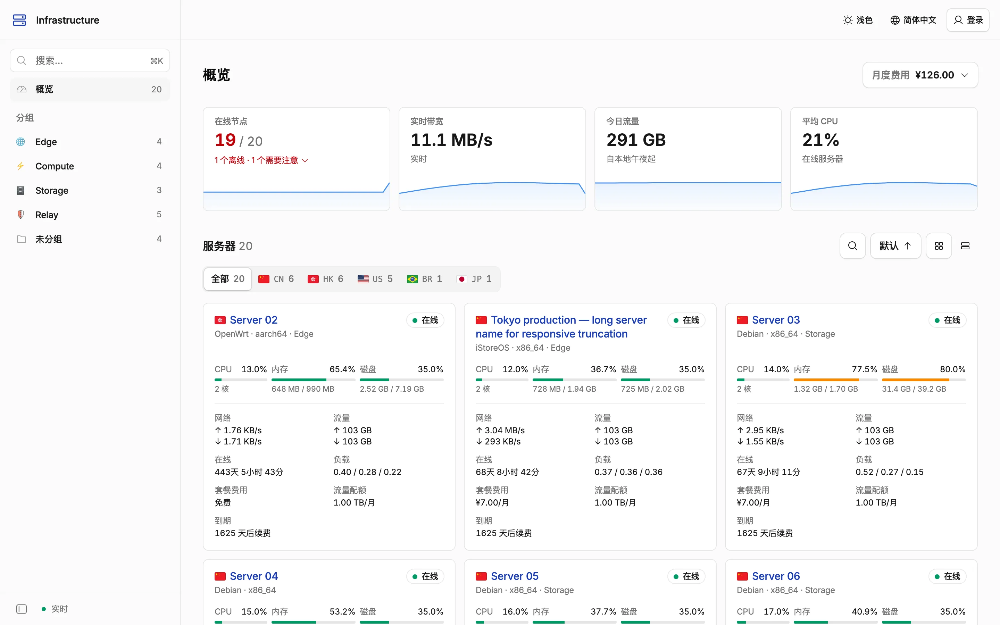
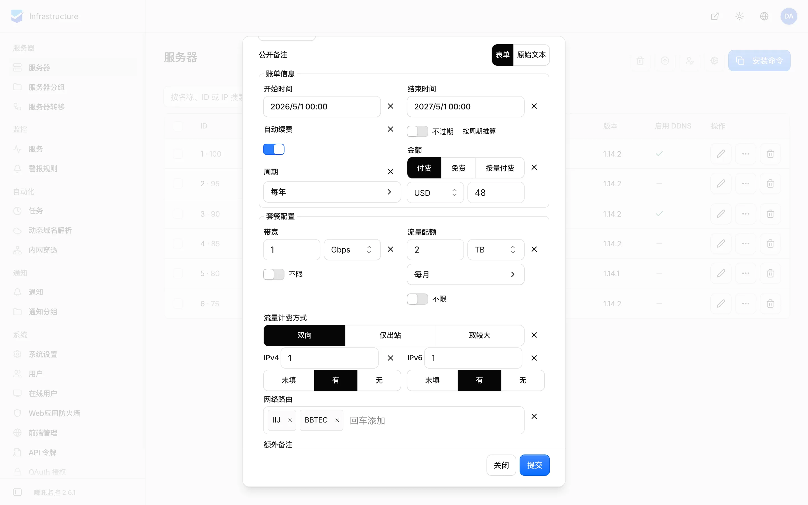

# Nezha Kumo Theme

[English](README.md) | 简体中文 | [繁體中文·台灣](README.zh-TW.md) | [繁體中文·香港](README.zh-HK.md) | [日本語](README.ja.md)

一个响应式的哪吒监控面板主题（公开状态前台与管理后台），采用 Cloudflare [Kumo](https://github.com/cloudflare/kumo) 设计系统的视觉语言。

主题支持 English、简体中文、繁体中文（台湾与香港）和日本語，访客可选择浅色、深色或跟随系统。分组图标支持单个 Emoji 或字符、内置 `vps:<slug>` 图标，以及 HTTPS 图片地址。公开前台提供实时状态、流量计费标识和今日流量汇总。内置 Web App manifest，支持将网站添加到主屏幕，并以站点名称作为独立应用打开首页。

## Screenshots

| 桌面端（浅色）                                                     | 桌面端（深色）                                                    |
| ------------------------------------------------------------------ | ----------------------------------------------------------------- |
|  |  |

| 移动端（浅色）                                                                            | 移动端（深色）                                                                           |
| ----------------------------------------------------------------------------------------- | ----------------------------------------------------------------------------------------- |
|  |  |

| 节点详情页                                           | 管理后台服务器列表                                   |
| ---------------------------------------------------- | ---------------------------------------------------- |
|  |  |

| 结构化公开备注编辑器                                      |
| --------------------------------------------------------- |
|  |

## Compatibility

- **支持版本**：[哪吒监控](https://github.com/nezhahq/nezha) **v2.6.0 及以上**（内置前端管理在 `v2.6.0` 引入）。
- **已验证**：已针对 **哪吒 v2.6.1** 完成测试和验证。

## Installation（推荐 — 哪吒 v2.6.0+）

> [!IMPORTANT]
>
> 1. 替换 **管理后台** 前，请先安装并验证 **用户前台**。
> 2. 启用第三方 **管理后台** 前，请复制并保存 [回滚](#rollback) 命令，以及个人访问令牌或服务器 Shell 权限。即使自定义后台无法加载，也可以恢复内置后台界面。

打开哪吒面板，进入 **Settings → Frontends**（`设置 → 前端管理`）：

| 目标             | GitHub 仓库                                                              | 资源基路径      | 发布资源      |
| ---------------- | ------------------------------------------------------------------------ | --------------- | ------------- |
| **用户前台**     | `zhdsmy/nezha-kumo-theme`（`https://github.com/zhdsmy/nezha-kumo-theme`） | `/`             | `dist.zip`    |
| **管理后台**     | `zhdsmy/nezha-kumo-admin`（`https://github.com/zhdsmy/nezha-kumo-admin`）  | `/dashboard/`   | `dist.zip`    |

1. 在 **User Frontend** 中填入 `zhdsmy/nezha-kumo-theme`，加载发布版本，安装目标标签（例如 `v1.0.0`），然后点击 **Activate**。
2. 打开公开状态页（`/`），确认前台正常显示。
3. 在 **Admin Panel** 中填入 `zhdsmy/nezha-kumo-admin`（从本仓库对应标签发布的仅发布镜像），加载发布版本，安装匹配的版本标签，然后点击 **Activate**。

每个发布包都包含位于 `dist/` 下且非空的 `dist/index.html`，并符合哪吒归档限制（`dist.zip` ≤ 64 MiB，解压后 ≤ 256 MiB，≤ 10,000 个条目，不含符号链接或重复路径）。

## Manual Installation

适用于没有前端管理功能，或使用自定义容器/主机挂载的面板：

1. 用户前台从 [GitHub Releases](https://github.com/zhdsmy/nezha-kumo-theme/releases) 下载 `dist.zip`（及 `dist.zip.sha256`），管理后台从 [`zhdsmy/nezha-kumo-admin` Releases](https://github.com/zhdsmy/nezha-kumo-admin/releases) 下载，并验证 SHA-256 校验和。
2. 将 `dist/` 解压到哪吒 Dashboard 进程或容器可读取的目录（例如 `data/kumo-user` 或 `data/kumo-admin`）。
3. _（可选，用户前台）_ 将 [`apps/frontend/public/config.js`](apps/frontend/public/config.js) 复制到解压后的 `index.html` 同级，并配置 `window.NezhaKumoConfig`。`dist.zip` 自带全注释的 `config.js`，升级前请备份自己的文件，解压后再恢复。
4. 修改哪吒 `data/config.yaml` 中的 `user_template`（和/或 `admin_template`）指向解压目录，然后重启哪吒 Dashboard 服务。

## Rollback

### 回滚管理后台

- **选项 A — 使用个人访问令牌（PAT）的 API**：

  ```bash
  curl -X POST "https://your-panel.example.com/api/v1/frontend/activate" \
    -H "Authorization: Bearer <YOUR_PAT>" \
    -H "Content-Type: application/json" \
    -d '{"path":"admin-dist","is_admin":true}'
  ```

- **选项 B — 修改服务器上的 `config.yaml`**：
  停止哪吒 Dashboard 服务或容器，在 `data/config.yaml` 设置 `admin_template: admin-dist`，然后再次启动面板。

### 回滚用户前台

- **选项 A — 使用 PAT 的 API**：

  ```bash
  curl -X POST "https://your-panel.example.com/api/v1/frontend/activate" \
    -H "Authorization: Bearer <YOUR_PAT>" \
    -H "Content-Type: application/json" \
    -d '{"path":"user-dist","is_admin":false}'
  ```

- **选项 B — 修改服务器上的 `config.yaml`**：
  停止哪吒 Dashboard 服务或容器，在 `data/config.yaml` 设置 `user_template: user-dist`，然后再次启动面板（或从管理界面的 **Settings → Frontends** 切回）。

## Upgrading & Removing Old Versions

1. 在 **Settings → Frontends** 刷新 `zhdsmy/nezha-kumo-theme`（及 `zhdsmy/nezha-kumo-admin`）的发布列表，安装新标签并启用。
2. 哪吒会在磁盘上保留之前安装的前端版本以便快速回滚。确认新版本工作正常后，从 **Frontends** 页面删除未启用的旧版本以释放磁盘空间。
3. 手动部署时，将新的 `dist.zip` 解压覆盖模板目录（保留 `index.html` 旁的 `config.js`），并删除不再使用的版本目录。

## Configuration

### Configuration Entrypoints

支持同时使用以下两种配置方式：

1. **面板自定义代码（前端管理安装推荐）**
   在 **Settings → System settings → Custom code**（`设置 → 自定义代码`，用户前台自定义代码）中添加 `id="nezha-kumo-config"` 的 JSON `<script>` 块：

   ```html
   <script type="application/json" id="nezha-kumo-config">
     {
       "siteTitle": "Infrastructure",
       "defaultAppearance": "system",
       "defaultLanguage": "auto",
       "showCost": true
     }
   </script>
   ```

   该代码块使用 `type="application/json"`，只会作为数据解析，不会执行 JavaScript。

2. **`config.js`（`window.NezhaKumoConfig`，用于手动部署）**
   在解压后的 `index.html` 同级放置 `config.js`：

   ```js
   window.NezhaKumoConfig = {
     siteTitle: "Infrastructure",
     showCost: true,
   };
   ```

   - 同时存在 `<script id="nezha-kumo-config">` 和 `config.js` 时，配置按字段合并，**`config.js` 优先级更高**。
   - 没有 `config.js` 时，页面正常使用面板 JSON 或默认值。浏览器会为缺失文件记录 404；`dist.zip` 自带注释版 `config.js`，只有删除它才会出现这条记录。

### Theme Settings Reference

所有字段均为可选，定义见 [`apps/frontend/src/core/settings.ts`](apps/frontend/src/core/settings.ts)：

| 配置键              | 类型                                           | 默认值     | 说明                                                                                 |
| ------------------- | ---------------------------------------------- | ---------- | ------------------------------------------------------------------------------------ |
| `defaultAppearance` | `"system" \| "light" \| "dark"`                | `"system"` | 访客选择前的初始配色模式（`nkt:appearance`）。                                        |
| `defaultLanguage`   | `"auto" \| "en" \| "zh-CN" \| "zh-HK" \| "zh-TW" \| "ja"` | `"auto"`   | 初始界面语言（`"auto"` 跟随浏览器或面板语言）。                                       |
| `siteTitle`         | `string`                                       | `""`       | 侧边栏和 `<title>` 中的自定义品牌标题。为空时回退到面板 `site_name`（或 `"Nezha"`）。 |
| `showOverview`      | `boolean`                                      | `true`     | 是否在首页顶部显示概览指标卡片。                                                     |
| `showCost`          | `boolean`                                      | `true`     | 是否在首页显示周期费用汇总菜单并启用货币换算。                                       |
| `showRegions`       | `boolean`                                      | `true`     | 是否在服务器列表上方显示地区国旗筛选栏。                                             |
| `showGroups`        | `boolean`                                      | `true`     | 是否在侧边栏显示服务器分组导航，并在首页按分组展示。                                 |
| `showBilling`       | `boolean`                                      | `true`     | 是否显示从 `public_note` 解析的套餐价格、计费周期、到期时间和配额信息。                |
| `showOffline`       | `boolean`                                      | `true`     | 是否在公开服务器列表中包含离线服务器（`false` 时隐藏离线服务器）。                    |
| `hiddenNodes`       | `string[]`                                     | `[]`       | 在公开前台隐藏的服务器 ID 或完整服务器名称（也接受逗号或换行分隔的 `string`）。         |
| `hideAdminEntry`    | `boolean`                                      | `false`    | 是否隐藏顶部栏的登录 / 管理后台入口按钮。                                            |
| `footerNote`        | `string`                                       | `""`       | 在页脚致谢下方单独显示的纯文本说明。                                                  |

### Server Group Icons (`nezha-kumo-group-icons`)

侧边栏服务器分组的自定义图标保存在用户前台 **Custom code**（`custom_code`）中，使用 `id="nezha-kumo-group-icons"` 的 JSON 块（见 [`packages/shared/group-icons.ts`](packages/shared/group-icons.ts)）：

```html
<script type="application/json" id="nezha-kumo-group-icons">
  { "1": "vps:aws", "2": "vps:azure", "3": "🗄️", "4": "https://cdn.example.com/icons/storage.svg" }
</script>
```

- **键**：哪吒服务器分组 ID 字符串（例如 `"1"`、`"2"`）。
- **值**：内置 **vps-icons v1.4.0** 的 `vps:<slug>` 图标（263 个浅色/深色供应商资源）、单个字素（适配侧边栏 `16px` 图标槽位的一个 Emoji 或字符），或 `https://` 图片地址。VPS slug 必须存在于内置目录。
- **可视化编辑**：在 Kumo 管理后台（`zhdsmy/nezha-kumo-admin`）的 **Server Group** 新建/编辑弹窗中可以选择或清除图标。选择器支持搜索供应商名称、中文名、别名和昵称，只更新 `custom_code` 中的这个 `<script>` 块。

## Public Note & Billing / Plan Fields

服务器账单与套餐信息保存在哪吒的 `public_note` JSON 字段中。主题兼容 **[nezhainfojson](https://plane.2233444.xyz/)** 生成器（以及 `nezha-dash` 和 `Nazhua` 方言），并在 Kumo 管理后台提供结构化 **Public Note** 编辑器，保存时会保留未知 JSON 键。

```json
{
  "billingDataMod": {
    "startDate": "2026-05-01T00:00:00+08:00",
    "endDate": "2027-05-01T00:00:00+08:00",
    "autoRenewal": "1",
    "cycle": "Year",
    "amount": "USD 48.00"
  },
  "planDataMod": {
    "bandwidth": "1Gbps",
    "trafficVol": "2TB/Month",
    "trafficType": "2",
    "IPv4": "1",
    "IPv6": "1",
    "networkRoute": "IIJ,BBTEC",
    "extra": "NVMe,Anycast"
  }
}
```

### `billingDataMod` Fields

| 字段          | 示例                          | 说明                                                                                                                                            |
| ------------- | ----------------------------- | ----------------------------------------------------------------------------------------------------------------------------------------------- |
| `startDate`   | `"2026-05-01T00:00:00+08:00"` | 计费开始时间（ISO 8601）。                                                                                                                       |
| `endDate`     | `"2027-05-01T00:00:00+08:00"` | 到期时间；长期有效服务器可使用 `"0000-00-00T23:59:59+08:00"`。                                                                                |
| `autoRenewal` | `"1"` / `"0"`                 | `"1"` 启用自动续费，`"0"` 关闭自动续费。                                                                                                       |
| `cycle`       | `"Year"`                      | 计费周期（`Day`、`Week`、`Month`、`Quarter`、`Half`、`Year`、`2Year` 等，以及中文/日文别名）。                                                     |
| `amount`      | `"USD 48.00"`                 | 使用 ISO 货币代码或符号的价格（如 `"USD 48.00"`、`"CNY 300.00"`、`"€9.50"`、`"0"` / `"Free"` 表示免费，`"-1"` 表示按量计费），可选 `/Cycle` 后缀。 |

### `planDataMod` Fields

| 字段           | 示例                    | 说明                                                                  |
| -------------- | ----------------------- | --------------------------------------------------------------------- |
| `bandwidth`    | `"1Gbps"`               | 端口带宽（`Mbps`、`Gbps` 或 `"Unlimited"`）。                          |
| `trafficVol`   | `"2TB/Month"`           | 流量配额和可选重置周期（`GB`、`TB` 或 `"Unlimited"`）。                 |
| `trafficType`  | `"1"` \| `"2"` \| `"3"` | 流量计费模式（见下文）。                                               |
| `IPv4`         | `"1"` / `"0"`           | `"1"` 表示有 IPv4，`"0"` 表示没有。                                    |
| `IPv6`         | `"1"` / `"0"`           | `"1"` 表示有 IPv6，`"0"` 表示没有。                                    |
| `networkRoute` | `"IIJ,BBTEC"`           | 以逗号分隔的线路标签。                                                  |
| `extra`        | `"NVMe,Anycast"`        | 以逗号分隔的硬件或套餐标签。                                            |

#### `trafficType` Values

- `"1"` — **仅单向出站**（`out`）：只有上传（`net_out_transfer`）计入 `trafficVol`。
- `"2"` — **双向合计**（`sum`）：上传和下载相加（`net_out_transfer + net_in_transfer`）计入 `trafficVol`。
- `"3"` — **取较大方向**（`max`，省略时默认）：上传和下载中的较大值（`max(net_out_transfer, net_in_transfer)`）计入 `trafficVol`。

### Private Actual Renewal Amount (`note`)

已登录的管理员可以在哪吒私有 **`note`** 字段中记录实际续费费用。公开访客仍只看到公开价格（或不显示价格），登录后会在费用汇总中看到实际费用：

```json
{
  "billingDataMod": {
    "actualAmount": "CNY 300.00/Year"
  }
}
```

`billingDataMod.actualAmount` 接受可选的 `/Cycle` 后缀（例如 `"CNY 300.00/Year"` 或 `"USD 25.00/Quarter"`）。省略周期后缀时，使用 `public_note` 中的 `billingDataMod.cycle`。

## Privacy & Third-Party Requests

- **汇率请求**：`showCost` 为 `true`（默认）时，访客浏览器会向 `https://api.frankfurter.dev/v2/rates?base=USD` 发起无凭据 `GET` 请求以换算多币种费用，并在 `localStorage`（`nkt:exchange-rates`）中缓存 **24 小时**。
- **关闭外部请求**：在 `nezha-kumo-config` 或 `config.js` 中设置 `"showCost": false`，即可关闭费用汇总，并对 `api.frankfurter.dev` 发起 **零次**请求。
- **本地静态资源**：字体（`@fontsource-variable/inter`）、SVG 国旗（`flag-icons`）和 VPS 供应商图标均随发布包本地打包，不依赖第三方字体或图标 CDN。

## Development

环境要求：**Node.js 22+** 与 **pnpm**（`corepack enable`）。

```bash
pnpm install          # 安装工作区依赖
pnpm check            # 运行全仓类型检查、测试与生产构建
pnpm typecheck        # 全仓类型检查
pnpm test             # 运行单元测试与 Playwright E2E 测试
pnpm build            # 构建前台与后台产物
```

### Mock E2E & App Workflows

- **公开前台**（[`apps/frontend`](apps/frontend/README.md)）：`pnpm --filter frontend test:e2e` 使用确定性的 HTTP 与 WebSocket Mock（`apps/frontend/tests/mock.ts`）运行 Playwright，无需连接真实哪吒面板。
- **管理后台**（[`apps/admin`](apps/admin/README.md)）：`pnpm --filter nezha-kumo-admin test` 运行 Vitest 组件/单元测试；`apps/admin/tests/e2e/` 下的 Playwright E2E 用例使用 Mock 的 `/api/v1/*` 路由或本地测试后端。
- **README 截图**：`NKT_DOCS_LANG=en node docs/capture-screenshots.mjs` 生成英文截图。使用 `zh-CN`、`zh-TW`、`zh-HK` 或 `ja` 生成对应语言截图，然后运行 `node docs/check-links.mjs`。

### Repository Layout

```text
.
├── apps/
│   ├── frontend/      # 公开状态前台（基路径：/）
│   └── admin/         # 重新设计的哪吒管理后台（基路径：/dashboard/）
├── packages/
│   ├── ui/            # 共用 AppShell、Page、断点和外壳 CSS 契约
│   └── shared/        # 共用公开备注解析/写入器和分组图标工具
└── docs/
    ├── screenshots/   # Mock WebP 截图
    ├── capture-screenshots.mjs
    └── check-links.mjs
```

贡献代码前请阅读 [CONTRIBUTING.md](CONTRIBUTING.md)（含提交规范与共用外壳布局规则），安全漏洞请参阅 [SECURITY.md](SECURITY.md) 私密上报。

## Acknowledgments & License

- 界面组件和设计令牌基于 [`@cloudflare/kumo`](https://github.com/cloudflare/kumo)（MIT）。本项目是独立的社区主题，与 Cloudflare, Inc. **没有隶属或背书关系**。
- 面向 [哪吒监控](https://github.com/nezhahq/nezha) 构建，基于 [`nezhahq/admin-frontend`](https://github.com/nezhahq/admin-frontend)、[`foru17/zool-theme`](https://github.com/foru17/zool-theme)、[`lipis/flag-icons`](https://github.com/lipis/flag-icons) 和 [Inter](https://github.com/rsms/inter) 的实现或资源。完整第三方声明（含 vps-icons v1.4.0）见 [NOTICE.md](NOTICE.md)。
- 本项目采用 [MIT License](LICENSE) 开源许可证。
