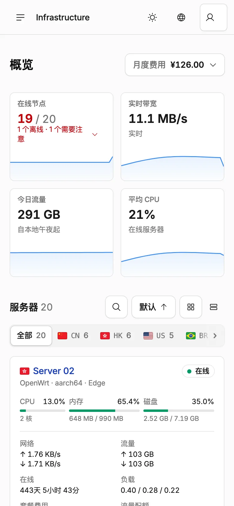
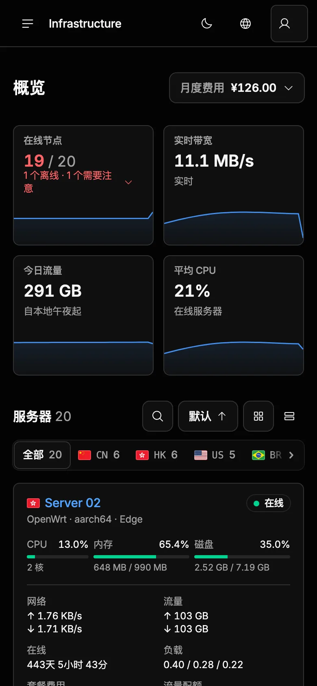

# Nezha Kumo Theme

[English](README.md) | 简体中文 | [繁體中文·台灣](README.zh-TW.md) | [繁體中文·香港](README.zh-HK.md) | [日本語](README.ja.md)

基于 Cloudflare [Kumo](https://github.com/cloudflare/kumo) 设计系统构建的响应式[哪吒监控](https://github.com/nezhahq/nezha)主题，包含公开状态前台与管理后台。

支持 English、简体中文、繁体中文（台湾与香港）和日本語，访客可在**浅色**、**深色**与**跟随系统**之间切换外观。公开前台提供实时状态监控、流量计费方式标识与**今日流量**汇总，并内置 Web App manifest，从任意页面添加到主屏幕后均可作为以站点名称命名的独立应用打开首页。侧边栏分组图标支持单个 Emoji 或字符、内置 `vps:<slug>` 厂商图标，以及 `https://` 图片地址。

## 界面预览

| 桌面端（浅色）                                                     | 桌面端（深色）                                                    |
| ------------------------------------------------------------------ | ----------------------------------------------------------------- |
|  |  |

| 移动端（浅色）                                                                                | 移动端（深色）                                                                               |
| --------------------------------------------------------------------------------------------- | -------------------------------------------------------------------------------------------- |
|  |  |

| 节点详情页                                             | 管理后台服务器列表                                               |
| ------------------------------------------------------ | ---------------------------------------------------------------- |
|  |  |

| 结构化公开备注编辑器                                                     |
| ------------------------------------------------------------------------ |
|  |

## 兼容版本

- **兼容范围**：[哪吒监控](https://github.com/nezhahq/nezha) **v2.6.0 及以上**（面板自 `v2.6.0` 起内置「前端管理」功能）。
- **已验证版本**：已在 **Nezha v2.6.1** 上完成测试与验证。

## 安装方式（推荐 — Nezha v2.6.0+ 前端管理）

> [!IMPORTANT]
>
> 1. 替换**管理后台前端**前，请先安装并验证**用户前端**。
> 2. 启用第三方**管理后台前端**前，请提前复制并保存下方的[回滚方法](#回滚方法)，同时准备好个人访问令牌（PAT）或服务器终端权限，以便在自定义后台异常时随时恢复内置后台。

打开哪吒面板后台，进入**设置 → 前端管理**（Kumo 管理后台中位于侧边栏**系统 → 前端管理**）：

| 前端类型         | GitHub 仓库地址                             | 资源基路径    | Release 附件 |
| ---------------- | ------------------------------------------- | ------------- | ------------ |
| **用户前端**     | `https://github.com/zhdsmy/nezha-kumo-theme` | `/`           | `dist.zip`   |
| **管理后台前端** | `https://github.com/zhdsmy/nezha-kumo-admin` | `/dashboard/` | `dist.zip`   |

1. 将**前端类型**设为**用户前端**，填写 `https://github.com/zhdsmy/nezha-kumo-theme`，点击**读取发布版本**，选择目标版本（例如 `v1.0.0`）点击**安装**，完成后点击**启用**。
2. 打开公开状态页（`/`），确认前台显示正常。
3. 将**前端类型**切换为**管理后台前端**，填写 `https://github.com/zhdsmy/nezha-kumo-admin`（随本仓库同名标签同步发布的后台构建产物镜像仓库），点击**读取发布版本**，安装相同版本号后点击**启用**。

每个发布版本的 `dist.zip` 内容均位于 `dist/` 目录下且包含非空的 `dist/index.html`，符合哪吒面板限制（`dist.zip` ≤ 64 MiB、解压后 ≤ 256 MiB、条目数 ≤ 10,000、无符号链接或重复路径）。

## 手动安装

适用于未内置「前端管理」功能的面板，或自行挂载静态目录的容器/宿主机部署：

1. 用户前台前往 [GitHub Releases](https://github.com/zhdsmy/nezha-kumo-theme/releases)，管理后台前往 [`zhdsmy/nezha-kumo-admin` Releases](https://github.com/zhdsmy/nezha-kumo-admin/releases)，下载 `dist.zip` 与 `dist.zip.sha256` 并校验 SHA-256 哈希值。
2. 将压缩包内的 `dist/` 解压到哪吒面板进程或容器可读取的目录（例如 `data/kumo-user` 或 `data/kumo-admin`）。
3. _（可选，仅用户前台）_ 将 [`apps/frontend/public/config.js`](apps/frontend/public/config.js) 复制到解压后的 `index.html` 同级目录，按需配置 `window.NezhaKumoConfig`。`dist.zip` 自带全注释的 `config.js`，升级解压前请先备份自己的 `config.js`，解压后再放回。
4. 修改面板 `data/config.yaml` 中的 `user_template`（及/或 `admin_template`）指向解压目录，然后重启哪吒面板服务。

## 回滚方法

### 回滚管理后台

- **方式一 — 使用个人访问令牌（PAT）调用接口**：

  ```bash
  curl -X POST "https://your-panel.example.com/api/v1/frontend/activate" \
    -H "Authorization: Bearer <YOUR_PAT>" \
    -H "Content-Type: application/json" \
    -d '{"path":"admin-dist","is_admin":true}'
  ```

- **方式二 — 修改服务器上的 `config.yaml`**：
  停止哪吒面板服务或容器，将 `data/config.yaml` 中的 `admin_template` 设为 `admin-dist`，然后重新启动面板。

### 回滚用户前台

- **方式一 — 使用 PAT 调用接口**：

  ```bash
  curl -X POST "https://your-panel.example.com/api/v1/frontend/activate" \
    -H "Authorization: Bearer <YOUR_PAT>" \
    -H "Content-Type: application/json" \
    -d '{"path":"user-dist","is_admin":false}'
  ```

- **方式二 — 修改服务器上的 `config.yaml`**：
  停止哪吒面板服务或容器，将 `data/config.yaml` 中的 `user_template` 设为 `user-dist`，然后重新启动面板（也可直接在后台**前端管理**页面切回内置版本）。

## 升级与清理旧版本

1. 进入**系统 → 前端管理**（或原版后台的**设置 → 前端管理**），重新读取 `https://github.com/zhdsmy/nezha-kumo-theme`（及 `https://github.com/zhdsmy/nezha-kumo-admin`）的发布版本，点击**安装**新版本并**启用**。
2. 哪吒会在磁盘上保留已安装的历史前端版本以便随时回滚；确认新版本运行正常后，可在**前端管理**页面对未启用的旧版本点击**删除**以释放磁盘空间。
3. 手动部署升级时，将新版本的 `dist.zip` 解压覆盖模板目录（保留 `index.html` 同级的 `config.js`），并删除不再使用的旧版本目录。

## 配置说明

### 两种配置入口

前台支持以下两种配置方式，二者可同时使用：

1. **面板自定义代码（推荐前端管理安装方式使用）**
   在后台**系统 → 系统设置**（原版后台为**设置 → 系统设置**）的**自定义代码（样式和脚本）**（用户前台 `custom_code`）中添加 `id="nezha-kumo-config"` 的 JSON `<script>` 块：

   ```html
   <script type="application/json" id="nezha-kumo-config">
     {
       "siteTitle": "Infrastructure",
       "defaultAppearance": "system",
       "defaultLanguage": "auto",
       "showCost": true
     }
   </script>
   ```

   该标签声明为 `type="application/json"`，前台仅将其作为 JSON 数据解析，不会作为 JavaScript 执行。

2. **`config.js`（`window.NezhaKumoConfig`，适合手动部署）**
   在解压目录的 `index.html` 同级放置 `config.js`：

   ```js
   window.NezhaKumoConfig = {
     siteTitle: "Infrastructure",
     showCost: true,
   };
   ```

   - 当 `<script id="nezha-kumo-config">` 与 `config.js` 同时存在时，按字段逐项合并，**`config.js` 优先级更高**。
   - 未放置 `config.js` 时，前台正常使用面板 JSON 配置或内置默认值。`dist.zip` 自带一份全注释的 `config.js`，只有主动删除该文件时浏览器控制台才会记录一条 404。

### 配置项一览

所有字段均为可选，定义与默认值见 [`apps/frontend/src/core/settings.ts`](apps/frontend/src/core/settings.ts)：

| 配置键              | 类型                                                       | 默认值     | 说明                                                                                     |
| ------------------- | ---------------------------------------------------------- | ---------- | ---------------------------------------------------------------------------------------- |
| `defaultAppearance` | `"system" \| "light" \| "dark"`                            | `"system"` | 访客手动切换前的初始外观模式（本地存储键 `nkt:appearance`）。                            |
| `defaultLanguage`   | `"auto" \| "en" \| "zh-CN" \| "zh-HK" \| "zh-TW" \| "ja"` | `"auto"`   | 访客手动选择前的初始界面语言（`nkt:language`）；`"auto"` 优先采用面板语言，其次浏览器语言。 |
| `siteTitle`         | `string`                                                   | `""`       | 侧边栏与 `<title>` 中的自定义站点标题；为空时回退使用面板 `site_name`（或 `"Nezha"`）。  |
| `showOverview`      | `boolean`                                                  | `true`     | 是否在首页顶部显示概览指标卡片。                                                         |
| `showCost`          | `boolean`                                                  | `true`     | 是否在首页显示周期费用汇总菜单（**月度费用** / **年度费用**）并启用多币种汇率换算。      |
| `showRegions`       | `boolean`                                                  | `true`     | 是否在服务器列表上方显示地区国旗筛选栏。                                                 |
| `showGroups`        | `boolean`                                                  | `true`     | 是否在侧边栏显示**分组**导航并启用按分组筛选。                                           |
| `showBilling`       | `boolean`                                                  | `true`     | 是否显示从 `public_note` 解析的套餐费用、计费周期、到期时间与流量配额信息。              |
| `showOffline`       | `boolean`                                                  | `true`     | 是否在公开服务器列表中包含离线服务器（设为 `false` 时隐藏离线服务器）。                  |
| `hiddenNodes`       | `string[]`                                                 | `[]`       | 在公开前台隐藏的服务器 ID 或完整服务器名称（也支持以逗号或换行分隔的 `string`）。        |
| `hideAdminEntry`    | `boolean`                                                  | `false`    | 是否隐藏顶部栏的**登录** / **管理后台**入口按钮。                                        |
| `footerNote`        | `string`                                                   | `""`       | 页脚版权与致谢下方另起一行显示的纯文本说明。                                             |

### 分组图标配置（`nezha-kumo-group-icons`）

侧边栏服务器分组的自定义图标保存在用户前台**自定义代码（样式和脚本）**（`custom_code`）中，使用 `id="nezha-kumo-group-icons"` 的 JSON `<script>` 块（见 [`packages/shared/group-icons.ts`](packages/shared/group-icons.ts)）：

```html
<script type="application/json" id="nezha-kumo-group-icons">
  { "1": "vps:aws", "2": "vps:azure", "3": "🗄️", "4": "https://cdn.example.com/icons/storage.svg" }
</script>
```

- **键**：哪吒服务器分组 ID 字符串（如 `"1"`、`"2"`）。
- **值**：内置 **vps-icons v1.4.0** 目录中的 `vps:<slug>` 图标（共 263 套浅色/深色厂商图标）、单个字素（适配侧边栏 `16px` 图标槽位的 1 个 Emoji 或字符），或 `https://` 图片地址。VPS `slug` 必须存在于内置图标目录中。
- **可视化编辑**：在 Kumo 管理后台（`zhdsmy/nezha-kumo-admin`）的**服务器分组**页面打开**创建服务器分组**或**编辑服务器分组**弹窗，可通过**选择 VPS 图标**搜索厂商英文名、中文名、slug、别名或常见简称，也可直接输入或清空图标；保存时只会更新 `custom_code` 中的该 `<script>` 块，不影响其他自定义代码。

## 公开备注与账单 / 套餐字段

服务器账单与套餐元数据保存在哪吒的 `public_note` JSON 字段中，兼容 **[nezhainfojson](https://plane.2233444.xyz/)** 生成器（以及 `nezha-dash`、`Nazhua` 方言）。Kumo 管理后台内置了结构化**公开备注**编辑器，保存时会保留未知 JSON 字段。

```json
{
  "billingDataMod": {
    "startDate": "2026-05-01T00:00:00+08:00",
    "endDate": "2027-05-01T00:00:00+08:00",
    "autoRenewal": "1",
    "cycle": "Year",
    "amount": "USD 48.00"
  },
  "planDataMod": {
    "bandwidth": "1Gbps",
    "trafficVol": "2TB/Month",
    "trafficType": "2",
    "IPv4": "1",
    "IPv6": "1",
    "networkRoute": "IIJ,BBTEC",
    "extra": "NVMe,Anycast"
  }
}
```

### `billingDataMod` 账单字段

| 字段          | 示例                          | 说明                                                                                                                                            |
| ------------- | ----------------------------- | ----------------------------------------------------------------------------------------------------------------------------------------------- |
| `startDate`   | `"2026-05-01T00:00:00+08:00"` | 计费开始时间（ISO 8601）。                                                                                                                      |
| `endDate`     | `"2027-05-01T00:00:00+08:00"` | 到期时间；长期有效服务器可填 `"0000-00-00T23:59:59+08:00"`。                                                                                    |
| `autoRenewal` | `"1"` / `"0"`                 | `"1"` 启用自动续费，`"0"` 关闭自动续费。                                                                                                        |
| `cycle`       | `"Year"`                      | 计费周期（支持 `Day`、`Week`、`Month`、`Quarter`、`Half`、`Year`、`2Year` 等形式，以及中文/日文周期别名）。                                     |
| `amount`      | `"USD 48.00"`                 | 带 ISO 货币代码或符号的价格（如 `"USD 48.00"`、`"CNY 300.00"`、`"€9.50"`；`"0"` / `"Free"` 表示免费，`"-1"` 表示按量计费），可选 `/Cycle` 后缀。 |

### `planDataMod` 套餐字段

| 字段           | 示例                    | 说明                                                       |
| -------------- | ----------------------- | ---------------------------------------------------------- |
| `bandwidth`    | `"1Gbps"`               | 端口带宽（`Mbps`、`Gbps` 或 `"Unlimited"`）。              |
| `trafficVol`   | `"2TB/Month"`           | 流量配额及可选重置周期（`GB`、`TB` 或 `"Unlimited"`）。    |
| `trafficType`  | `"1"` \| `"2"` \| `"3"` | 流量计费方式（取值见下文）。                               |
| `IPv4`         | `"1"` / `"0"`           | `"1"` 表示有 IPv4，`"0"` 表示无。                          |
| `IPv6`         | `"1"` / `"0"`           | `"1"` 表示有 IPv6，`"0"` 表示无。                          |
| `networkRoute` | `"IIJ,BBTEC"`           | 逗号分隔的网络线路标签。                                   |
| `extra`        | `"NVMe,Anycast"`        | 逗号分隔的硬件或套餐标签。                                 |

#### `trafficType` 取值说明

- `"1"` — **仅出站**（`out`）：仅将上传流量（`net_out_transfer`）计入 `trafficVol`。
- `"2"` — **双向**（`sum`）：将上传与下载流量之和（`net_out_transfer + net_in_transfer`）计入 `trafficVol`。
- `"3"` — **取较大**（`max`，省略时的默认值）：取上传与下载中的较大值（`max(net_out_transfer, net_in_transfer)`）计入 `trafficVol`。

### 私有备注实际续费价格（`note`）

管理员可在哪吒服务器的私有 **`note`** 字段（或通过 Kumo 管理后台的**私有备注**编辑器）记录实际续费开销。未登录访客仅看到公开备注价格（或无价格），已登录会话则会在首页费用汇总及节点详情的**实际成本**中按实际续费金额计算：

```json
{
  "billingDataMod": {
    "actualAmount": "CNY 300.00/Year"
  }
}
```

`billingDataMod.actualAmount` 需包含货币代码或符号，并支持可选的 `/Cycle` 后缀（例如 `"CNY 300.00/Year"` 或 `"USD 25.00/Quarter"`）；省略周期后缀时默认沿用 `public_note` 中的 `billingDataMod.cycle`。

## 隐私说明

- **汇率接口请求**：当 `showCost` 为 `true`（默认）时，访客浏览器会向 `https://api.frankfurter.dev/v2/rates?base=USD` 发起不携带凭据的 `GET` 请求用于多币种换算，并将结果在 `localStorage`（`nkt:exchange-rates`）中缓存 **24 小时**。
- **关闭外部请求**：在 `nezha-kumo-config` 或 `config.js` 中设置 `"showCost": false`，即可关闭费用汇总且不再向 `api.frankfurter.dev` 发起任何请求。
- **本地静态资源**：Inter 字体（`@fontsource-variable/inter`）、SVG 国旗图标（`flag-icons`）与 VPS 厂商图标均随发布包本地打包，不依赖第三方字体或图标 CDN。

## 本地开发与贡献

环境要求：**Node.js 22+** 与 **pnpm**（`corepack enable`）。

```bash
pnpm install          # 安装工作区依赖
pnpm check            # 运行全仓类型检查、测试与生产构建
pnpm typecheck        # 全仓类型检查
pnpm test             # 运行单元测试与 Playwright E2E 测试
pnpm build            # 构建前台与后台产物
```

### Mock E2E 测试与开发工作流

- **公开前台**（[`apps/frontend`](apps/frontend/README.md)）：`pnpm --filter frontend test:e2e` 基于确定性的 HTTP 与 WebSocket Mock（`apps/frontend/tests/mock.ts`）运行 Playwright 端到端测试，无需连接真实哪吒面板。
- **管理后台**（[`apps/admin`](apps/admin/README.md)）：`pnpm --filter nezha-kumo-admin test` 运行 Vitest 组件与单元测试；`apps/admin/tests/e2e/` 下的 Playwright E2E 用例基于路由拦截 Mock（`/api/v1/*`）或本地测试后端运行。
- **README 截图**：`NKT_DOCS_LANG=en node docs/capture-screenshots.mjs` 生成英文截图，指定 `zh-CN`、`zh-TW`、`zh-HK` 或 `ja` 可生成对应语言截图，完成后运行 `node docs/check-links.mjs` 校验链接。

### 目录结构

```text
.
├── apps/
│   ├── frontend/      # 公开状态前台（基路径：/）
│   └── admin/         # 重新设计的哪吒管理后台（基路径：/dashboard/）
├── packages/
│   ├── ui/            # 共用 AppShell、Page、断点和外壳 CSS 契约
│   └── shared/        # 共用公开备注解析/写入器和分组图标工具
└── docs/
    ├── screenshots/   # Mock WebP 截图
    ├── capture-screenshots.mjs
    └── check-links.mjs
```

参与代码贡献前请阅读 [CONTRIBUTING.md](CONTRIBUTING.md)（含提交规范与共用外壳布局规则），安全漏洞请按 [SECURITY.md](SECURITY.md) 私密上报。

## 致谢与许可证

- 界面组件与设计令牌基于 [`@cloudflare/kumo`](https://github.com/cloudflare/kumo)（MIT）。本项目为独立社区主题，与 Cloudflare, Inc. **无隶属或背书关系**。
- 面向[哪吒监控](https://github.com/nezhahq/nezha)构建，部分实现与资源源自 [`nezhahq/admin-frontend`](https://github.com/nezhahq/admin-frontend)、[`foru17/zool-theme`](https://github.com/foru17/zool-theme)、[`lipis/flag-icons`](https://github.com/lipis/flag-icons) 及 [Inter](https://github.com/rsms/inter)，完整第三方声明（含 vps-icons v1.4.0）见 [NOTICE.md](NOTICE.md)。
- 本项目采用 [MIT License](LICENSE) 开源许可证发布。
