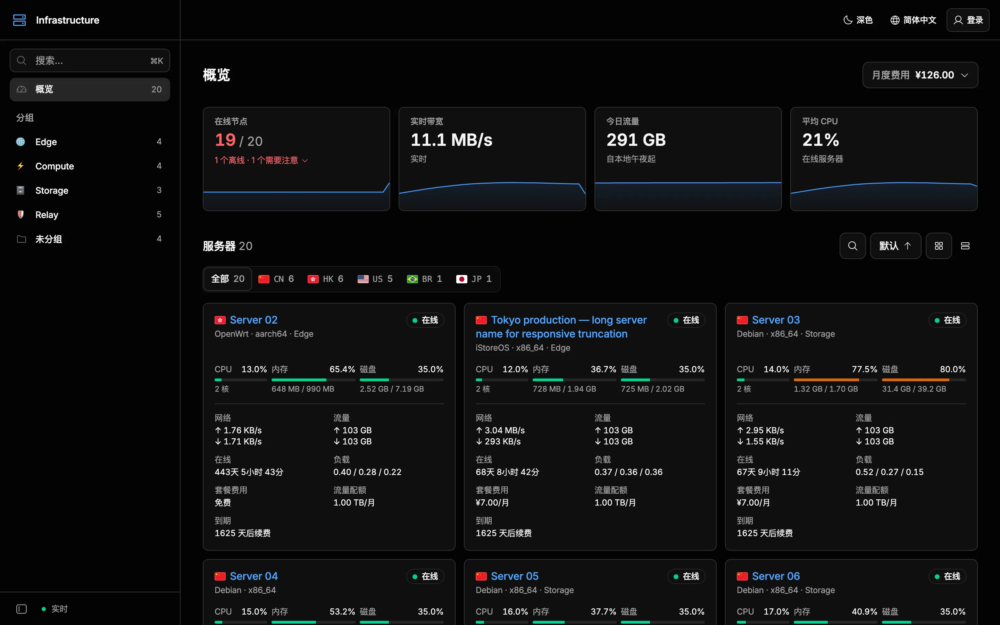
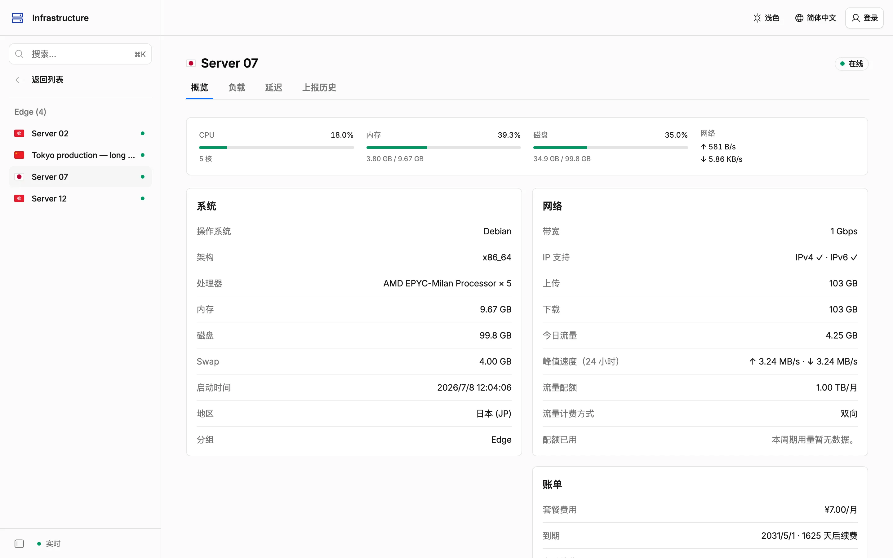
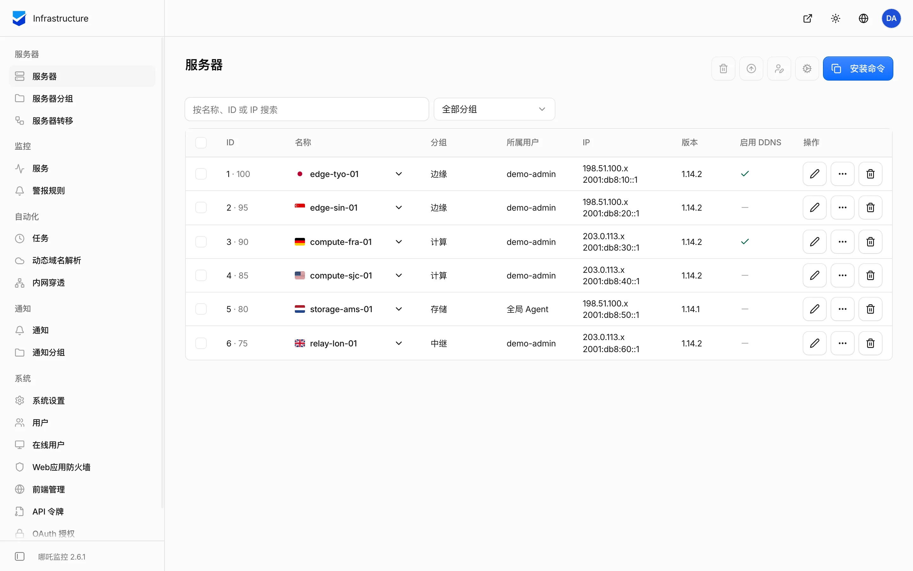

# Nezha Kumo Theme（简体中文）

[English](README.md) | 简体中文

基于 Cloudflare [Kumo](https://github.com/cloudflare/kumo) 设计系统视觉语言构建的响应式哪吒监控（Nezha Monitoring）主题，包含公开状态前台与管理后台。

## 界面预览

| 桌面端（浅色）                                              | 桌面端（深色）                                             |
| ----------------------------------------------------------- | ---------------------------------------------------------- |
|  |  |

| 移动端（浅色）                                                                         | 移动端（深色）                                                                        |
| -------------------------------------------------------------------------------------- | ------------------------------------------------------------------------------------- |
|  |  |

| 节点详情页                                       | 管理后台服务器列表                                         |
| ------------------------------------------------ | ---------------------------------------------------------- |
|  |  |

| 结构化公开备注编辑器                                       |
| ---------------------------------------------------------- |
|  |

## 兼容版本

- **兼容范围**：[Nezha Monitoring](https://github.com/nezhahq/nezha) **v2.6.0 及以上**（面板内置「前端管理」功能自 `v2.6.0` 起提供）。
- **已验证版本**：已在 **Nezha v2.6.1** 上完成验证。

## 安装方式（推荐 — Nezha v2.6.0+ 前端管理）

> [!IMPORTANT]
>
> 1. 请**先安装并验证用户前台**，确认无误后再切换管理后台。
> 2. 在切换**管理后台**之前，请务必提前保存下方的[回滚方法](#回滚方法)（并准备好个人访问令牌 PAT 或服务器终端权限），以便在后台异常时随时恢复默认后台。

进入哪吒面板后台，打开 **设置 → 前端管理**（`Settings → Frontends`）：

| 目标         | GitHub 仓库地址                                                           | 资源基路径    | Release 附件 |
| ------------ | ------------------------------------------------------------------------- | ------------- | ------------ |
| **用户前台** | `zhdsmy/nezha-kumo-theme`（`https://github.com/zhdsmy/nezha-kumo-theme`） | `/`           | `dist.zip`   |
| **管理后台** | `zhdsmy/nezha-kumo-admin`（`https://github.com/zhdsmy/nezha-kumo-admin`） | `/dashboard/` | `dist.zip`   |

1. 在**用户前台**处填写本仓库 `zhdsmy/nezha-kumo-theme`，加载版本列表，安装目标版本（如 `v0.1.0`）并点击**启用**。
2. 打开公开状态页（`/`）确认前台显示正常。
3. 在**管理后台**处填写 `zhdsmy/nezha-kumo-admin`（仅用于发布管理后台 Release 产物的镜像仓库，版本号与本仓库一致），安装对应版本并点击**启用**。

每个 Release 均提供 `dist.zip`，压缩包内所有文件位于 `dist/` 目录下且包含非空的 `dist/index.html`，符合哪吒面板限制（`dist.zip` ≤ 64 MiB、解压后 ≤ 256 MiB、条目数 ≤ 10,000、无符号链接与重复路径）。

## 手动安装

适用于未内置「前端管理」功能的面板，或需要自行挂载静态目录的部署环境：

1. 前往 [GitHub Releases](https://github.com/zhdsmy/nezha-kumo-theme/releases)（用户前台）或 [`zhdsmy/nezha-kumo-admin` Releases](https://github.com/zhdsmy/nezha-kumo-admin/releases)（管理后台）下载 `dist.zip` 与对应的 `.sha256` 校验文件并核对哈希值。
2. 将压缩包中的 `dist/` 解压到面板进程/容器可读取的目录（例如 `data/kumo-user` 或 `data/kumo-admin`）。
3. _（可选，仅用户前台）_ 将 [`apps/frontend/public/config.js`](apps/frontend/public/config.js) 复制到解压后的 `index.html` 同级目录，按需修改 `window.NezhaKumoConfig`。`dist.zip` 自带一份全部注释掉的 `config.js`，手动升级解压前请先备份自己的 `config.js`，解压后再放回。
4. 修改面板 `data/config.yaml` 中的 `user_template`（及/或 `admin_template`）指向解压后的目录，重启哪吒面板服务。

## 回滚方法

### 回滚管理后台

- **方式一 — 使用 PAT 调用接口**：

  ```bash
  curl -X POST "https://your-panel.example.com/api/v1/frontend/activate" \
    -H "Authorization: Bearer <YOUR_PAT>" \
    -H "Content-Type: application/json" \
    -d '{"path":"admin-dist","is_admin":true}'
  ```

- **方式二 — 修改服务器 `config.yaml`**：
  停止哪吒面板服务/容器，将 `data/config.yaml` 中的 `admin_template` 改回 `admin-dist`，然后重新启动面板。

### 回滚用户前台

- **方式一 — 使用 PAT 调用接口**：

  ```bash
  curl -X POST "https://your-panel.example.com/api/v1/frontend/activate" \
    -H "Authorization: Bearer <YOUR_PAT>" \
    -H "Content-Type: application/json" \
    -d '{"path":"user-dist","is_admin":false}'
  ```

- **方式二 — 修改服务器 `config.yaml`**：
  停止哪吒面板服务/容器，将 `data/config.yaml` 中的 `user_template` 改回 `user-dist`，然后重新启动面板（也可直接在后台「设置 → 前端管理」页面切回默认前台）。

## 升级与清理旧版本

1. 在 **设置 → 前端管理** 页面刷新 `zhdsmy/nezha-kumo-theme`（及 `zhdsmy/nezha-kumo-admin`）的 Release 列表，安装新版本并点击**启用**。
2. 哪吒前端管理默认保留历史版本以便回滚；确认新版本运行正常后，可在「前端管理」列表中删除未启用的旧版本以释放磁盘空间。
3. 手动部署用户在升级时直接用新版本 `dist/` 替换模板目录内容（保留 `index.html` 同级的 `config.js`），随后清理不再使用的旧目录即可。

## 配置说明

### 两种配置入口

前台支持以下两种配置入口，二者可同时存在：

1. **面板「自定义代码」（推荐前端管理安装用户使用）**
   在面板 **设置 → 系统设置 → 自定义代码**（用户前台 `custom_code`）中添加 `id="nezha-kumo-config"` 的 JSON 块：

   ```html
   <script type="application/json" id="nezha-kumo-config">
     {
       "siteTitle": "Infrastructure",
       "defaultAppearance": "system",
       "defaultLanguage": "auto",
       "showCost": true
     }
   </script>
   ```

   该标签声明为 `type="application/json"`，前台仅将其作为 JSON 数据解析，**不会**当作脚本执行。

2. **`config.js`（`window.NezhaKumoConfig`，适合手动部署用户）**
   在解压目录的 `index.html` 同级放置 `config.js`：

   ```js
   window.NezhaKumoConfig = {
     siteTitle: "Infrastructure",
     showCost: true,
   };
   ```

   - 当两种入口同时存在时，按字段逐键合并，**`config.js` 优先级更高**。
   - 未提供 `config.js` 时，前台使用自定义代码块配置或默认配置，页面不受影响。浏览器控制台会记录一条该文件的 404。`dist.zip` 自带一份注释掉的 `config.js`，只有删掉它才会出现这条记录。

### 配置项一览

所有字段均为可选，定义与默认值以 [`apps/frontend/src/core/settings.ts`](apps/frontend/src/core/settings.ts) 为准：

| 配置键              | 类型                                           | 默认值     | 说明                                                                             |
| ------------------- | ---------------------------------------------- | ---------- | -------------------------------------------------------------------------------- |
| `defaultAppearance` | `"system" \| "light" \| "dark"`                | `"system"` | 访客未手动切换外观时的默认配色模式（本地存储键 `nkt:appearance`）。              |
| `defaultLanguage`   | `"auto" \| "en" \| "zh-CN" \| "zh-HK" \| "zh-TW" \| "ja"` | `"auto"`   | 默认界面语言（`"auto"` 自动跟随浏览器或面板语言）。                              |
| `siteTitle`         | `string`                                       | `""`       | 自定义左上角与页面标题；为空时回退使用面板 `site_name`（或 `"Nezha"`）。         |
| `showOverview`      | `boolean`                                      | `true`     | 是否在首页顶部展示概览统计卡片。                                                 |
| `showCost`          | `boolean`                                      | `true`     | 是否在首页展示费用汇总菜单并启用多币种汇率换算。                                 |
| `showRegions`       | `boolean`                                      | `true`     | 是否在服务器列表上方展示地区国旗筛选栏。                                         |
| `showGroups`        | `boolean`                                      | `true`     | 是否在侧边栏提供服务器分组导航并在首页按分组展示。                               |
| `showBilling`       | `boolean`                                      | `true`     | 是否展示公开备注（`public_note`）中的价格、周期、到期时间与流量配额信息。        |
| `showOffline`       | `boolean`                                      | `true`     | 是否在公开列表中显示离线节点（设为 `false` 时隐藏离线节点）。                    |
| `hiddenNodes`       | `string[]`                                     | `[]`       | 在公开前台隐藏的服务器 ID 或完整服务器名称列表（也支持逗号或换行分隔的字符串）。 |
| `hideAdminEntry`    | `boolean`                                      | `false`    | 是否隐藏顶部栏的登录 / 管理后台入口按钮。                                        |
| `footerNote`        | `string`                                       | `""`       | 页脚附加纯文本说明。                                                             |

### 分组图标配置（`nezha-kumo-group-icons`）

侧边栏服务器分组图标保存在用户前台「自定义代码」（`custom_code`）中，使用 `id="nezha-kumo-group-icons"` 的 JSON 块（格式定义见 [`packages/shared/group-icons.ts`](packages/shared/group-icons.ts)）：

```html
<script type="application/json" id="nezha-kumo-group-icons">
  { "1": "🌐", "2": "⚡", "3": "https://cdn.example.com/icons/storage.svg" }
</script>
```

- **键（Key）**：哪吒服务器分组 ID 字符串（如 `"1"`、`"2"`）。
- **值（Value）**：**单个字素**（1 个 Emoji 或单个字符，适配侧边栏 `16px` 图标槽位），或以 **`https://` 开头的图片 URL**（含空白字符或非 HTTPS 协议的值会被忽略）。
- **可视化编辑**：使用配套的 Kumo 管理后台时，可直接在「服务器分组」新建/编辑弹窗中配置图标，保存时只会更新 `custom_code` 中的 `<script id="nezha-kumo-group-icons">` 块，不影响其他自定义代码。

## 公开备注与账单 / 套餐字段

账单与套餐信息存放在服务器的公开备注（`public_note`）JSON 中，完全兼容 **[nezhainfojson](https://plane.2233444.xyz/)** 生成器（以及 `nezha-dash`、`Nazhua` 方言），也可直接使用 Kumo 管理后台内置的**公开备注结构化编辑器**填写（保存时会保留未知顶层 JSON 字段）。

```json
{
  "billingDataMod": {
    "startDate": "2026-05-01T00:00:00+08:00",
    "endDate": "2027-05-01T00:00:00+08:00",
    "autoRenewal": "1",
    "cycle": "Year",
    "amount": "USD 48.00"
  },
  "planDataMod": {
    "bandwidth": "1Gbps",
    "trafficVol": "2TB/Month",
    "trafficType": "2",
    "IPv4": "1",
    "IPv6": "1",
    "networkRoute": "IIJ,BBTEC",
    "extra": "NVMe,Anycast"
  }
}
```

### `billingDataMod` 账单字段

| 字段          | 示例                          | 说明                                                                                                                                             |
| ------------- | ----------------------------- | ------------------------------------------------------------------------------------------------------------------------------------------------ |
| `startDate`   | `"2026-05-01T00:00:00+08:00"` | 计费开始时间（ISO 8601）。                                                                                                                       |
| `endDate`     | `"2027-05-01T00:00:00+08:00"` | 到期时间；长期有效可填 `"0000-00-00T23:59:59+08:00"`。                                                                                           |
| `autoRenewal` | `"1"` / `"0"`                 | `"1"` 表示自动续费，`"0"` 表示不自动续费。                                                                                                       |
| `cycle`       | `"Year"`                      | 计费周期（支持 `Day`、`Week`、`Month`、`Quarter`、`Half`、`Year`、`2Year` 等及中/日文别名如 `月`、`季`、`半年`、`年`）。                         |
| `amount`      | `"USD 48.00"`                 | 账单金额与币种代码或符号（如 `"USD 48.00"`、`"CNY 300.00"`、`"€9.50"`；`"0"` / `"免费"` 表示免费，`"-1"` 表示按量计费），可选附带 `/周期` 后缀。 |

### `planDataMod` 套餐字段

| 字段           | 示例                    | 说明                                                                    |
| -------------- | ----------------------- | ----------------------------------------------------------------------- |
| `bandwidth`    | `"1Gbps"`               | 端口带宽（支持 `Mbps`、`Gbps` 或 `"Unlimited"` / `"不限"`）。           |
| `trafficVol`   | `"2TB/Month"`           | 流量配额与可选重置周期（支持 `GB`、`TB` 或 `"Unlimited"` / `"无限"`）。 |
| `trafficType`  | `"1"` \| `"2"` \| `"3"` | 流量计费方向（含义见下）。                                              |
| `IPv4`         | `"1"` / `"0"`           | `"1"` 表示具备 IPv4，`"0"` 表示无。                                     |
| `IPv6`         | `"1"` / `"0"`           | `"1"` 表示具备 IPv6，`"0"` 表示无。                                     |
| `networkRoute` | `"IIJ,BBTEC"`           | 线路标签，多个标签用英文或中文逗号分隔。                                |
| `extra`        | `"NVMe,Anycast"`        | 硬件或附加特性标签，逗号分隔。                                          |

#### `trafficType` 取值说明

- `"1"` — **仅单向出站**（`out`）：仅统计上传流量（`net_out_transfer`）。
- `"2"` — **双向合计**（`sum`）：上传与下载流量相加（`net_out_transfer + net_in_transfer`）。
- `"3"` — **取较大方向**（`max`，未填写时的默认值）：按上传与下载中的较大值计入配额（`max(net_out_transfer, net_in_transfer)`）。

### 私有备注实际续费价格（`note`）

管理员可在服务器的私有备注（`note`）中写入 `billingDataMod.actualAmount`；未登录访客仅能看到公开备注价格，而管理员登录后首页费用汇总会优先按实际续费金额折算：

```json
{
  "billingDataMod": {
    "actualAmount": "CNY 300.00/Year"
  }
}
```

`billingDataMod.actualAmount` 支持附带可选周期后缀（例如 `"CNY 300.00/Year"` 或 `"USD 25.00/Quarter"`）；省略周期时默认沿用公开备注中的 `billingDataMod.cycle`。

## 隐私说明

- **汇率接口请求**：当 `showCost` 为 `true`（默认）时，访客浏览器会向 `https://api.frankfurter.dev/v2/rates?base=USD` 发起不携带凭据的请求以换算多币种费用，并在浏览器 `localStorage`（`nkt:exchange-rates`）中缓存 **24 小时**。
- **关闭第三方请求**：将配置中的 `showCost` 设为 `false` 即可完全关闭费用汇总与 `api.frankfurter.dev` 请求。
- **本地静态资源**：Inter 字体（`@fontsource-variable/inter`）与国旗图标（`flag-icons`）均随发布包本地打包，不请求外部字体或图标 CDN。

## 本地开发与贡献

环境要求：**Node.js 22+** 与 **pnpm**（`corepack enable`）。

```bash
pnpm install          # 安装工作区依赖
pnpm check            # 运行全仓类型检查、测试与生产构建
pnpm typecheck        # 全仓类型检查
pnpm test             # 运行单元测试与 Playwright E2E 测试
pnpm build            # 构建前台与后台产物
```

- **Mock E2E 测试**：公开前台（[`apps/frontend`](apps/frontend/README.md)）通过 `pnpm --filter frontend test:e2e` 使用内置 HTTP/WebSocket Mock（`apps/frontend/tests/mock.ts`）完成端到端测试，无需连接真实面板；管理后台（[`apps/admin`](apps/admin/README.md)）提供 Vitest 单测与基于路由拦截 Mock 的 Playwright 用例。
- **目录结构**：
  - [`apps/frontend`](apps/frontend/README.md) — 公开状态前台（基路径 `/`）
  - [`apps/admin`](apps/admin/README.md) — 管理后台（基路径 `/dashboard/`）
  - `packages/ui` — 前后台共用的 `AppShell`、`Page`、响应式断点与外壳样式契约
  - `packages/shared` — 共用的公开备注解析/序列化器与分组图标工具
  - `docs/` — Mock 截图（`docs/screenshots/`）与链接检查脚本
- 参与代码贡献前请阅读 [CONTRIBUTING.md](CONTRIBUTING.md)（含提交规范与共用外壳规则），安全漏洞请按 [SECURITY.md](SECURITY.md) 私密上报。

## 致谢与许可证

- 界面组件与设计令牌基于 [`@cloudflare/kumo`](https://github.com/cloudflare/kumo)（MIT）。本项目为独立社区主题，与 Cloudflare, Inc. 无隶属或背书关系。
- 面向 [Nezha Monitoring](https://github.com/nezhahq/nezha) 构建，部分实现与资源源自 [`nezhahq/admin-frontend`](https://github.com/nezhahq/admin-frontend)、[`foru17/zool-theme`](https://github.com/foru17/zool-theme)、[`lipis/flag-icons`](https://github.com/lipis/flag-icons) 及 [Inter](https://github.com/rsms/inter)，完整第三方声明见 [NOTICE.md](NOTICE.md)。
- 本项目采用 [MIT License](LICENSE) 开源许可证发布。
