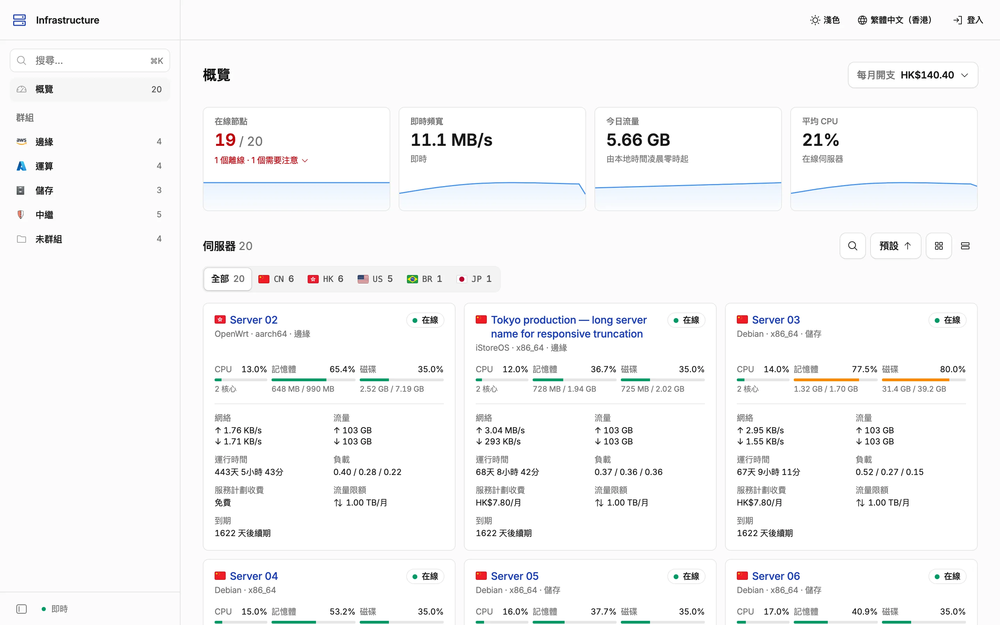
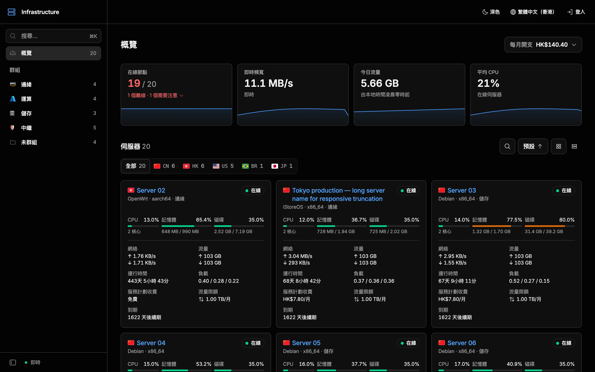
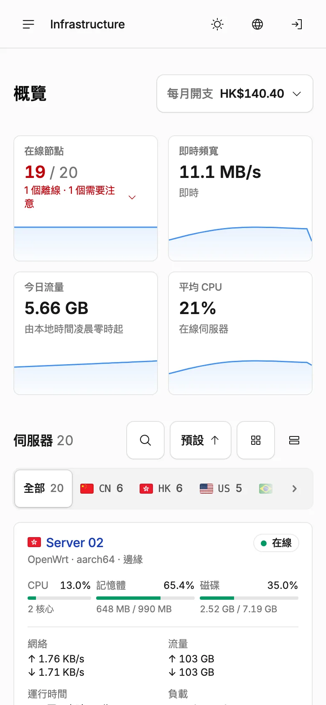
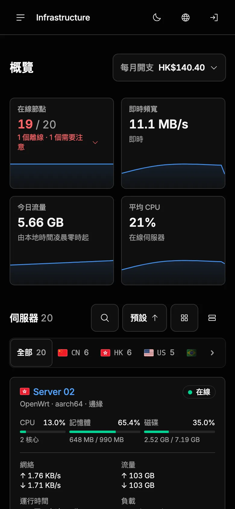
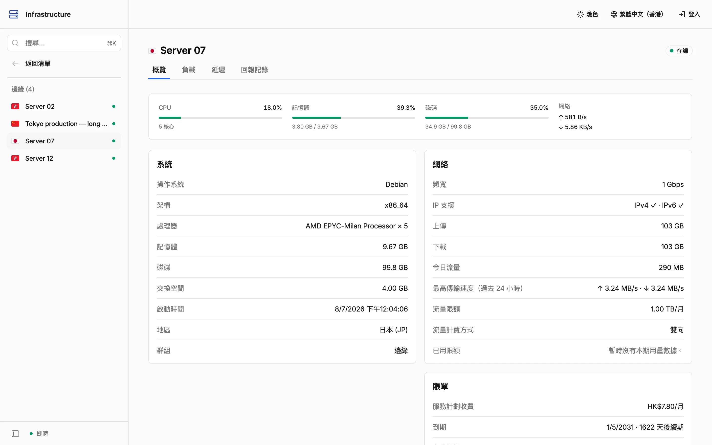
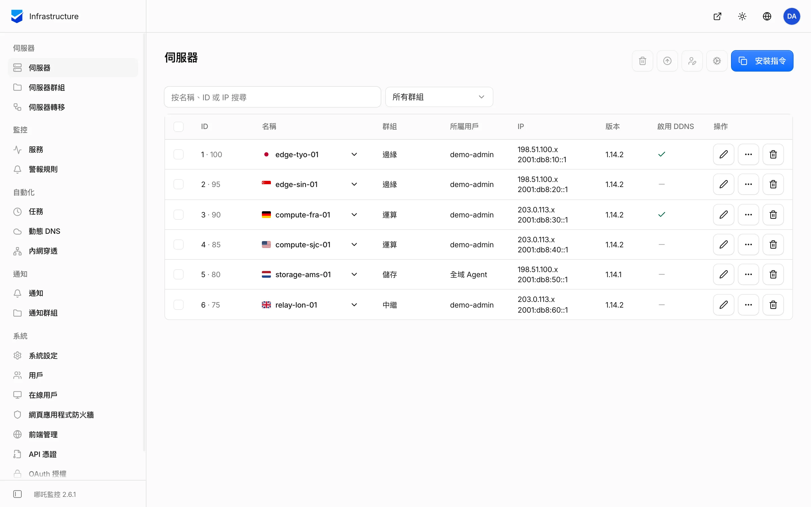
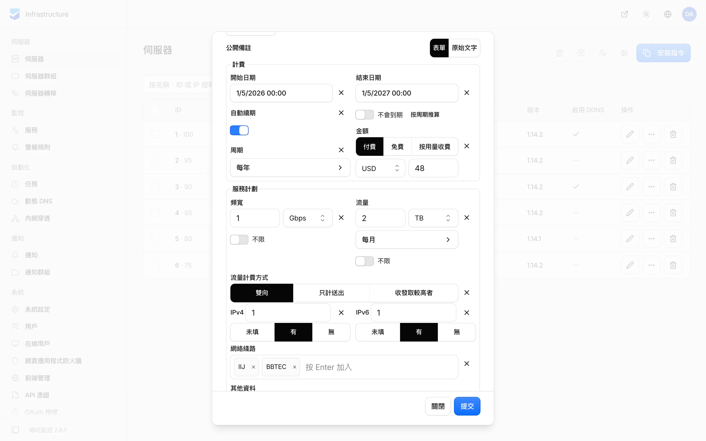

# Nezha Kumo Theme

[English](README.md) | [简体中文](README.zh-CN.md) | [繁體中文·台灣](README.zh-TW.md) | 繁體中文·香港 | [日本語](README.ja.md)

採用 Cloudflare [Kumo](https://github.com/cloudflare/kumo) 設計系統視覺風格開發的響應式[哪吒監控](https://github.com/nezhahq/nezha)主題，同時提供公開狀態前台及管理後台。

內置 English、简体中文、繁體中文（香港及台灣）與日本語介面，訪客可選用**淺色**、**深色**或**依照系統設定**顯示模式。公開前台支援即時狀態監察、流量計費方式標示及**今日流量**統計，並附帶 Web App manifest，無論從哪一頁將網站加入主畫面，開啟時均會以網站名稱作為獨立應用程式直達首頁。側邊欄群組圖示可使用單一 Emoji 或字元、內置 `vps:<slug>` 供應商圖示，或 `https://` 圖片網址。

## 介面預覽

| 桌面版（淺色）                                                     | 桌面版（深色）                                                    |
| ------------------------------------------------------------------ | ----------------------------------------------------------------- |
|  |  |

| 流動版（淺色）                                                                                | 流動版（深色）                                                                               |
| --------------------------------------------------------------------------------------------- | -------------------------------------------------------------------------------------------- |
|  |  |

| 節點詳細資料                                             | 管理後台伺服器清單                                               |
| -------------------------------------------------------- | ---------------------------------------------------------------- |
|  |  |

| 結構化公開備註編輯器                                                     |
| ------------------------------------------------------------------------ |
|  |

## 相容版本

- **支援版本**：[哪吒監控](https://github.com/nezhahq/nezha) **v2.6.0 或以上**（面板由 `v2.6.0` 起內置「前端管理」功能）。
- **已驗證版本**：已於 **Nezha v2.6.1** 完成測試及驗證。

## 安裝方法（推薦 — Nezha v2.6.0+ 前端管理）

> [!IMPORTANT]
>
> 1. 更換**管理後台**之前，請先安裝並確認**用戶前台**運作正常。
> 2. 啟用第三方**管理後台**前，請預先複製並保存下方的[還原方法](#還原方法)，同時備妥個人存取憑證（PAT）或伺服器終端機權限；萬一自訂後台未能載入，仍可隨時還原內置管理介面。

登入哪吒管理面板，進入**設定 → 前端管理**（如已啟用 Kumo 管理後台，則位於側邊欄**系統 → 前端管理**）：

| 前端類型     | GitHub 程式碼庫網址                         | 資源基路徑    | 發佈檔案   |
| ------------ | ------------------------------------------- | ------------- | ---------- |
| **用戶前台** | `https://github.com/zhdsmy/nezha-kumo-theme` | `/`           | `dist.zip` |
| **管理後台** | `https://github.com/zhdsmy/nezha-kumo-admin` | `/dashboard/` | `dist.zip` |

1. 在**前端類型**選擇**用戶前台**，輸入 `https://github.com/zhdsmy/nezha-kumo-theme`，按**讀取發佈版本**，揀選目標版本（例如 `v1.0.0`）按**安裝**，完成後按**啟用**。
2. 開啟公開狀態頁（`/`），確認版面顯示正常。
3. 將**前端類型**改為**管理後台**，輸入 `https://github.com/zhdsmy/nezha-kumo-admin`（隨本程式碼庫同名標籤同步發佈後台產物的專用鏡像程式碼庫），按**讀取發佈版本**，安裝相同版本標籤後按**啟用**。

每個發佈版本的 `dist.zip` 均將檔案置於 `dist/` 目錄下並包含非空的 `dist/index.html`，符合哪吒壓縮檔規範（`dist.zip` ≤ 64 MiB、解壓後 ≤ 256 MiB、項目數 ≤ 10,000、不含符號連結或重複路徑）。

## 手動安裝

適用於未設「前端管理」功能的面板，或自訂容器／主機目錄掛載的部署環境：

1. 用戶前台請到 [GitHub Releases](https://github.com/zhdsmy/nezha-kumo-theme/releases)，管理後台請到 [`zhdsmy/nezha-kumo-admin` Releases](https://github.com/zhdsmy/nezha-kumo-admin/releases) 下載 `dist.zip` 及 `dist.zip.sha256`，並核對 SHA-256 校驗值。
2. 將壓縮包內的 `dist/` 解壓至哪吒 Dashboard 程序或容器可讀取的目錄（例如 `data/kumo-user` 或 `data/kumo-admin`）。
3. _（選用，只限用戶前台）_ 將 [`apps/frontend/public/config.js`](apps/frontend/public/config.js) 複製到解壓後的 `index.html` 同一目錄，按需要修改 `window.NezhaKumoConfig`。由於 `dist.zip` 附有全註釋的 `config.js`，手動升級解壓前請先備份自訂的 `config.js`，解壓後再放回原位。
4. 在哪吒 `data/config.yaml` 將 `user_template`（及／或 `admin_template`）指向解壓目錄，然後重新啟動哪吒 Dashboard 服務。

## 還原方法

### 還原管理後台

- **方法 A — 以個人存取憑證（PAT）呼叫 API**：

  ```bash
  curl -X POST "https://your-panel.example.com/api/v1/frontend/activate" \
    -H "Authorization: Bearer <YOUR_PAT>" \
    -H "Content-Type: application/json" \
    -d '{"path":"admin-dist","is_admin":true}'
  ```

- **方法 B — 修改伺服器上的 `config.yaml`**：
  停止哪吒 Dashboard 服務或容器，在 `data/config.yaml` 將 `admin_template` 設回 `admin-dist`，再重新啟動面板。

### 還原用戶前台

- **方法 A — 以 PAT 呼叫 API**：

  ```bash
  curl -X POST "https://your-panel.example.com/api/v1/frontend/activate" \
    -H "Authorization: Bearer <YOUR_PAT>" \
    -H "Content-Type: application/json" \
    -d '{"path":"user-dist","is_admin":false}'
  ```

- **方法 B — 修改伺服器上的 `config.yaml`**：
  停止哪吒 Dashboard 服務或容器，在 `data/config.yaml` 將 `user_template` 設回 `user-dist`，再重新啟動面板（亦可直接於管理後台的**前端管理**頁面切回內置版本）。

## 升級及清理舊版本

1. 進入**系統 → 前端管理**（或原版後台的**設定 → 前端管理**），重新讀取 `https://github.com/zhdsmy/nezha-kumo-theme`（及 `https://github.com/zhdsmy/nezha-kumo-admin`）的發佈版本，按**安裝**新版本並**啟用**。
2. 系統會在磁碟保留過往安裝的前端版本以便即時還原；確認新版本運作正常後，可在**前端管理**頁面將未啟用的舊版本按**刪除**以騰出磁碟空間。
3. 如屬手動部署，升級時只需將新版 `dist.zip` 解壓覆蓋範本目錄（保留 `index.html` 旁的 `config.js`），再刪除停用的舊目錄即可。

## 設定說明

### 兩種設定途徑

前台支援以下兩種設定途徑，兩者可同時使用：

1. **面板自訂程式碼（推薦前端管理安裝用戶使用）**
   在後台**系統 → 系統設定**（原版後台為**設定 → 系統設定**）的**自訂程式碼（樣式及指令碼）**（用戶前台 `custom_code`）加入 `id="nezha-kumo-config"` 的 JSON `<script>` 區塊：

   ```html
   <script type="application/json" id="nezha-kumo-config">
     {
       "siteTitle": "Infrastructure",
       "defaultAppearance": "system",
       "defaultLanguage": "auto",
       "showCost": true
     }
   </script>
   ```

   此區塊使用 `type="application/json"`，前台只會當作純 JSON 數據解析，絕不會以 JavaScript 執行。

2. **`config.js`（`window.NezhaKumoConfig`，適合手動部署）**
   在解壓目錄的 `index.html` 同層放置 `config.js`：

   ```js
   window.NezhaKumoConfig = {
     siteTitle: "Infrastructure",
     showCost: true,
   };
   ```

   - 當 `<script id="nezha-kumo-config">` 與 `config.js` 同時存在時，各項設定會逐鍵合併，並**以 `config.js` 優先**。
   - 如未放置 `config.js`，前台會沿用面板 JSON 設定或內置預設值。`dist.zip` 已附帶全註釋版 `config.js`，除非手動刪除該檔案，否則瀏覽器控制台不會出現 404 記錄。

### 設定項目一覽

所有欄位均屬選填，定義及預設值見 [`apps/frontend/src/core/settings.ts`](apps/frontend/src/core/settings.ts)：

| 設定鍵              | 類型                                                       | 預設值     | 說明                                                                                     |
| ------------------- | ---------------------------------------------------------- | ---------- | ---------------------------------------------------------------------------------------- |
| `defaultAppearance` | `"system" \| "light" \| "dark"`                            | `"system"` | 訪客自行切換前的初始外觀模式（本地儲存鍵 `nkt:appearance`）。                            |
| `defaultLanguage`   | `"auto" \| "en" \| "zh-CN" \| "zh-HK" \| "zh-TW" \| "ja"` | `"auto"`   | 訪客自行選擇前的初始介面語言（`nkt:language`）；`"auto"` 優先採用面板語言，其次瀏覽器語言。 |
| `siteTitle`         | `string`                                                   | `""`       | 側邊欄及 `<title>` 的自訂網站標題；留空時沿用面板 `site_name`（或 `"Nezha"`）。          |
| `showOverview`      | `boolean`                                                  | `true`     | 是否在首頁頂部顯示概覽指標卡片。                                                         |
| `showCost`          | `boolean`                                                  | `true`     | 是否在首頁顯示周期開支選單（**每月開支**／**每年開支**）並啟用多貨幣匯率換算。           |
| `showRegions`       | `boolean`                                                  | `true`     | 是否在伺服器清單上方顯示地區國旗篩選列。                                                 |
| `showGroups`        | `boolean`                                                  | `true`     | 是否在側邊欄顯示**群組**導覽並啟用按群組篩選。                                           |
| `showBilling`       | `boolean`                                                  | `true`     | 是否顯示由 `public_note` 解析的服務計劃收費、計費周期、到期日及流量限額資料。            |
| `showOffline`       | `boolean`                                                  | `true`     | 是否在公開伺服器清單顯示離線伺服器（設為 `false` 則隱藏離線伺服器）。                    |
| `hiddenNodes`       | `string[]`                                                 | `[]`       | 於公開前台隱藏的伺服器 ID 或完整伺服器名稱（亦接受以逗號或換行分隔的 `string`）。        |
| `hideAdminEntry`    | `boolean`                                                  | `false`    | 是否隱藏頂部列的**登入**／**管理後台**按鈕。                                             |
| `footerNote`        | `string`                                                   | `""`       | 在頁尾鳴謝下方另起一行顯示的純文字備註。                                                 |

### 群組圖示設定（`nezha-kumo-group-icons`）

側邊欄伺服器群組的自訂圖示儲存在用戶前台**自訂程式碼（樣式及指令碼）**（`custom_code`）內，格式為 `id="nezha-kumo-group-icons"` 的 JSON `<script>` 區塊（見 [`packages/shared/group-icons.ts`](packages/shared/group-icons.ts)）：

```html
<script type="application/json" id="nezha-kumo-group-icons">
  { "1": "vps:aws", "2": "vps:azure", "3": "🗄️", "4": "https://cdn.example.com/icons/storage.svg" }
</script>
```

- **鍵**：哪吒伺服器群組 ID 字串（例如 `"1"`、`"2"`）。
- **值**：內置 **vps-icons v1.4.0** 圖示庫的 `vps:<slug>`（共 263 款淺色／深色供應商圖示）、單一字素（配合側邊欄 `16px` 圖示位置的 1 個 Emoji 或字元），或 `https://` 圖片網址。VPS `slug` 必須列於內置圖示庫內。
- **視覺化編輯**：在 Kumo 管理後台（`zhdsmy/nezha-kumo-admin`）進入**伺服器群組**，開啟**建立伺服器群組**或**編輯伺服器群組**對話框，即可按**選擇 VPS 圖示**搜尋供應商中英文名稱、slug、別名或常用簡稱，亦可直接輸入或清除圖示；儲存時只會更新 `custom_code` 內的這個 `<script>` 區塊，不會改動其他自訂程式碼。

## 公開備註與賬單／服務計劃欄位

伺服器的賬單及服務計劃資料存放在哪吒的 `public_note` JSON 欄位，相容 **[nezhainfojson](https://plane.2233444.xyz/)** 產生器（以及 `nezha-dash`、`Nazhua` 格式）。Kumo 管理後台設有結構化**公開備註**編輯器，儲存時會保留未識別的 JSON 鍵。

```json
{
  "billingDataMod": {
    "startDate": "2026-05-01T00:00:00+08:00",
    "endDate": "2027-05-01T00:00:00+08:00",
    "autoRenewal": "1",
    "cycle": "Year",
    "amount": "USD 48.00"
  },
  "planDataMod": {
    "bandwidth": "1Gbps",
    "trafficVol": "2TB/Month",
    "trafficType": "2",
    "IPv4": "1",
    "IPv6": "1",
    "networkRoute": "IIJ,BBTEC",
    "extra": "NVMe,Anycast"
  }
}
```

### `billingDataMod` 賬單欄位

| 欄位          | 範例                          | 說明                                                                                                                                            |
| ------------- | ----------------------------- | ----------------------------------------------------------------------------------------------------------------------------------------------- |
| `startDate`   | `"2026-05-01T00:00:00+08:00"` | 計費開始時間（ISO 8601）。                                                                                                                      |
| `endDate`     | `"2027-05-01T00:00:00+08:00"` | 到期時間；不會到期的伺服器可填 `"0000-00-00T23:59:59+08:00"`。                                                                                  |
| `autoRenewal` | `"1"` / `"0"`                 | `"1"` 啟用自動續期，`"0"` 停用自動續期。                                                                                                        |
| `cycle`       | `"Year"`                      | 計費周期（支援 `Day`、`Week`、`Month`、`Quarter`、`Half`、`Year`、`2Year` 等寫法，以及中文／日文周期別名）。                                     |
| `amount`      | `"USD 48.00"`                 | 附有 ISO 貨幣代碼或符號的收費（如 `"USD 48.00"`、`"CNY 300.00"`、`"€9.50"`；`"0"` / `"Free"` 代表免費，`"-1"` 代表按用量收費），可附帶 `/Cycle` 後綴。 |

### `planDataMod` 服務計劃欄位

| 欄位           | 範例                    | 說明                                                       |
| -------------- | ----------------------- | ---------------------------------------------------------- |
| `bandwidth`    | `"1Gbps"`               | 連接埠頻寬（`Mbps`、`Gbps` 或 `"Unlimited"`）。            |
| `trafficVol`   | `"2TB/Month"`           | 流量限額及選填重設周期（`GB`、`TB` 或 `"Unlimited"`）。    |
| `trafficType`  | `"1"` \| `"2"` \| `"3"` | 流量計費方式（取值見下文）。                               |
| `IPv4`         | `"1"` / `"0"`           | `"1"` 代表支援 IPv4，`"0"` 代表無。                        |
| `IPv6`         | `"1"` / `"0"`           | `"1"` 代表支援 IPv6，`"0"` 代表無。                        |
| `networkRoute` | `"IIJ,BBTEC"`           | 以逗號分隔的網絡綫路標籤。                                 |
| `extra`        | `"NVMe,Anycast"`        | 以逗號分隔的硬件或服務計劃標籤。                           |

#### `trafficType` 取值說明

- `"1"` — **只計送出流量**（`out`）：只把上傳流量（`net_out_transfer`）計入 `trafficVol`。
- `"2"` — **雙向**（`sum`）：把上傳及下載流量總和（`net_out_transfer + net_in_transfer`）計入 `trafficVol`。
- `"3"` — **取收發流量中較高的一項**（`max`，省略時的預設值）：取上傳與下載之中較高的一項（`max(net_out_transfer, net_in_transfer)`）計入 `trafficVol`。

### 私人備註實際續期開支（`note`）

管理員可在哪吒伺服器的私人 **`note`** 欄位（或使用 Kumo 管理後台的**私人備註**編輯器）記錄實際續期開支。公眾訪客只會看到公開收費（或不顯示收費），而登入用戶則會在首頁開支總額及節點詳情的**實際開支**中看到實際金額：

```json
{
  "billingDataMod": {
    "actualAmount": "CNY 300.00/Year"
  }
}
```

`billingDataMod.actualAmount` 須包含貨幣代碼或符號，並可附帶選填的 `/Cycle` 後綴（例如 `"CNY 300.00/Year"` 或 `"USD 25.00/Quarter"`）；如省略周期後綴，則沿用 `public_note` 內的 `billingDataMod.cycle`。

## 私隱與第三方請求

- **匯率查詢請求**：當 `showCost` 為 `true`（預設）時，訪客瀏覽器會向 `https://api.frankfurter.dev/v2/rates?base=USD` 發出不附帶憑證的 `GET` 請求以換算多種貨幣開支，並將結果快取在 `localStorage`（`nkt:exchange-rates`）**24 小時**。
- **停用外部請求**：在 `nezha-kumo-config` 或 `config.js` 設定 `"showCost": false`，即可關閉開支總額選單，不會向 `api.frankfurter.dev` 發出任何請求。
- **本地靜態資源**：Inter 字型（`@fontsource-variable/inter`）、SVG 國旗圖示（`flag-icons`）及 VPS 供應商圖示均隨發佈檔案本地打包，無須連接第三方字型或圖示 CDN。

## 本地開發與貢獻

環境要求：**Node.js 22+** 與 **pnpm**（`corepack enable`）。

```bash
pnpm install          # 安裝工作區依賴
pnpm check            # 執行全倉類型檢查、測試與生產構建
pnpm typecheck        # 全倉類型檢查
pnpm test             # 執行單元測試與 Playwright E2E 測試
pnpm build            # 構建前台與後台產物
```

### Mock E2E 測試與開發流程

- **公開前台**（[`apps/frontend`](apps/frontend/README.md)）：`pnpm --filter frontend test:e2e` 透過確定性的 HTTP 及 WebSocket Mock（`apps/frontend/tests/mock.ts`）執行 Playwright 測試，無須連接真實哪吒面板。
- **管理後台**（[`apps/admin`](apps/admin/README.md)）：`pnpm --filter nezha-kumo-admin test` 執行 Vitest 元件及單元測試；`apps/admin/tests/e2e/` 內的 Playwright E2E 測試則配合模擬的 `/api/v1/*` 路由或本地測試後端執行。
- **README 截圖**：執行 `NKT_DOCS_LANG=en node docs/capture-screenshots.mjs` 可產生英文截圖，改用 `zh-CN`、`zh-TW`、`zh-HK` 或 `ja` 則可產生相應語言截圖，完成後請執行 `node docs/check-links.mjs` 檢查連結。

### 目錄結構

```text
.
├── apps/
│   ├── frontend/      # 公開狀態前台（基路徑：/）
│   └── admin/         # 重新設計的哪吒管理後台（基路徑：/dashboard/）
├── packages/
│   ├── ui/            # 共用 AppShell、Page、斷點及外殼 CSS 契約
│   └── shared/        # 共用公開備註解析/寫入器及群組圖示工具
└── docs/
    ├── screenshots/   # Mock WebP 截圖
    ├── capture-screenshots.mjs
    └── check-links.mjs
```

提交程式碼前請閱讀 [CONTRIBUTING.md](CONTRIBUTING.md)（載有提交規範及共用外殼版面規則）；如發現安全漏洞，請按 [SECURITY.md](SECURITY.md) 私下匯報。

## 鳴謝及授權條款

- 介面元件及設計 Token 基於 [`@cloudflare/kumo`](https://github.com/cloudflare/kumo)（MIT）。本專案屬獨立社群主題，與 Cloudflare, Inc. **並無隸屬或認可關係**。
- 專為[哪吒監控](https://github.com/nezhahq/nezha)開發，部分實作及資源源自 [`nezhahq/admin-frontend`](https://github.com/nezhahq/admin-frontend)、[`foru17/zool-theme`](https://github.com/foru17/zool-theme)、[`lipis/flag-icons`](https://github.com/lipis/flag-icons) 及 [Inter](https://github.com/rsms/inter)。完整第三方聲明（包括 vps-icons v1.4.0）載於 [NOTICE.md](NOTICE.md)。
- 本專案按 [MIT License](LICENSE) 開源授權條款發佈。
