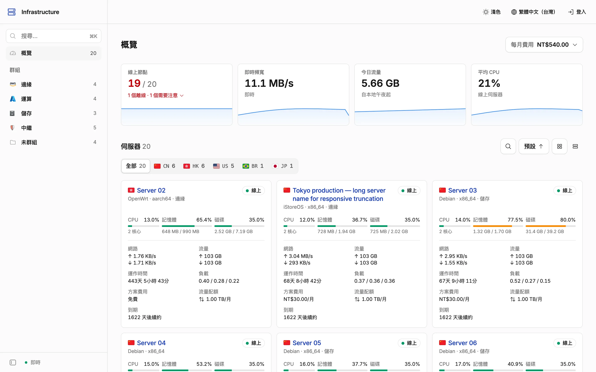
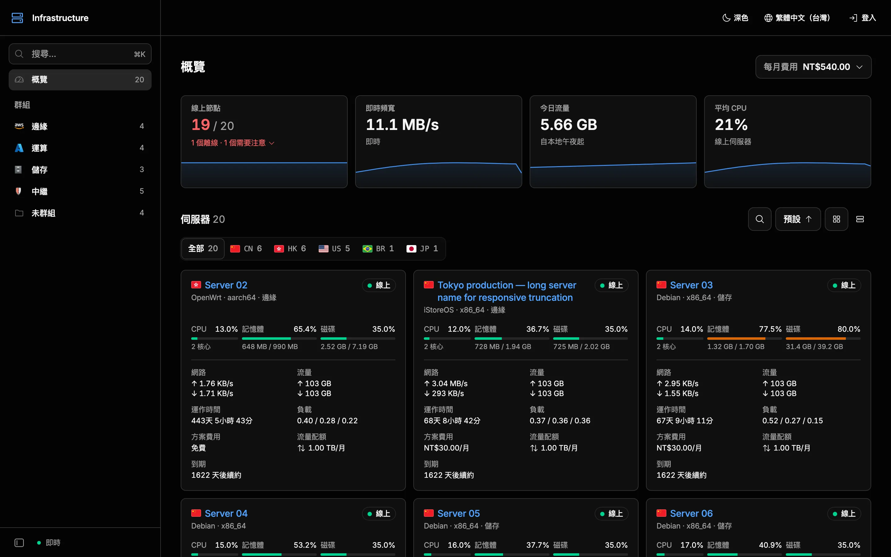
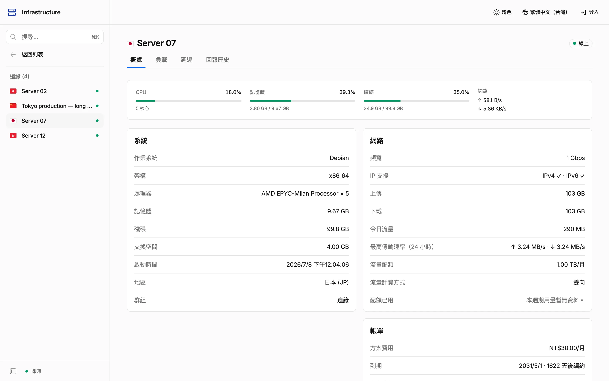
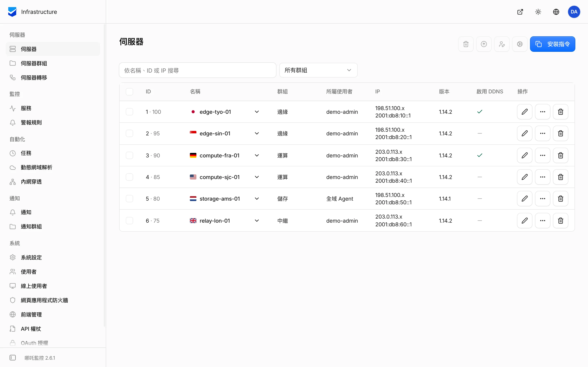

# Nezha Kumo Theme

[English](README.md) | [简体中文](README.zh-CN.md) | 繁體中文·台灣 | [繁體中文·香港](README.zh-HK.md) | [日本語](README.ja.md)

一個響應式的哪吒監控面板主題（公開狀態前台與管理後台），採用 Cloudflare [Kumo](https://github.com/cloudflare/kumo) 設計系統的視覺語言。

主題支援 English、簡體中文、繁體中文（台灣與香港）與日本語，訪客可選擇淺色、深色或跟隨系統。分組圖示支援單個 Emoji 或字元、內建 `vps:<slug>` 圖示，以及 HTTPS 圖片網址。公開前台提供即時狀態、流量計費標記及今日流量總覽。內建 Web App manifest，支援將網站加入主畫面，並以網站名稱作為獨立應用程式開啟首頁。

## Screenshots

| 桌面版（淺色）                                                     | 桌面版（深色）                                                    |
| ------------------------------------------------------------------ | ----------------------------------------------------------------- |
|  |  |

| 行動版（淺色）                                                                            | 行動版（深色）                                                                           |
| ----------------------------------------------------------------------------------------- | ----------------------------------------------------------------------------------------- |
|  |  |

| 節點詳細資料                                           | 管理後台伺服器清單                                   |
| ---------------------------------------------------- | ---------------------------------------------------- |
|  |  |

| 結構化公開備註編輯器                                      |
| --------------------------------------------------------- |
|  |

## Compatibility

- **支援版本**：[哪吒監控](https://github.com/nezhahq/nezha) **v2.6.0 或以上**（內建前台管理在 `v2.6.0` 引入）。
- **已驗證**：已針對 **哪吒 v2.6.1** 完成測試與驗證。

## Installation（推薦 — 哪吒 v2.6.0+）

> [!IMPORTANT]
>
> 1. 替換 **管理後台** 前，請先安裝並驗證 **使用者前台**。
> 2. 啟用第三方 **管理後台** 前，請複製並儲存 [回復](#rollback) 指令，以及個人存取權杖或伺服器 Shell 權限。即使自訂後台無法載入，也可以恢復內建後台介面。

開啟哪吒面板，進入 **Settings → Frontends**（`設定 → 前台管理`）：

| 目標             | GitHub 儲存庫                                                              | 資源基路徑      | 發佈資源      |
| ---------------- | ------------------------------------------------------------------------ | --------------- | ------------- |
| **使用者前台**     | `zhdsmy/nezha-kumo-theme`（`https://github.com/zhdsmy/nezha-kumo-theme`） | `/`             | `dist.zip`    |
| **管理後台**     | `zhdsmy/nezha-kumo-admin`（`https://github.com/zhdsmy/nezha-kumo-admin`）  | `/dashboard/`   | `dist.zip`    |

1. 在 **User Frontend** 中填入 `zhdsmy/nezha-kumo-theme`，載入發佈版本，安裝目標標籤（例如 `v1.0.0`），然後點擊 **Activate**。
2. 開啟公開狀態頁（`/`），確認前台正常顯示。
3. 在 **Admin Panel** 中填入 `zhdsmy/nezha-kumo-admin`（從本儲存庫對應標籤發佈的僅發佈映像），載入發佈版本，安裝相符的版本標籤，然後點擊 **Activate**。

每個發佈包都包含位於 `dist/` 下且非空白的 `dist/index.html`，並符合哪吒歸檔限制（`dist.zip` ≤ 64 MiB，解壓後 ≤ 256 MiB，≤ 10,000 個項目，不包括符號連結或重複路徑）。

## Manual Installation

適用於沒有前台管理功能，或使用自訂容器/主機掛載的面板：

1. 使用者前台從 [GitHub Releases](https://github.com/zhdsmy/nezha-kumo-theme/releases) 下載 `dist.zip`（及 `dist.zip.sha256`），管理後台從 [`zhdsmy/nezha-kumo-admin` Releases](https://github.com/zhdsmy/nezha-kumo-admin/releases) 下載，並驗證 SHA-256 校驗和。
2. 將 `dist/` 解壓到哪吒 Dashboard 程序或容器可讀取的目錄（例如 `data/kumo-user` 或 `data/kumo-admin`）。
3. _（可選，使用者前台）_ 將 [`apps/frontend/public/config.js`](apps/frontend/public/config.js) 複製到解壓後的 `index.html` 同層，並設定 `window.NezhaKumoConfig`。`dist.zip` 自帶完整註釋的 `config.js`，升級前請備份自訂的檔案，解壓後再恢復。
4. 修改哪吒 `data/config.yaml` 中的 `user_template`（及/或 `admin_template`）指向解壓目錄，然後重新啟動哪吒 Dashboard 服務。

## Rollback

### 回復管理後台

- **選項 A — 使用個人存取權杖（PAT）的 API**：

  ```bash
  curl -X POST "https://your-panel.example.com/api/v1/frontend/activate" \
    -H "Authorization: Bearer <YOUR_PAT>" \
    -H "Content-Type: application/json" \
    -d '{"path":"admin-dist","is_admin":true}'
  ```

- **選項 B — 修改伺服器上的 `config.yaml`**：
  停止哪吒 Dashboard 服務或容器，在 `data/config.yaml` 設定 `admin_template: admin-dist`，然後再次啟動面板。

### 回復使用者前台

- **選項 A — 使用 PAT 的 API**：

  ```bash
  curl -X POST "https://your-panel.example.com/api/v1/frontend/activate" \
    -H "Authorization: Bearer <YOUR_PAT>" \
    -H "Content-Type: application/json" \
    -d '{"path":"user-dist","is_admin":false}'
  ```

- **選項 B — 修改伺服器上的 `config.yaml`**：
  停止哪吒 Dashboard 服務或容器，在 `data/config.yaml` 設定 `user_template: user-dist`，然後再次啟動面板（或從管理介面的 **Settings → Frontends** 切換回）。

## Upgrading & Removing Old Versions

1. 在 **Settings → Frontends** 重新整理 `zhdsmy/nezha-kumo-theme`（及 `zhdsmy/nezha-kumo-admin`）的發佈清單，安裝新標籤並啟用。
2. 哪吒會在磁碟上保留之前安裝的前台版本以便快速回復。確認新版本工作正常後，從 **Frontends** 頁面刪除未啟用的舊版本以釋放磁碟空間。
3. 手動部署時，將新的 `dist.zip` 解壓覆蓋範本目錄（保留 `index.html` 旁的 `config.js`），並刪除不再使用的版本目錄。

## Configuration

### Configuration Entrypoints

支援同時使用以下兩種設定方式：

1. **面板自訂程式碼（前台管理安裝推薦）**
   在 **Settings → System settings → Custom code**（`設定 → 自訂程式碼`，使用者前台自訂程式碼）中加入 `id="nezha-kumo-config"` 的 JSON `<script>` 區塊：

   ```html
   <script type="application/json" id="nezha-kumo-config">
     {
       "siteTitle": "Infrastructure",
       "defaultAppearance": "system",
       "defaultLanguage": "auto",
       "showCost": true
     }
   </script>
   ```

   該程式碼區塊使用 `type="application/json"`，只會作為資料解析，不會執行 JavaScript。

2. **`config.js`（`window.NezhaKumoConfig`，用於手動部署）**
   在解壓後的 `index.html` 同層放置 `config.js`：

   ```js
   window.NezhaKumoConfig = {
     siteTitle: "Infrastructure",
     showCost: true,
   };
   ```

   - 同時存在 `<script id="nezha-kumo-config">` 及 `config.js` 時，設定按欄位合併，**`config.js` 優先級較高**。
   - 沒有 `config.js` 時，頁面正常使用面板 JSON 或預設值。瀏覽器會為缺少檔案記錄 404；`dist.zip` 自帶完整註釋版 `config.js`，只有刪除它才會出現這條記錄。

### Theme Settings Reference

所有欄位均為可選，定義見 [`apps/frontend/src/core/settings.ts`](apps/frontend/src/core/settings.ts)：

| 設定鍵              | 類型                                           | 預設值     | 說明                                                                                 |
| ------------------- | ---------------------------------------------- | ---------- | ------------------------------------------------------------------------------------ |
| `defaultAppearance` | `"system" \| "light" \| "dark"`                | `"system"` | 訪客選擇前的初始配色模式（`nkt:appearance`）。                                        |
| `defaultLanguage`   | `"auto" \| "en" \| "zh-CN" \| "zh-HK" \| "zh-TW" \| "ja"` | `"auto"`   | 初始介面語言（`"auto"` 跟隨瀏覽器或面板語言）。                                       |
| `siteTitle`         | `string`                                       | `""`       | 側邊欄及 `<title>` 中的自訂品牌標題。為空白時回退到面板 `site_name`（或 `"Nezha"`）。 |
| `showOverview`      | `boolean`                                      | `true`     | 是否在首頁頂部顯示概覽指標卡片。                                                     |
| `showCost`          | `boolean`                                      | `true`     | 是否在首頁顯示週期費用總覽選單並啟用貨幣換算。                                       |
| `showRegions`       | `boolean`                                      | `true`     | 是否在伺服器清單上方顯示地區國旗篩選列。                                             |
| `showGroups`        | `boolean`                                      | `true`     | 是否在側邊欄顯示伺服器分組導航，並在首頁按分組展開顯示。                                 |
| `showBilling`       | `boolean`                                      | `true`     | 是否顯示從 `public_note` 解析的方案價格、計費週期、到期時間及配額資料。                |
| `showOffline`       | `boolean`                                      | `true`     | 是否在公開伺服器清單中包含離線伺服器（`false` 時隱藏離線伺服器）。                    |
| `hiddenNodes`       | `string[]`                                     | `[]`       | 在公開前台隱藏的伺服器 ID 或完整伺服器名稱（也直接受逗號或換行分隔的 `string`）。         |
| `hideAdminEntry`    | `boolean`                                      | `false`    | 是否隱藏頂部欄的登入 / 管理後台入口按鈕。                                            |
| `footerNote`        | `string`                                       | `""`       | 在頁腳致謝下方單獨顯示的純文字說明。                                                  |

### Server Group Icons (`nezha-kumo-group-icons`)

側邊欄伺服器分組的自訂圖示儲存在使用者前台 **Custom code**（`custom_code`）中，使用 `id="nezha-kumo-group-icons"` 的 JSON 區塊（見 [`packages/shared/group-icons.ts`](packages/shared/group-icons.ts)）：

```html
<script type="application/json" id="nezha-kumo-group-icons">
  { "1": "vps:aws", "2": "vps:azure", "3": "🗄️", "4": "https://cdn.example.com/icons/storage.svg" }
</script>
```

- **鍵**：哪吒伺服器分組 ID 字串（例如 `"1"`、`"2"`）。
- **值**：內建 **vps-icons v1.4.0** 的 `vps:<slug>` 圖示（263 個淺色/深色供應商資源）、單一字元（適用於側邊欄 `16px` 圖示槽位的一個 Emoji 或字元），或 `https://` 圖片網址。VPS slug 必須存在於內建目錄。
- **視覺化編輯**：在 Kumo 管理後台（`zhdsmy/nezha-kumo-admin`）的 **Server Group** 新增/編輯對話框中可以選擇或清除圖示。選擇器支援搜尋供應商名稱、中文名稱、別名及暱稱，只更新 `custom_code` 中的這個 `<script>` 區塊。

## Public Note & Billing / Plan Fields

伺服器帳單與方案資料儲存在哪吒的 `public_note` JSON 欄位中。主題相容 **[nezhainfojson](https://plane.2233444.xyz/)** 產生器（以及 `nezha-dash` 及 `Nazhua` 方言），並在 Kumo 管理後台提供結構化 **Public Note** 編輯器，儲存時會保留未知 JSON 鍵。

```json
{
  "billingDataMod": {
    "startDate": "2026-05-01T00:00:00+08:00",
    "endDate": "2027-05-01T00:00:00+08:00",
    "autoRenewal": "1",
    "cycle": "Year",
    "amount": "USD 48.00"
  },
  "planDataMod": {
    "bandwidth": "1Gbps",
    "trafficVol": "2TB/Month",
    "trafficType": "2",
    "IPv4": "1",
    "IPv6": "1",
    "networkRoute": "IIJ,BBTEC",
    "extra": "NVMe,Anycast"
  }
}
```

### `billingDataMod` Fields

| 欄位          | 範例                          | 說明                                                                                                                                            |
| ------------- | ----------------------------- | ----------------------------------------------------------------------------------------------------------------------------------------------- |
| `startDate`   | `"2026-05-01T00:00:00+08:00"` | 計費開始時間（ISO 8601）。                                                                                                                       |
| `endDate`     | `"2027-05-01T00:00:00+08:00"` | 到期時間；長期有效伺服器可使用 `"0000-00-00T23:59:59+08:00"`。                                                                                |
| `autoRenewal` | `"1"` / `"0"`                 | `"1"` 啟用自動續約，`"0"` 關閉自動續約。                                                                                                       |
| `cycle`       | `"Year"`                      | 計費週期（`Day`、`Week`、`Month`、`Quarter`、`Half`、`Year`、`2Year` 等，以及中文/日文別名）。                                                     |
| `amount`      | `"USD 48.00"`                 | 使用 ISO 貨幣程式碼或符號的價格（如 `"USD 48.00"`、`"CNY 300.00"`、`"€9.50"`、`"0"` / `"Free"` 表示免費，`"-1"` 表示按量計費），可選 `/Cycle` 後綴。 |

### `planDataMod` Fields

| 欄位           | 範例                    | 說明                                                                  |
| -------------- | ----------------------- | --------------------------------------------------------------------- |
| `bandwidth`    | `"1Gbps"`               | 連接埠頻寬（`Mbps`、`Gbps` 或 `"Unlimited"`）。                          |
| `trafficVol`   | `"2TB/Month"`           | 流量配額及可選重設週期（`GB`、`TB` 或 `"Unlimited"`）。                 |
| `trafficType`  | `"1"` \| `"2"` \| `"3"` | 流量計費模式（見下文）。                                               |
| `IPv4`         | `"1"` / `"0"`           | `"1"` 表示有 IPv4，`"0"` 表示沒有。                                    |
| `IPv6`         | `"1"` / `"0"`           | `"1"` 表示有 IPv6，`"0"` 表示沒有。                                    |
| `networkRoute` | `"IIJ,BBTEC"`           | 以逗號分隔的線路標籤。                                                  |
| `extra`        | `"NVMe,Anycast"`        | 以逗號分隔的硬體或方案標籤。                                            |

#### `trafficType` Values

- `"1"` — **僅單向出站**（`out`）：只有上傳（`net_out_transfer`）計入 `trafficVol`。
- `"2"` — **雙向合計**（`sum`）：上傳及下載相加（`net_out_transfer + net_in_transfer`）計入 `trafficVol`。
- `"3"` — **取較大方向**（`max`，省略時預設）：上傳及下載中的較大值（`max(net_out_transfer, net_in_transfer)`）計入 `trafficVol`。

### Private Actual Renewal Amount (`note`)

已登入的管理員可以在哪吒私有 **`note`** 欄位中記錄實際續約費用。公開訪客仍只看到公開價格（或不顯示價格），登入後會在費用總覽中看到實際費用：

```json
{
  "billingDataMod": {
    "actualAmount": "CNY 300.00/Year"
  }
}
```

`billingDataMod.actualAmount` 直接受可選的 `/Cycle` 後綴（例如 `"CNY 300.00/Year"` 或 `"USD 25.00/Quarter"`）。省略週期後綴時，使用 `public_note` 中的 `billingDataMod.cycle`。

## Privacy & Third-Party Requests

- **匯率請求**：`showCost` 為 `true`（預設）時，訪客瀏覽器會向 `https://api.frankfurter.dev/v2/rates?base=USD` 發出不帶憑證 `GET` 請求以換算多幣種費用，並在 `localStorage`（`nkt:exchange-rates`）中快取 **24 小時**。
- **關閉外部請求**：在 `nezha-kumo-config` 或 `config.js` 中設定 `"showCost": false`，即可關閉費用總覽，並對 `api.frankfurter.dev` 發出 **零次**請求。
- **本地靜態資源**：字型（`@fontsource-variable/inter`）、SVG 國旗（`flag-icons`）及 VPS 供應商圖示均隨發佈包本地打包，不依賴第三方字型或圖示 CDN。

## Development

環境要求：**Node.js 22+** 與 **pnpm**（`corepack enable`）。

```bash
pnpm install          # 安裝工作區依賴
pnpm check            # 執行全倉類型檢查、測試與生產構建
pnpm typecheck        # 全倉類型檢查
pnpm test             # 執行單元測試與 Playwright E2E 測試
pnpm build            # 構建前台與後台產物
```

### Mock E2E & App Workflows

- **公開前台**（[`apps/frontend`](apps/frontend/README.md)）：`pnpm --filter frontend test:e2e` 使用確定性的 HTTP 與 WebSocket Mock（`apps/frontend/tests/mock.ts`）執行 Playwright，無需連接真實哪吒面板。
- **管理後台**（[`apps/admin`](apps/admin/README.md)）：`pnpm --filter nezha-kumo-admin test` 執行 Vitest 組件/單元測試；`apps/admin/tests/e2e/` 下的 Playwright E2E 案例使用 Mock 的 `/api/v1/*` 路由或本地測試後端。
- **README 截圖**：`NKT_DOCS_LANG=en node docs/capture-screenshots.mjs` 生成英文截圖。使用 `zh-CN`、`zh-TW`、`zh-HK` 或 `ja` 生成對應語言截圖，然後執行 `node docs/check-links.mjs`。

### Repository Layout

```text
.
├── apps/
│   ├── frontend/      # 公開狀態前台（基路徑：/）
│   └── admin/         # 重新設計的哪吒管理後台（基路徑：/dashboard/）
├── packages/
│   ├── ui/            # 共用 AppShell、Page、斷點及外殼 CSS 契約
│   └── shared/        # 共用公開備註解析/寫入器及分組圖示工具
└── docs/
    ├── screenshots/   # Mock WebP 截圖
    ├── capture-screenshots.mjs
    └── check-links.mjs
```

貢獻程式碼前請閱讀 [CONTRIBUTING.md](CONTRIBUTING.md)（包含提交規範與共用外殼版面規則），安全漏洞請參閱 [SECURITY.md](SECURITY.md) 私下回報。

## Acknowledgments & License

- 介面組件及設計令牌基於 [`@cloudflare/kumo`](https://github.com/cloudflare/kumo)（MIT）。本專案是獨立的社群主題，與 Cloudflare, Inc. **沒有隸屬或背書關係**。
- 為 [哪吒監控](https://github.com/nezhahq/nezha) 打造，基於 [`nezhahq/admin-frontend`](https://github.com/nezhahq/admin-frontend)、[`foru17/zool-theme`](https://github.com/foru17/zool-theme)、[`lipis/flag-icons`](https://github.com/lipis/flag-icons) 及 [Inter](https://github.com/rsms/inter) 的實現或資源。完整第三方聲明（包括 vps-icons v1.4.0）見 [NOTICE.md](NOTICE.md)。
- 本專案採用 [MIT License](LICENSE) 開源授權條款。
