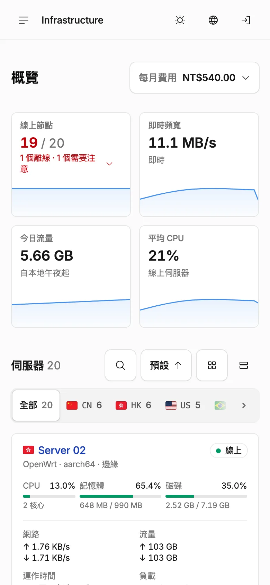
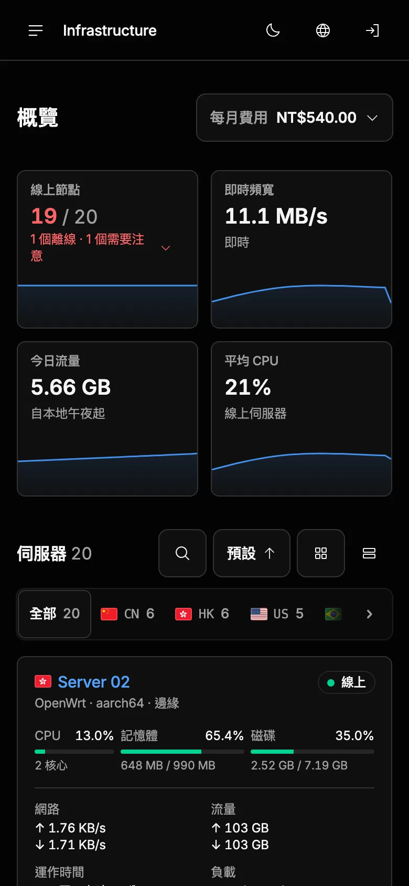
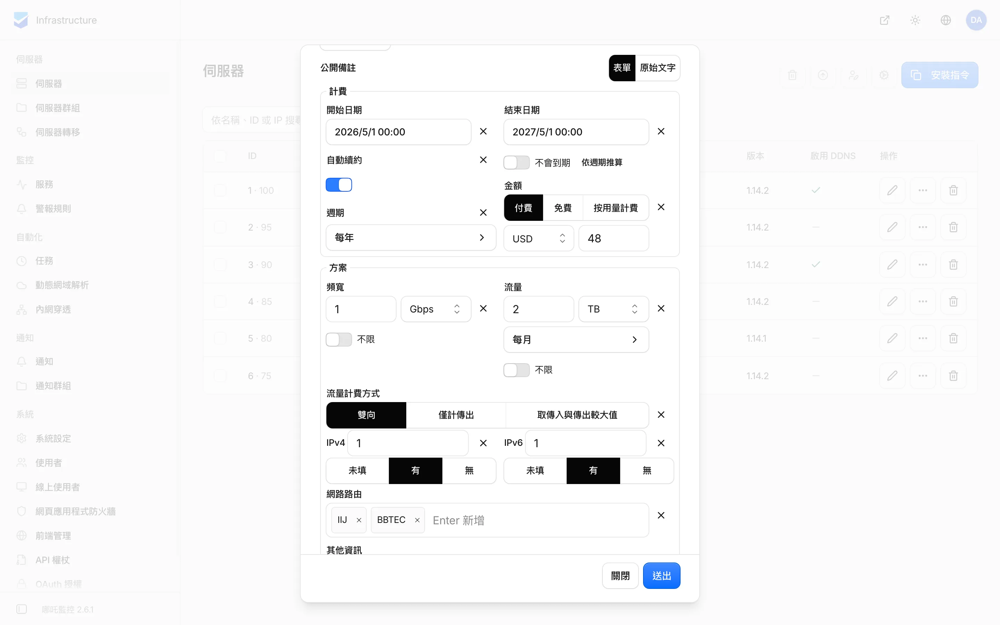

# Nezha Kumo Theme

[English](README.md) | [简体中文](README.zh-CN.md) | 繁體中文·台灣 | [繁體中文·香港](README.zh-HK.md) | [日本語](README.ja.md)

以 Cloudflare [Kumo](https://github.com/cloudflare/kumo) 設計系統打造的響應式[哪吒監控](https://github.com/nezhahq/nezha)面板主題，涵蓋公開狀態前台與管理後台。

支援 English、简体中文、繁體中文（台灣與香港）及日本語，訪客可切換**淺色**、**深色**或**跟隨系統**外觀。公開前台提供即時狀態監控、流量計費方式標示與**今日流量**統計，並內建 Web App manifest，從任一頁面將網站加入主畫面後，皆可作為以網站名稱命名的獨立應用程式開啟首頁。側邊欄群組圖示支援單一 Emoji 或字元、內建 `vps:<slug>` 廠商圖示，以及 `https://` 圖片網址。

## 介面預覽

| 桌面版（淺色）                                                     | 桌面版（深色）                                                    |
| ------------------------------------------------------------------ | ----------------------------------------------------------------- |
|  |  |

| 行動版（淺色）                                                                                | 行動版（深色）                                                                               |
| --------------------------------------------------------------------------------------------- | -------------------------------------------------------------------------------------------- |
|  |  |

| 節點詳細資料                                             | 管理後台伺服器清單                                               |
| -------------------------------------------------------- | ---------------------------------------------------------------- |
|  |  |

| 結構化公開備註編輯器                                                     |
| ------------------------------------------------------------------------ |
|  |

## 相容版本

- **支援版本**：[哪吒監控](https://github.com/nezhahq/nezha) **v2.6.0 及以上**（面板自 `v2.6.0` 起內建「前端管理」功能）。
- **已驗證版本**：已於 **Nezha v2.6.1** 完成測試與驗證。

## 安裝方式（推薦 — Nezha v2.6.0+ 前端管理）

> [!IMPORTANT]
>
> 1. 替換**管理後台**前，請先安裝並驗證**使用者前台**。
> 2. 啟用第三方**管理後台**前，請先複製並妥善保存下方的[復原方法](#復原方法)，同時備妥個人存取權杖（PAT）或伺服器終端機權限，確保自訂後台無法載入時仍能復原內建後台。

開啟哪吒管理面板，前往**設定 → 前端管理**（在 Kumo 管理後台中位於側邊欄**系統 → 前端管理**）：

| 前端類型       | GitHub 儲存庫網址                           | 資源基路徑    | 發行檔案   |
| -------------- | ------------------------------------------- | ------------- | ---------- |
| **使用者前台** | `https://github.com/zhdsmy/nezha-kumo-theme` | `/`           | `dist.zip` |
| **管理後台**   | `https://github.com/zhdsmy/nezha-kumo-admin` | `/dashboard/` | `dist.zip` |

1. 將**前端類型**選為**使用者前台**，輸入 `https://github.com/zhdsmy/nezha-kumo-theme`，點擊**讀取發行版本**，找到目標標籤（例如 `v1.0.0`）點擊**安裝**，完成後點擊**啟用**。
2. 開啟公開狀態頁（`/`），確認前台畫面顯示正常。
3. 將**前端類型**切換為**管理後台**，輸入 `https://github.com/zhdsmy/nezha-kumo-admin`（隨本儲存庫對應標籤同步發佈的建置產物鏡像儲存庫），點擊**讀取發行版本**，安裝相同版本標籤後點擊**啟用**。

每個發行版本的 `dist.zip` 內容皆位於 `dist/` 目錄下且包含非空的 `dist/index.html`，符合哪吒封存檔限制（`dist.zip` ≤ 64 MiB、解壓縮後 ≤ 256 MiB、項目數 ≤ 10,000、不含符號連結或重複路徑）。

## 手動安裝

適用於未內建「前端管理」功能的面板，或自行掛載靜態目錄的容器／主機部署環境：

1. 使用者前台請至 [GitHub Releases](https://github.com/zhdsmy/nezha-kumo-theme/releases)，管理後台請至 [`zhdsmy/nezha-kumo-admin` Releases](https://github.com/zhdsmy/nezha-kumo-admin/releases) 下載 `dist.zip` 與 `dist.zip.sha256`，並驗證 SHA-256 雜湊值。
2. 將封存檔內的 `dist/` 解壓縮至哪吒 Dashboard 行程或容器可讀取的目錄（例如 `data/kumo-user` 或 `data/kumo-admin`）。
3. _（選用，僅使用者前台）_ 將 [`apps/frontend/public/config.js`](apps/frontend/public/config.js) 複製到解壓縮後的 `index.html` 同層目錄，依需求設定 `window.NezhaKumoConfig`。`dist.zip` 內附全註解的 `config.js`，手動升級解壓縮前請先備份自訂的 `config.js`，解壓縮後再放回。
4. 修改哪吒 `data/config.yaml` 中的 `user_template`（及／或 `admin_template`）指向解壓縮目錄，接著重新啟動哪吒 Dashboard 服務。

## 復原方法

### 復原管理後台

- **方式 A — 使用個人存取權杖（PAT）呼叫 API**：

  ```bash
  curl -X POST "https://your-panel.example.com/api/v1/frontend/activate" \
    -H "Authorization: Bearer <YOUR_PAT>" \
    -H "Content-Type: application/json" \
    -d '{"path":"admin-dist","is_admin":true}'
  ```

- **方式 B — 修改伺服器上的 `config.yaml`**：
  停止哪吒 Dashboard 服務或容器，將 `data/config.yaml` 中的 `admin_template` 設為 `admin-dist`，再重新啟動面板。

### 復原使用者前台

- **方式 A — 使用 PAT 呼叫 API**：

  ```bash
  curl -X POST "https://your-panel.example.com/api/v1/frontend/activate" \
    -H "Authorization: Bearer <YOUR_PAT>" \
    -H "Content-Type: application/json" \
    -d '{"path":"user-dist","is_admin":false}'
  ```

- **方式 B — 修改伺服器上的 `config.yaml`**：
  停止哪吒 Dashboard 服務或容器，將 `data/config.yaml` 中的 `user_template` 設為 `user-dist`，再重新啟動面板（亦可直接從管理後台的**前端管理**頁面切換回內建版本）。

## 升級與清理舊版本

1. 前往**系統 → 前端管理**（或原版後台的**設定 → 前端管理**），重新讀取 `https://github.com/zhdsmy/nezha-kumo-theme`（及 `https://github.com/zhdsmy/nezha-kumo-admin`）的發行版本，點擊**安裝**新版本並**啟用**。
2. 哪吒會在磁碟上保留先前安裝的前端版本以便快速復原；確認新版本運作正常後，可在**前端管理**頁面將未啟用的舊版本點擊**刪除**以釋放磁碟空間。
3. 手動部署升級時，將新版本的 `dist.zip` 解壓縮覆蓋範本目錄（保留 `index.html` 同層的 `config.js`），並移除不再使用的舊版本目錄。

## 設定說明

### 兩種設定方式

前台支援以下兩種設定方式，可同時搭配使用：

1. **面板自訂程式碼（推薦前端管理安裝方式使用）**
   在後台**系統 → 系統設定**（原版後台為**設定 → 系統設定**）的**自訂程式碼（樣式和腳本）**（使用者前台 `custom_code`）中加入 `id="nezha-kumo-config"` 的 JSON `<script>` 區塊：

   ```html
   <script type="application/json" id="nezha-kumo-config">
     {
       "siteTitle": "Infrastructure",
       "defaultAppearance": "system",
       "defaultLanguage": "auto",
       "showCost": true
     }
   </script>
   ```

   此標籤宣告為 `type="application/json"`，前台僅將其作為 JSON 資料解析，不會當作 JavaScript 執行。

2. **`config.js`（`window.NezhaKumoConfig`，適合手動部署）**
   在解壓縮目錄的 `index.html` 同層放置 `config.js`：

   ```js
   window.NezhaKumoConfig = {
     siteTitle: "Infrastructure",
     showCost: true,
   };
   ```

   - 當 `<script id="nezha-kumo-config">` 與 `config.js` 同時存在時，設定會依欄位合併，且**以 `config.js` 優先**。
   - 未提供 `config.js` 時，前台會直接使用面板 JSON 設定或內建預設值。`dist.zip` 內附全註解的 `config.js`，唯有主動刪除該檔案時瀏覽器主控台才會記錄一筆 404。

### 設定項目一覽

所有欄位皆為選填，定義與預設值見 [`apps/frontend/src/core/settings.ts`](apps/frontend/src/core/settings.ts)：

| 設定鍵              | 類型                                                       | 預設值     | 說明                                                                                     |
| ------------------- | ---------------------------------------------------------- | ---------- | ---------------------------------------------------------------------------------------- |
| `defaultAppearance` | `"system" \| "light" \| "dark"`                            | `"system"` | 訪客手動切換前的初始配色模式（本機儲存鍵 `nkt:appearance`）。                            |
| `defaultLanguage`   | `"auto" \| "en" \| "zh-CN" \| "zh-HK" \| "zh-TW" \| "ja"` | `"auto"`   | 訪客手動選擇前的初始介面語言（`nkt:language`）；`"auto"` 優先採用面板語言，其次瀏覽器語言。 |
| `siteTitle`         | `string`                                                   | `""`       | 側邊欄與 `<title>` 中的自訂網站標題；留空時回退使用面板 `site_name`（或 `"Nezha"`）。    |
| `showOverview`      | `boolean`                                                  | `true`     | 是否在首頁頂部顯示概覽指標卡片。                                                         |
| `showCost`          | `boolean`                                                  | `true`     | 是否在首頁顯示週期費用選單（**每月費用**／**每年費用**）並啟用多幣別匯率換算。           |
| `showRegions`       | `boolean`                                                  | `true`     | 是否在伺服器清單上方顯示地區國旗篩選列。                                                 |
| `showGroups`        | `boolean`                                                  | `true`     | 是否在側邊欄顯示**群組**導覽並啟用依群組篩選。                                           |
| `showBilling`       | `boolean`                                                  | `true`     | 是否顯示自 `public_note` 解析的方案費用、計費週期、到期時間與流量配額資訊。              |
| `showOffline`       | `boolean`                                                  | `true`     | 是否在公開伺服器清單中納入離線伺服器（設為 `false` 時隱藏離線伺服器）。                  |
| `hiddenNodes`       | `string[]`                                                 | `[]`       | 在公開前台隱藏的伺服器 ID 或完整伺服器名稱（亦支援以逗號或換行分隔的 `string`）。        |
| `hideAdminEntry`    | `boolean`                                                  | `false`    | 是否隱藏頂部列的**登入**／**管理後台**入口按鈕。                                         |
| `footerNote`        | `string`                                                   | `""`       | 頁尾版權與致謝下方另起一行顯示的純文字說明。                                             |

### 群組圖示設定（`nezha-kumo-group-icons`）

側邊欄伺服器群組的自訂圖示儲存在使用者前台**自訂程式碼（樣式和腳本）**（`custom_code`）中，格式為 `id="nezha-kumo-group-icons"` 的 JSON `<script>` 區塊（見 [`packages/shared/group-icons.ts`](packages/shared/group-icons.ts)）：

```html
<script type="application/json" id="nezha-kumo-group-icons">
  { "1": "vps:aws", "2": "vps:azure", "3": "🗄️", "4": "https://cdn.example.com/icons/storage.svg" }
</script>
```

- **鍵**：哪吒伺服器群組 ID 字串（例如 `"1"`、`"2"`）。
- **值**：內建 **vps-icons v1.4.0** 目錄中的 `vps:<slug>` 圖示（共 263 組淺色／深色廠商圖示）、單一字素（符合側邊欄 `16px` 圖示槽位的 1 個 Emoji 或字元），或 `https://` 圖片網址。VPS `slug` 必須存在於內建圖示目錄中。
- **視覺化編輯**：在 Kumo 管理後台（`zhdsmy/nezha-kumo-admin`）的**伺服器群組**頁面開啟**建立伺服器群組**或**編輯伺服器群組**對話框，可透過**選擇 VPS 圖示**搜尋廠商英文名稱、中文名稱、slug、別名或暱稱，亦可直接輸入或清除圖示；儲存時只會更新 `custom_code` 中的該 `<script>` 區塊，不影響其他自訂程式碼。

## 公開備註與帳單／方案欄位

伺服器帳單與方案中繼資料儲存在哪吒的 `public_note` JSON 欄位中，相容 **[nezhainfojson](https://plane.2233444.xyz/)** 產生器（以及 `nezha-dash`、`Nazhua` 方言）。Kumo 管理後台內建結構化**公開備註**編輯器，儲存時會保留未知的 JSON 鍵。

```json
{
  "billingDataMod": {
    "startDate": "2026-05-01T00:00:00+08:00",
    "endDate": "2027-05-01T00:00:00+08:00",
    "autoRenewal": "1",
    "cycle": "Year",
    "amount": "USD 48.00"
  },
  "planDataMod": {
    "bandwidth": "1Gbps",
    "trafficVol": "2TB/Month",
    "trafficType": "2",
    "IPv4": "1",
    "IPv6": "1",
    "networkRoute": "IIJ,BBTEC",
    "extra": "NVMe,Anycast"
  }
}
```

### `billingDataMod` 帳單欄位

| 欄位          | 範例                          | 說明                                                                                                                                            |
| ------------- | ----------------------------- | ----------------------------------------------------------------------------------------------------------------------------------------------- |
| `startDate`   | `"2026-05-01T00:00:00+08:00"` | 計費開始時間（ISO 8601）。                                                                                                                      |
| `endDate`     | `"2027-05-01T00:00:00+08:00"` | 到期時間；長期有效伺服器可填 `"0000-00-00T23:59:59+08:00"`。                                                                                    |
| `autoRenewal` | `"1"` / `"0"`                 | `"1"` 啟用自動續約，`"0"` 停用自動續約。                                                                                                        |
| `cycle`       | `"Year"`                      | 計費週期（支援 `Day`、`Week`、`Month`、`Quarter`、`Half`、`Year`、`2Year` 等格式，以及中文／日文週期別名）。                                     |
| `amount`      | `"USD 48.00"`                 | 含 ISO 貨幣代碼或符號的價格（如 `"USD 48.00"`、`"CNY 300.00"`、`"€9.50"`；`"0"` / `"Free"` 代表免費，`"-1"` 代表隨用隨付），可加上 `/Cycle` 後綴。 |

### `planDataMod` 方案欄位

| 欄位           | 範例                    | 說明                                                       |
| -------------- | ----------------------- | ---------------------------------------------------------- |
| `bandwidth`    | `"1Gbps"`               | 連接埠頻寬（`Mbps`、`Gbps` 或 `"Unlimited"`）。            |
| `trafficVol`   | `"2TB/Month"`           | 流量配額及選填的重設週期（`GB`、`TB` 或 `"Unlimited"`）。  |
| `trafficType`  | `"1"` \| `"2"` \| `"3"` | 流量計費方式（數值說明見下文）。                           |
| `IPv4`         | `"1"` / `"0"`           | `"1"` 代表有 IPv4，`"0"` 代表無。                          |
| `IPv6`         | `"1"` / `"0"`           | `"1"` 代表有 IPv6，`"0"` 代表無。                          |
| `networkRoute` | `"IIJ,BBTEC"`           | 以逗號分隔的網路線路標籤。                                 |
| `extra`        | `"NVMe,Anycast"`        | 以逗號分隔的硬體或方案標籤。                               |

#### `trafficType` 數值說明

- `"1"` — **僅計傳出**（`out`）：僅將上傳流量（`net_out_transfer`）計入 `trafficVol`。
- `"2"` — **雙向**（`sum`）：將上傳與下載流量加總（`net_out_transfer + net_in_transfer`）計入 `trafficVol`。
- `"3"` — **取傳入與傳出較大值**（`max`，省略時的預設值）：取上傳與下載中的較大值（`max(net_out_transfer, net_in_transfer)`）計入 `trafficVol`。

### 私有備註實際續約費用（`note`）

管理員可在哪吒伺服器的私有 **`note`** 欄位（或透過 Kumo 管理後台的**私有備註**編輯器）記錄實際續約花費。未登入訪客仍只會看到公開價格（或不顯示價格），登入後則會在首頁費用總額與節點詳細資料的**實際成本**中套用實際續約金額：

```json
{
  "billingDataMod": {
    "actualAmount": "CNY 300.00/Year"
  }
}
```

`billingDataMod.actualAmount` 須包含貨幣代碼或符號，並支援選填的 `/Cycle` 後綴（例如 `"CNY 300.00/Year"` 或 `"USD 25.00/Quarter"`）；省略週期後綴時預設沿用 `public_note` 中的 `billingDataMod.cycle`。

## 隱私權與第三方請求

- **匯率查詢請求**：當 `showCost` 為 `true`（預設）時，訪客瀏覽器會向 `https://api.frankfurter.dev/v2/rates?base=USD` 發出不帶憑證的 `GET` 請求以換算多幣別費用，並將回應快取於 `localStorage`（`nkt:exchange-rates`）**24 小時**。
- **停用外部請求**：在 `nezha-kumo-config` 或 `config.js` 中設定 `"showCost": false`，即可關閉費用總額選單，且不會對 `api.frankfurter.dev` 發出任何請求。
- **本機靜態資源**：Inter 字型（`@fontsource-variable/inter`）、SVG 國旗圖示（`flag-icons`）與 VPS 廠商圖示皆隨發行檔案打包於本機，不依賴第三方字型或圖示 CDN。

## 本機開發與貢獻

環境需求：**Node.js 22+** 與 **pnpm**（`corepack enable`）。

```bash
pnpm install          # 安裝工作區依賴
pnpm check            # 執行全倉類型檢查、測試與生產構建
pnpm typecheck        # 全倉類型檢查
pnpm test             # 執行單元測試與 Playwright E2E 測試
pnpm build            # 構建前台與後台產物
```

### Mock E2E 測試與開發流程

- **公開前台**（[`apps/frontend`](apps/frontend/README.md)）：`pnpm --filter frontend test:e2e` 使用確定性的 HTTP 與 WebSocket Mock（`apps/frontend/tests/mock.ts`）執行 Playwright 端對端測試，無須連線至真實哪吒面板。
- **管理後台**（[`apps/admin`](apps/admin/README.md)）：`pnpm --filter nezha-kumo-admin test` 執行 Vitest 元件與單元測試；`apps/admin/tests/e2e/` 下的 Playwright E2E 測試則搭配路由攔截 Mock（`/api/v1/*`）或本機測試後端執行。
- **README 截圖**：`NKT_DOCS_LANG=en node docs/capture-screenshots.mjs` 可產生英文截圖，指定 `zh-CN`、`zh-TW`、`zh-HK` 或 `ja` 可產生對應語言截圖，完成後請執行 `node docs/check-links.mjs` 檢查連結。

### 目錄結構

```text
.
├── apps/
│   ├── frontend/      # 公開狀態前台（基路徑：/）
│   └── admin/         # 重新設計的哪吒管理後台（基路徑：/dashboard/）
├── packages/
│   ├── ui/            # 共用 AppShell、Page、斷點及外殼 CSS 契約
│   └── shared/        # 共用公開備註解析/寫入器及分組圖示工具
└── docs/
    ├── screenshots/   # Mock WebP 截圖
    ├── capture-screenshots.mjs
    └── check-links.mjs
```

提交程式碼前請先閱讀 [CONTRIBUTING.md](CONTRIBUTING.md)（含提交規範與共用外殼版面規則），回報資安漏洞請參閱 [SECURITY.md](SECURITY.md)。

## 致謝與授權條款

- 介面元件與設計 Token 採用 [`@cloudflare/kumo`](https://github.com/cloudflare/kumo)（MIT）。本專案為獨立的社群主題，與 Cloudflare, Inc. **無任何隸屬或背書關係**。
- 專為[哪吒監控](https://github.com/nezhahq/nezha)打造，部分實作與資源源自 [`nezhahq/admin-frontend`](https://github.com/nezhahq/admin-frontend)、[`foru17/zool-theme`](https://github.com/foru17/zool-theme)、[`lipis/flag-icons`](https://github.com/lipis/flag-icons) 及 [Inter](https://github.com/rsms/inter)。完整第三方授權聲明（含 vps-icons v1.4.0）請見 [NOTICE.md](NOTICE.md)。
- 本專案依據 [MIT License](LICENSE) 開源授權條款發佈。
